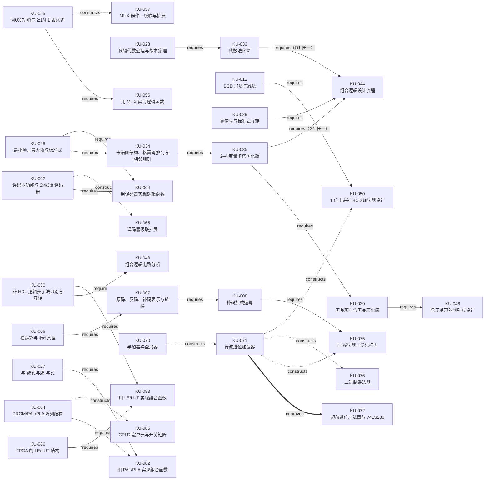
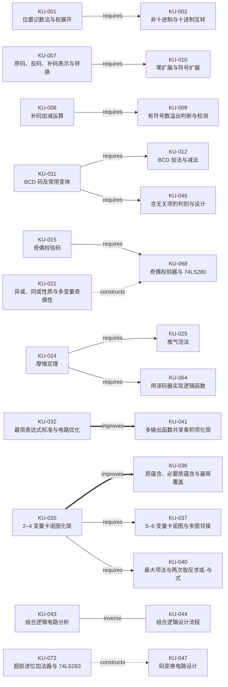

# 知识点地图

> 仅展示 `status=approved` 且端点属于当前单元的关系：主视图 28 条，辅助视图 15 条，共 43 条。退休单元不进入本文件。

## 主题汇总

| 课次 | 主题 | 核心学习表现 | 主题评级与理由 | 单元峰值 | 星级分布 |
| --- | --- | --- | --- | --- | --- |
| L01 | `TH-01` 数制与数制转换 | 能在十进制、二进制、八进制、十六进制之间准确转换，并按权解释一个数的值。 | 5 星（★★★★★）；主题核心的多类数制转换被习题课基本题型明确列出，并被多次作业直接考查。 | 5 星 | 5 星 2 个、4 星 3 个 |
| L01 | `TH-02` 有符号数与补码运算 | 能写出正负数的原码、反码、补码，并用补码完成加减与溢出判断。 | 5 星（★★★★★）；主题核心的原反补码与补码运算被习题课明确列出，并被多次作业直接考查。 | 5 星 | 5 星 1 个、4 星 4 个 |
| L01 | `TH-03` 常用编码与可靠性编码 | 能识别并使用 BCD、ASCII、格雷码、奇偶校验码与汉明码，说明其编码规则和检错能力。 | 5 星（★★★★★）；主题核心的 BCD、格雷码等有习题课基本题型和解答例题支撑，作业覆盖也充分。 | 5 星 | 5 星 2 个、3 星 2 个、2 星 2 个 |
| L02 | `TH-04` 逻辑运算与逻辑门 | 能由逻辑门或真值表判断逻辑功能，并用基本门或通用门实现给定运算。 | 5 星（★★★★★）；主题核心的逻辑门及通用门实现有习题课基本题型和解答例题直接支撑。 | 5 星 | 5 星 2 个、4 星 3 个、3 星 1 个 |
| L02 | `TH-05` 逻辑代数公理与规则 | 能运用逻辑代数公理、定理、摩根定理、推气泡法和三个重要规则完成等式变换与证明。 | 5 星（★★★★★）；主题核心的代数规则、摩根定理在习题课解答例题中直接应用。 | 5 星 | 5 星 1 个、4 星 2 个、3 星 1 个 |
| L02 | `TH-06` 逻辑函数表达与表示 | 能在函数式、真值表、逻辑图、波形图之间转换，并写出标准与-或式或标准或-与式。 | 5 星（★★★★★）；主题核心的标准式与表示转换被习题课明确列出，并在多组解答例题中出现。 | 5 星 | 5 星 3 个、4 星 2 个 |
| L02 | `TH-07` 逻辑函数化简 | 能按最简与-或式标准，用代数法合并、吸收、消去、消项和配项。 | 5 星（★★★★★）；主题核心的代数化简在习题课多组解答例题和作业中直接考查。 | 5 星 | 5 星 1 个、4 星 1 个 |
| L03 | `TH-08` 卡诺图基础与化简 | 能画出并读取 2–6 变量卡诺图，按相邻与最简覆盖规则完成化简。 | 5 星（★★★★★）；主题核心的卡诺图化简在习题课多组解答例题和作业中直接考查。 | 5 星 | 5 星 1 个、4 星 2 个、3 星 2 个 |
| L03 | `TH-09` 无关项、或-与式与多输出化简 | 能利用无关项、最大项法和两次取反法化简，并对多输出函数共享乘积项。 | 5 星（★★★★★）；主题核心的无关项、最大项和多输出化简有基本题型、解答例题及作业证据。 | 5 星 | 5 星 1 个、4 星 2 个 |
| L04 | `TH-10` 组合逻辑分析与设计 | 能判断组合电路、由电路图求功能，并按设计流程从需求得到逻辑电路。 | 5 星（★★★★★）；主题核心的组合分析与设计在习题课基本题型和解答例题中均有直接证据。 | 5 星 | 5 星 2 个、3 星 1 个 |
| L04 | `TH-11` 组合逻辑设计实例 | 能把文字需求、编码转换、比较与十进制运算转化为分层、可实现的组合电路。 | 5 星（★★★★★）；主题核心的文字需求与码变换设计在习题课解答例题中直接覆盖，并有作业支撑。 | 5 星 | 5 星 2 个、4 星 1 个、3 星 2 个 |
| L04 | `TH-12` 竞争冒险与延迟 | 能识别竞争、冒险和关键路径，判断冒险并用冗余项、电容或选通脉冲消除。 | 4 星（★★★★☆）；主题核心的冒险判断与消除有作业直接证据，但缺少习题课专项解答例题。 | 4 星 | 4 星 2 个、3 星 2 个 |
| L05 | `TH-13` 复用器与分配器 | 能使用 MUX 选择数据、用 MUX 实现逻辑函数，并说明 MUX/DMUX 的扩展与数据传输。 | 5 星（★★★★★）；主题核心的 MUX 功能、分析、实现与器件在基本题型、解答例题和作业中均有证据。 | 5 星 | 5 星 1 个、4 星 2 个、3 星 2 个 |
| L05 | `TH-14` 编码器与译码器 | 能区分普通/优先编码与通用/显示译码，使用 74 系列器件实现函数、扩展与地址译码。 | 5 星（★★★★★）；主题核心的译码器实现有习题课解答例题，编码/译码器件也有汇总与作业证据。 | 5 星 | 5 星 1 个、4 星 4 个、3 星 2 个 |
| L05 | `TH-15` 移位器 | 能区分逻辑、循环、算术移位，并说明 4 位移位器控制码与输出关系。 | 3 星（★★★☆☆）；主题核心的移位类型和控制只有课件实例；习题课的移位乘法不覆盖整个主题，故不按直接主题证据升级。 | 3 星 | 3 星 1 个 |
| L06 | `TH-16` 校验器与比较器 | 能用异或与 74LS280 构成奇偶校验，用 74HC85 完成数位比较与级联。 | 4 星（★★★★☆）；主题核心的数值比较器有作业和器件汇总直接证据；校验器部分缺少直接题目，整体不按五星。 | 4 星 | 4 星 1 个、3 星 1 个 |
| L06 | `TH-17` 加法器、减法器与乘法器 | 能分析半加/全加、行波与超前进位、加减法器和二进制乘法器的结构及溢出。 | 5 星（★★★★★）；主题核心的加法器实现和移位相加乘法有习题课解答例题及作业证据。 | 5 星 | 5 星 2 个、4 星 2 个、3 星 2 个 |
| L06 | `TH-18` 二进制与 BCD 转换 | 能用推导方程或移位加 3 算法完成二进制到 BCD 的转换。 | 3 星（★★★☆☆）；主题核心的二进制转 BCD 算法只有课件完整示例，未获得直接题目证据。 | 3 星 | 3 星 1 个 |
| L06 | `TH-19` 逻辑门器件理论 | 能说明开关电路、二极管/三极管开关特性以及 TTL/CMOS 门电路的器件基础。 | 4 星（★★★★☆）；习题课基本题型明确列出常用逻辑门及电器特征，但缺少专项解答例题。 | 4 星 | 4 星 4 个 |
| L06 | `TH-20` 可编程逻辑器件与 FPGA | 能说明 PROM/PAL/PLA 的阵列可编程性、CPLD 的宏单元结构，以及 FPGA 的 LE、LUT 与配置结构。 | 4 星（★★★★☆）；主题核心的与或阵列和 LE/LUT 实现有作业直接证据，但缺少习题课专项解答例题。 | 4 星 | 4 星 2 个、3 星 2 个、2 星 1 个 |

## 前置路线组

未分组的 `requires` 入边分别必要；路线组与未分组前置之间按 AND 连接，组内严格按下表解释。

| 路线组 | 目标 | 条件 | 可替代成员 | 依据与价值 |
| --- | --- | --- | --- | --- |
| `G1` | `KU-044` 组合逻辑设计流程 | **任一（OR，不是 AND）** | `KU-033` 代数法化简；`KU-035` 2–4 变量卡诺图化简 | 代数化简与卡诺图是通用设计的两条可替代化简路线，不能解释为共同必需。 [SRC-C02 · PDF P52–60](../%E7%90%86%E8%AE%BA%E8%AF%BE/%E8%AF%BE%E4%BB%B6/02%20%E9%80%BB%E8%BE%91%E4%BB%A3%E6%95%B0.pdf)：代数化简路线 [SRC-C03 · PDF P4–16](../%E7%90%86%E8%AE%BA%E8%AF%BE/%E8%AF%BE%E4%BB%B6/03%20%E5%8D%A1%E8%AF%BA%E5%9B%BE.pdf)：卡诺图路线 [SRC-C04 · PDF P19–20](../%E7%90%86%E8%AE%BA%E8%AF%BE/%E8%AF%BE%E4%BB%B6/04%20%E7%BB%84%E5%90%88%E9%80%BB%E8%BE%91%E5%88%86%E6%9E%90%2B%E8%AE%BE%E8%AE%A1.pdf)：组合设计流程 |

**G1 明确结论：`KU-033` 与 `KU-035` 任一即可，不要求两者同时掌握。**

## 已审核关系表

| 关系 | 视图 | 类型 | 起点 → 终点 | 价值 / 路线 | 来源 |
| --- | --- | --- | --- | --- | --- |
| `REL-001` | `main` | `requires`（学习前置） | `KU-006` 模运算与补码原理 → `KU-007` 原码、反码、补码表示与转换 | 先理解模 2^n 与补数，才能解释补码表示及后续减法转加法，而非只背取反加一。 | [SRC-C01 · PDF P25–27、35–38](../%E7%90%86%E8%AE%BA%E8%AF%BE/%E8%AF%BE%E4%BB%B6/01%20%E7%AE%80%E4%BB%8B%E3%80%81%E8%BF%9B%E5%88%B6%2B%E7%A0%81%E5%88%B6.pdf)：模与补数到补码表示 |
| `REL-002` | `main` | `requires`（学习前置） | `KU-007` 原码、反码、补码表示与转换 → `KU-008` 补码加减运算 | 先要能写出并识别正负数补码，才能把减法转成加负数补码并正确解释运算结果。 | [SRC-C01 · PDF P35–39、43–45](../%E7%90%86%E8%AE%BA%E8%AF%BE/%E8%AF%BE%E4%BB%B6/01%20%E7%AE%80%E4%BB%8B%E3%80%81%E8%BF%9B%E5%88%B6%2B%E7%A0%81%E5%88%B6.pdf)：补码表示到补码加减 |
| `REL-003` | `main` | `requires`（学习前置） | `KU-008` 补码加减运算 → `KU-075` 加/减法器与溢出标志 | 加/减法器的减法路线复用 A-B=A+B′+1，先掌握补码减法才能理解 B 取反且 C0=1。 | [SRC-C01 · PDF P39、43–45](../%E7%90%86%E8%AE%BA%E8%AF%BE/%E8%AF%BE%E4%BB%B6/01%20%E7%AE%80%E4%BB%8B%E3%80%81%E8%BF%9B%E5%88%B6%2B%E7%A0%81%E5%88%B6.pdf)：补码减法原理 [SRC-C06 · PDF P28–30](../%E7%90%86%E8%AE%BA%E8%AF%BE/%E8%AF%BE%E4%BB%B6/06%20%E7%BB%84%E5%90%88%E6%A8%A1%E5%9D%972%2B%E4%BB%A3%E7%A0%81.pdf)：加/减法器结构 |
| `REL-004` | `main` | `requires`（学习前置） | `KU-012` BCD 加法与减法 → `KU-050` 1 位十进制 BCD 加法器设计 | BCD 加法器的修正逻辑直接实现和大于 9 或产生进位则加 6，先掌握该算术规则才能理解修正级。 | [SRC-C01 · PDF P49–50](../%E7%90%86%E8%AE%BA%E8%AF%BE/%E8%AF%BE%E4%BB%B6/01%20%E7%AE%80%E4%BB%8B%E3%80%81%E8%BF%9B%E5%88%B6%2B%E7%A0%81%E5%88%B6.pdf)：BCD 加减规则 [SRC-C04 · PDF P38–43](../%E7%90%86%E8%AE%BA%E8%AF%BE/%E8%AF%BE%E4%BB%B6/04%20%E7%BB%84%E5%90%88%E9%80%BB%E8%BE%91%E5%88%86%E6%9E%90%2B%E8%AE%BE%E8%AE%A1.pdf)：1 位 BCD 加法器设计 |
| `REL-005` | `main` | `requires`（学习前置） | `KU-023` 逻辑代数公理与基本定理 → `KU-033` 代数法化简 | 并项、吸收、消去、消项和配项都以公理、定理为合法变换依据，能避免只会套技巧而不知化简为何成立。 | [SRC-C02 · PDF P15–20、52–60](../%E7%90%86%E8%AE%BA%E8%AF%BE/%E8%AF%BE%E4%BB%B6/02%20%E9%80%BB%E8%BE%91%E4%BB%A3%E6%95%B0.pdf)：公理定理到代数化简 |
| `REL-006` | `main` | `requires`（学习前置） | `KU-028` 最小项、最大项与标准式 → `KU-034` 卡诺图结构、格雷码排列与相邻规则 | 卡诺图每格对应最小项，先会编号和读写标准式，才能正确填图并理解相邻合并为何能消去变量。 | [SRC-C02 · PDF P34–37](../%E7%90%86%E8%AE%BA%E8%AF%BE/%E8%AF%BE%E4%BB%B6/02%20%E9%80%BB%E8%BE%91%E4%BB%A3%E6%95%B0.pdf)：最小项与标准式 [SRC-C03 · PDF P3–7、35](../%E7%90%86%E8%AE%BA%E8%AF%BE/%E8%AF%BE%E4%BB%B6/03%20%E5%8D%A1%E8%AF%BA%E5%9B%BE.pdf)：卡诺图单元与最小项 |
| `REL-007` | `main` | `requires`（学习前置） | `KU-034` 卡诺图结构、格雷码排列与相邻规则 → `KU-035` 2–4 变量卡诺图化简 | 圈组前必须掌握格雷排列及首尾、四角相邻，否则会把并不相邻的格错误合并。 | [SRC-C03 · PDF P3–10](../%E7%90%86%E8%AE%BA%E8%AF%BE/%E8%AF%BE%E4%BB%B6/03%20%E5%8D%A1%E8%AF%BA%E5%9B%BE.pdf)：卡诺图结构与相邻规则 |
| `REL-008` | `main` | `requires`（学习前置） | `KU-035` 2–4 变量卡诺图化简 → `KU-039` 无关项与含无关项化简 | 含 d 化简仍须形成合法 2^k 块并完整覆盖 1，先会普通圈组才能决定每个 d 是否值得圈入。 | [SRC-C03 · PDF P4–16、23–27](../%E7%90%86%E8%AE%BA%E8%AF%BE/%E8%AF%BE%E4%BB%B6/03%20%E5%8D%A1%E8%AF%BA%E5%9B%BE.pdf)：普通圈组到含无关项化简 |
| `REL-009` | `main` | `requires`（学习前置） | `KU-030` 非 HDL 逻辑表示法识别与互转 → `KU-043` 组合逻辑电路分析 | 组合分析要在逻辑图、函数式、真值表和波形之间转换，先掌握表示互转才能沿不同路径求得电路功能。 | [SRC-C02 · PDF P45–48](../%E7%90%86%E8%AE%BA%E8%AF%BE/%E8%AF%BE%E4%BB%B6/02%20%E9%80%BB%E8%BE%91%E4%BB%A3%E6%95%B0.pdf)：非 HDL 表示互转 [SRC-C04 · PDF P8–17](../%E7%90%86%E8%AE%BA%E8%AF%BE/%E8%AF%BE%E4%BB%B6/04%20%E7%BB%84%E5%90%88%E9%80%BB%E8%BE%91%E5%88%86%E6%9E%90%2B%E8%AE%BE%E8%AE%A1.pdf)：组合逻辑分析 |
| `REL-010` | `main` | `requires`（学习前置） | `KU-033` 代数法化简 → `KU-044` 组合逻辑设计流程 | 通用设计的求最简式可走代数法，与卡诺图路线并列显示可避免把两种方法误设为共同必需。 **G1：组内任一（OR）** | [SRC-C02 · PDF P52–60](../%E7%90%86%E8%AE%BA%E8%AF%BE/%E8%AF%BE%E4%BB%B6/02%20%E9%80%BB%E8%BE%91%E4%BB%A3%E6%95%B0.pdf)：代数化简路线 [SRC-C04 · PDF P19–20](../%E7%90%86%E8%AE%BA%E8%AF%BE/%E8%AF%BE%E4%BB%B6/04%20%E7%BB%84%E5%90%88%E9%80%BB%E8%BE%91%E5%88%86%E6%9E%90%2B%E8%AE%BE%E8%AE%A1.pdf)：组合设计流程 |
| `REL-011` | `main` | `requires`（学习前置） | `KU-035` 2–4 变量卡诺图化简 → `KU-044` 组合逻辑设计流程 | 通用设计的求最简式也可走卡诺图，与代数法组成可替代路线，便于按题目给定表示选择方法。 **G1：组内任一（OR）** | [SRC-C03 · PDF P4–16](../%E7%90%86%E8%AE%BA%E8%AF%BE/%E8%AF%BE%E4%BB%B6/03%20%E5%8D%A1%E8%AF%BA%E5%9B%BE.pdf)：卡诺图化简路线 [SRC-C04 · PDF P19–20](../%E7%90%86%E8%AE%BA%E8%AF%BE/%E8%AF%BE%E4%BB%B6/04%20%E7%BB%84%E5%90%88%E9%80%BB%E8%BE%91%E5%88%86%E6%9E%90%2B%E8%AE%BE%E8%AE%A1.pdf)：组合设计流程 |
| `REL-012` | `main` | `requires`（学习前置） | `KU-039` 无关项与含无关项化简 → `KU-046` 含无关项的判别与设计 | 含无关项设计先要把系统约束翻译成 d 并独立决定是否圈入，才能由无效或不出现组合得到合法最简电路。 | [SRC-C03 · PDF P23–27](../%E7%90%86%E8%AE%BA%E8%AF%BE/%E8%AF%BE%E4%BB%B6/03%20%E5%8D%A1%E8%AF%BA%E5%9B%BE.pdf)：无关项及使用 [SRC-C04 · PDF P25、35–37](../%E7%90%86%E8%AE%BA%E8%AF%BE/%E8%AF%BE%E4%BB%B6/04%20%E7%BB%84%E5%90%88%E9%80%BB%E8%BE%91%E5%88%86%E6%9E%90%2B%E8%AE%BE%E8%AE%A1.pdf)：含无关项设计 |
| `REL-013` | `main` | `requires`（学习前置） | `KU-055` MUX 功能与 2:1/4:1 表达式 → `KU-056` 用 MUX 实现逻辑函数 | 用 MUX 实现函数前要先理解选择端如何选中通道，才能正确对应选择变量与数据端的 0、1、原变量或反变量。 | [SRC-C05 · PDF P4–5、17–20](../%E7%90%86%E8%AE%BA%E8%AF%BE/%E8%AF%BE%E4%BB%B6/05%20%E7%BB%84%E5%90%88%E6%A8%A1%E5%9D%971%2B%E4%BB%A3%E7%A0%81.pdf)：MUX 选择规则与函数实现 |
| `REL-014` | `main` | `constructs`（构造 / 扩展） | `KU-055` MUX 功能与 2:1/4:1 表达式 → `KU-057` MUX 器件、级联与扩展 | 三个 2:1 MUX 构成 4:1 能直接展示两级选择如何扩展通道数，而不是只背 74 系列型号。 | [SRC-C05 · PDF P4–5、13](../%E7%90%86%E8%AE%BA%E8%AF%BE/%E8%AF%BE%E4%BB%B6/05%20%E7%BB%84%E5%90%88%E6%A8%A1%E5%9D%971%2B%E4%BB%A3%E7%A0%81.pdf)：二选一 MUX 构造四选一 MUX |
| `REL-015` | `main` | `requires`（学习前置） | `KU-028` 最小项、最大项与标准式 → `KU-064` 用译码器实现逻辑函数 | 译码器实现函数前要先写成 Σm 并识别所需最小项，否则无法确定应连接哪些输出端。 | [SRC-C02 · PDF P34–37、40–43](../%E7%90%86%E8%AE%BA%E8%AF%BE/%E8%AF%BE%E4%BB%B6/02%20%E9%80%BB%E8%BE%91%E4%BB%A3%E6%95%B0.pdf)：最小项与标准式 [SRC-C05 · PDF P35、37、39、42–43](../%E7%90%86%E8%AE%BA%E8%AF%BE/%E8%AF%BE%E4%BB%B6/05%20%E7%BB%84%E5%90%88%E6%A8%A1%E5%9D%971%2B%E4%BB%A3%E7%A0%81.pdf)：译码器实现函数 |
| `REL-016` | `main` | `requires`（学习前置） | `KU-062` 译码器功能与 2:4/3:8 译码器 → `KU-064` 用译码器实现逻辑函数 | 必须先知道译码器各输出对应哪个输入码及其极性，才能选择输出端和正确的合并门。 | [SRC-C05 · PDF P30–32、34–35、37、39、42–43](../%E7%90%86%E8%AE%BA%E8%AF%BE/%E8%AF%BE%E4%BB%B6/05%20%E7%BB%84%E5%90%88%E6%A8%A1%E5%9D%971%2B%E4%BB%A3%E7%A0%81.pdf)：译码器功能、极性与函数实现 |
| `REL-017` | `main` | `constructs`（构造 / 扩展） | `KU-062` 译码器功能与 2:4/3:8 译码器 → `KU-065` 译码器级联扩展 | 两片 3:8 译码器借高位地址控制使能形成 4:16，清楚呈现低位并接、高位分片的扩展结构。 | [SRC-C05 · PDF P30–32、36、40–41](../%E7%90%86%E8%AE%BA%E8%AF%BE/%E8%AF%BE%E4%BB%B6/05%20%E7%BB%84%E5%90%88%E6%A8%A1%E5%9D%971%2B%E4%BB%A3%E7%A0%81.pdf)：译码器级联扩展 |
| `REL-018` | `main` | `constructs`（构造 / 扩展） | `KU-070` 半加器与全加器 → `KU-071` 行波进位加法器 | 行波加法器把全加器的进位逐位串联，连接结构本身同时解释多位加法与进位链的来源。 | [SRC-C06 · PDF P14–17、20](../%E7%90%86%E8%AE%BA%E8%AF%BE/%E8%AF%BE%E4%BB%B6/06%20%E7%BB%84%E5%90%88%E6%A8%A1%E5%9D%972%2B%E4%BB%A3%E7%A0%81.pdf)：全加器到行波进位加法器 |
| `REL-019` | `main` | `improves`（优化 / 演进） | `KU-071` 行波进位加法器 → `KU-072` 超前进位加法器与 74LS283 | 超前进位用生成、传播信号并行求进位，可与行波结构直接比较同一加法功能如何缩短进位等待。 | [SRC-C06 · PDF P17–19](../%E7%90%86%E8%AE%BA%E8%AF%BE/%E8%AF%BE%E4%BB%B6/06%20%E7%BB%84%E5%90%88%E6%A8%A1%E5%9D%972%2B%E4%BB%A3%E7%A0%81.pdf)：行波进位到超前进位 |
| `REL-020` | `main` | `constructs`（构造 / 扩展） | `KU-071` 行波进位加法器 → `KU-075` 加/减法器与溢出标志 | 在多位加法器前加入受控异或并复用 C0，就能演进到加/减两用结构，突出硬件复用而非另造一套电路。 | [SRC-C06 · PDF P17、20、28–30](../%E7%90%86%E8%AE%BA%E8%AF%BE/%E8%AF%BE%E4%BB%B6/06%20%E7%BB%84%E5%90%88%E6%A8%A1%E5%9D%972%2B%E4%BB%A3%E7%A0%81.pdf)：多位加法器到加/减法器 |
| `REL-021` | `main` | `constructs`（构造 / 扩展） | `KU-071` 行波进位加法器 → `KU-076` 二进制乘法器 | 乘法器复用多位加法器累加部分积，可把与门产生部分积、加法器逐行累加的整体结构看清。 | [SRC-C06 · PDF P17、20、33–34](../%E7%90%86%E8%AE%BA%E8%AF%BE/%E8%AF%BE%E4%BB%B6/06%20%E7%BB%84%E5%90%88%E6%A8%A1%E5%9D%972%2B%E4%BB%A3%E7%A0%81.pdf)：多位加法器到二进制乘法器 |
| `REL-022` | `main` | `constructs`（构造 / 扩展） | `KU-071` 行波进位加法器 → `KU-050` 1 位十进制 BCD 加法器设计 | 1 位 BCD 加法器以 4 位二进制加法器为第一级，再接加 6 修正级，呈现算术规则到两级硬件的构造。 | [SRC-C06 · PDF P17、20](../%E7%90%86%E8%AE%BA%E8%AF%BE/%E8%AF%BE%E4%BB%B6/06%20%E7%BB%84%E5%90%88%E6%A8%A1%E5%9D%972%2B%E4%BB%A3%E7%A0%81.pdf)：多位加法器基础 [SRC-C04 · PDF P38–43](../%E7%90%86%E8%AE%BA%E8%AF%BE/%E8%AF%BE%E4%BB%B6/04%20%E7%BB%84%E5%90%88%E9%80%BB%E8%BE%91%E5%88%86%E6%9E%90%2B%E8%AE%BE%E8%AE%A1.pdf)：BCD 加法器两级构造 |
| `REL-023` | `main` | `requires`（学习前置） | `KU-027` 与-或式与或-与式 → `KU-082` 用 PAL/PLA 实现组合函数 | PAL/PLA 通过乘积项和与或阵列实现 SOP，先理解与-或式才能分配乘积项并处理阵列资源约束。 | [SRC-C02 · PDF P30–31](../%E7%90%86%E8%AE%BA%E8%AF%BE/%E8%AF%BE%E4%BB%B6/02%20%E9%80%BB%E8%BE%91%E4%BB%A3%E6%95%B0.pdf)：与-或式 [SRC-C06 · PDF P55–60](../%E7%90%86%E8%AE%BA%E8%AF%BE/%E8%AF%BE%E4%BB%B6/06%20%E7%BB%84%E5%90%88%E6%A8%A1%E5%9D%972%2B%E4%BB%A3%E7%A0%81.pdf)：PAL/PLA 实现 |
| `REL-024` | `main` | `requires`（学习前置） | `KU-084` PROM/PAL/PLA 阵列结构 → `KU-082` 用 PAL/PLA 实现组合函数 | 实现前必须区分 PROM/PAL/PLA 哪一阵列可编程，尤其 PAL 固定或阵列会直接限制乘积项分配。 | [SRC-C06 · PDF P54–60](../%E7%90%86%E8%AE%BA%E8%AF%BE/%E8%AF%BE%E4%BB%B6/06%20%E7%BB%84%E5%90%88%E6%A8%A1%E5%9D%972%2B%E4%BB%A3%E7%A0%81.pdf)：阵列结构到 PAL/PLA 实现 |
| `REL-025` | `main` | `requires`（学习前置） | `KU-086` FPGA 的 LE/LUT 结构 → `KU-083` 用 LE/LUT 实现组合函数 | 估算和配置 LE 前需知道 LE 含有 4 输入 LUT 及相关资源，否则无法判断单 LE 能力和多 LE 分解。 | [SRC-C06 · PDF P63–67](../%E7%90%86%E8%AE%BA%E8%AF%BE/%E8%AF%BE%E4%BB%B6/06%20%E7%BB%84%E5%90%88%E6%A8%A1%E5%9D%972%2B%E4%BB%A3%E7%A0%81.pdf)：FPGA/LE/LUT 结构到实现 |
| `REL-026` | `main` | `requires`（学习前置） | `KU-030` 非 HDL 逻辑表示法识别与互转 → `KU-083` 用 LE/LUT 实现组合函数 | LUT 按真值表配置输入组合对应的输出，先会在函数式与真值表间转换才能配置，不需要先化简。 | [SRC-C02 · PDF P45–48](../%E7%90%86%E8%AE%BA%E8%AF%BE/%E8%AF%BE%E4%BB%B6/02%20%E9%80%BB%E8%BE%91%E4%BB%A3%E6%95%B0.pdf)：表示转换到 LUT 配置 [SRC-C06 · PDF P63–67](../%E7%90%86%E8%AE%BA%E8%AF%BE/%E8%AF%BE%E4%BB%B6/06%20%E7%BB%84%E5%90%88%E6%A8%A1%E5%9D%972%2B%E4%BB%A3%E7%A0%81.pdf)：LE/LUT 实现 |
| `REL-027` | `main` | `constructs`（构造 / 扩展） | `KU-084` PROM/PAL/PLA 阵列结构 → `KU-085` CPLD 宏单元与开关矩阵 | 多个含与或阵列的 PLD/宏单元经可编程开关矩阵连接形成 CPLD，可解释其宏单元和互连结构从何而来。 | [SRC-C06 · PDF P54–56、61–62](../%E7%90%86%E8%AE%BA%E8%AF%BE/%E8%AF%BE%E4%BB%B6/06%20%E7%BB%84%E5%90%88%E6%A8%A1%E5%9D%972%2B%E4%BB%A3%E7%A0%81.pdf)：PLD 阵列到 CPLD 结构 |
| `REL-028` | `auxiliary` | `requires`（学习前置） | `KU-001` 位置记数法与权展开 → `KU-002` 非十进制与十进制互转 | 按权相加与除基、乘基都围绕位权和基数展开，先理解权展开可减少对两套转换规则的机械记忆。 | [SRC-C01 · PDF P20、30–33](../%E7%90%86%E8%AE%BA%E8%AF%BE/%E8%AF%BE%E4%BB%B6/01%20%E7%AE%80%E4%BB%8B%E3%80%81%E8%BF%9B%E5%88%B6%2B%E7%A0%81%E5%88%B6.pdf)：位权与数制转换 |
| `REL-029` | `auxiliary` | `requires`（学习前置） | `KU-008` 补码加减运算 → `KU-009` 有符号数溢出判断与检测 | 溢出判断发生在补码加减之后，先会执行并解释运算，才能进一步判断同号相加异号或进位差异。 | [SRC-C01 · PDF P39、42–45](../%E7%90%86%E8%AE%BA%E8%AF%BE/%E8%AF%BE%E4%BB%B6/01%20%E7%AE%80%E4%BB%8B%E3%80%81%E8%BF%9B%E5%88%B6%2B%E7%A0%81%E5%88%B6.pdf)：补码运算到溢出判断 [SRC-C06 · PDF P21–22](../%E7%90%86%E8%AE%BA%E8%AF%BE/%E8%AF%BE%E4%BB%B6/06%20%E7%BB%84%E5%90%88%E6%A8%A1%E5%9D%972%2B%E4%BB%A3%E7%A0%81.pdf)：溢出检测变体 |
| `REL-030` | `auxiliary` | `requires`（学习前置） | `KU-007` 原码、反码、补码表示与转换 → `KU-010` 零扩展与符号扩展 | 符号扩展要保持负数补码值，先识别符号位与补码表示才能理解为何复制符号位而不是补 0。 | [SRC-C01 · PDF P23、35–38、40–41](../%E7%90%86%E8%AE%BA%E8%AF%BE/%E8%AF%BE%E4%BB%B6/01%20%E7%AE%80%E4%BB%8B%E3%80%81%E8%BF%9B%E5%88%B6%2B%E7%A0%81%E5%88%B6.pdf)：补码表示到符号扩展 |
| `REL-031` | `auxiliary` | `requires`（学习前置） | `KU-011` BCD 码及常用变体 → `KU-012` BCD 加法与减法 | BCD 运算先要知道 4 位对应一个十进制数字及 0000–1001 的有效范围，才能解释加 6 和十进制进位。 | [SRC-C01 · PDF P47–50](../%E7%90%86%E8%AE%BA%E8%AF%BE/%E8%AF%BE%E4%BB%B6/01%20%E7%AE%80%E4%BB%8B%E3%80%81%E8%BF%9B%E5%88%B6%2B%E7%A0%81%E5%88%B6.pdf)：BCD 编码到 BCD 加减 |
| `REL-032` | `auxiliary` | `requires`（学习前置） | `KU-015` 奇偶校验码 → `KU-068` 奇偶校验器与 74LS280 | 校验器实现的是奇偶校验协议，先理解校验位及只能发现奇数个错误，才能正确解释发送、接收和报错。 | [SRC-C01 · PDF P55](../%E7%90%86%E8%AE%BA%E8%AF%BE/%E8%AF%BE%E4%BB%B6/01%20%E7%AE%80%E4%BB%8B%E3%80%81%E8%BF%9B%E5%88%B6%2B%E7%A0%81%E5%88%B6.pdf)：奇偶校验码 [SRC-C06 · PDF P3–5](../%E7%90%86%E8%AE%BA%E8%AF%BE/%E8%AF%BE%E4%BB%B6/06%20%E7%BB%84%E5%90%88%E6%A8%A1%E5%9D%972%2B%E4%BB%A3%E7%A0%81.pdf)：奇偶校验器实现 |
| `REL-033` | `auxiliary` | `requires`（学习前置） | `KU-024` 摩根定理 → `KU-025` 推气泡法 | 推气泡是摩根定理的图形化操作，先掌握断反相线、换与或和逐项取反，才能避免改错门。 | [SRC-C02 · PDF P21–24](../%E7%90%86%E8%AE%BA%E8%AF%BE/%E8%AF%BE%E4%BB%B6/02%20%E9%80%BB%E8%BE%91%E4%BB%A3%E6%95%B0.pdf)：摩根定理到推气泡 |
| `REL-034` | `auxiliary` | `improves`（优化 / 演进） | `KU-035` 2–4 变量卡诺图化简 → `KU-036` 质蕴含、必要质蕴含与最简覆盖 | 质蕴含和必要质蕴含把尽量圈大推进为可检查的最简覆盖流程，可用来发现漏圈必要项或任意选圈。 | [SRC-C03 · PDF P8–16](../%E7%90%86%E8%AE%BA%E8%AF%BE/%E8%AF%BE%E4%BB%B6/03%20%E5%8D%A1%E8%AF%BA%E5%9B%BE.pdf)：圈组到最简覆盖 |
| `REL-035` | `auxiliary` | `requires`（学习前置） | `KU-035` 2–4 变量卡诺图化简 → `KU-037` 5–6 变量卡诺图与多图邻接 | 5–6 变量图新增跨子图邻接，先会单图圈组，才能继续判断选择码只差一位的对应块能否合并。 | [SRC-C03 · PDF P4–10、19–21](../%E7%90%86%E8%AE%BA%E8%AF%BE/%E8%AF%BE%E4%BB%B6/03%20%E5%8D%A1%E8%AF%BA%E5%9B%BE.pdf)：单图到多图邻接 |
| `REL-036` | `auxiliary` | `requires`（学习前置） | `KU-035` 2–4 变量卡诺图化简 → `KU-040` 最大项法与两次取反求或-与式 | 圈 0 求 POS 或先化简 F′ 都复用基本圈组规则，先掌握圈 1 化简再切换覆盖对象可减少混淆。 | [SRC-C03 · PDF P4–16、29–33](../%E7%90%86%E8%AE%BA%E8%AF%BE/%E8%AF%BE%E4%BB%B6/03%20%E5%8D%A1%E8%AF%BA%E5%9B%BE.pdf)：圈 1 到圈 0 与或-与式 |
| `REL-037` | `auxiliary` | `improves`（优化 / 演进） | `KU-032` 最简表达式标准与电路优化 → `KU-041` 多输出函数共享乘积项化简 | 多输出共享把单输出最简标准扩展为总乘积项、总门数优化，防止各输出分别最简却失去共享收益。 | [SRC-C02 · PDF P50–51](../%E7%90%86%E8%AE%BA%E8%AF%BE/%E8%AF%BE%E4%BB%B6/02%20%E9%80%BB%E8%BE%91%E4%BB%A3%E6%95%B0.pdf)：最简标准 [SRC-C03 · PDF P40–45](../%E7%90%86%E8%AE%BA%E8%AF%BE/%E8%AF%BE%E4%BB%B6/03%20%E5%8D%A1%E8%AF%BA%E5%9B%BE.pdf)：多输出共享优化 |
| `REL-038` | `auxiliary` | `inverse`（互逆） | `KU-043` 组合逻辑电路分析 — `KU-044` 组合逻辑设计流程 | 把电路到功能与需求到电路并排对照，可用分析结果验证设计；此边只作互逆导航，不参与前置追溯。 | [SRC-C04 · PDF P13、19–20、56](../%E7%90%86%E8%AE%BA%E8%AF%BE/%E8%AF%BE%E4%BB%B6/04%20%E7%BB%84%E5%90%88%E9%80%BB%E8%BE%91%E5%88%86%E6%9E%90%2B%E8%AE%BE%E8%AE%A1.pdf)：组合分析与设计互逆 |
| `REL-039` | `auxiliary` | `requires`（学习前置） | `KU-011` BCD 码及常用变体 → `KU-046` 含无关项的判别与设计 | 在 8421 设计中，先知道 0000–1001 有效才能把 1010–1111 识别为 d，是 BCD 无效码设计的必要先备。 路线：BCD 无效码设计 | [SRC-C01 · PDF P47–48](../%E7%90%86%E8%AE%BA%E8%AF%BE/%E8%AF%BE%E4%BB%B6/01%20%E7%AE%80%E4%BB%8B%E3%80%81%E8%BF%9B%E5%88%B6%2B%E7%A0%81%E5%88%B6.pdf)：8421 有效编码 [SRC-C04 · PDF P25、35–37](../%E7%90%86%E8%AE%BA%E8%AF%BE/%E8%AF%BE%E4%BB%B6/04%20%E7%BB%84%E5%90%88%E9%80%BB%E8%BE%91%E5%88%86%E6%9E%90%2B%E8%AE%BE%E8%AE%A1.pdf)：BCD 无效码设计 |
| `REL-040` | `auxiliary` | `requires`（学习前置） | `KU-024` 摩根定理 → `KU-064` 用译码器实现逻辑函数 | 低有效输出 Yi′=mi′ 时，摩根定理能解释为何用 NAND 或等效负逻辑 OR 合成 Σm，而非普通 OR。 路线：低有效输出实现 | [SRC-C02 · PDF P21–22](../%E7%90%86%E8%AE%BA%E8%AF%BE/%E8%AF%BE%E4%BB%B6/02%20%E9%80%BB%E8%BE%91%E4%BB%A3%E6%95%B0.pdf)：摩根定理 [SRC-C05 · PDF P35、37、39、42–43](../%E7%90%86%E8%AE%BA%E8%AF%BE/%E8%AF%BE%E4%BB%B6/05%20%E7%BB%84%E5%90%88%E6%A8%A1%E5%9D%971%2B%E4%BB%A3%E7%A0%81.pdf)：低有效输出实现 |
| `REL-041` | `auxiliary` | `constructs`（构造 / 扩展） | `KU-072` 超前进位加法器与 74LS283 → `KU-047` 码变换电路设计 | 余 3=BCD+3 时可直接复用 4 位加法器，绕过逐输出化简，为码变换增加一条算术构造路线。 路线：算术码变换 | [SRC-C06 · PDF P18–19](../%E7%90%86%E8%AE%BA%E8%AF%BE/%E8%AF%BE%E4%BB%B6/06%20%E7%BB%84%E5%90%88%E6%A8%A1%E5%9D%972%2B%E4%BB%A3%E7%A0%81.pdf)：4 位加法器 [SRC-C04 · PDF P26–30](../%E7%90%86%E8%AE%BA%E8%AF%BE/%E8%AF%BE%E4%BB%B6/04%20%E7%BB%84%E5%90%88%E9%80%BB%E8%BE%91%E5%88%86%E6%9E%90%2B%E8%AE%BE%E8%AE%A1.pdf)：算术码变换 |
| `REL-042` | `auxiliary` | `constructs`（构造 / 扩展） | `KU-021` 异或、同或性质与多变量奇偶性 → `KU-068` 奇偶校验器与 74LS280 | 多变量异或的奇偶性可直接构成校验位生成、检测树，使学生能把代数性质与门级校验电路对应起来。 路线：异或门实现 | [SRC-C02 · PDF P11–12](../%E7%90%86%E8%AE%BA%E8%AF%BE/%E8%AF%BE%E4%BB%B6/02%20%E9%80%BB%E8%BE%91%E4%BB%A3%E6%95%B0.pdf)：异或性质 [SRC-C06 · PDF P3–5](../%E7%90%86%E8%AE%BA%E8%AF%BE/%E8%AF%BE%E4%BB%B6/06%20%E7%BB%84%E5%90%88%E6%A8%A1%E5%9D%972%2B%E4%BB%A3%E7%A0%81.pdf)：异或树与校验器 |
| `REL-043` | `main` | `requires`（学习前置） | `KU-029` 真值表与标准式互转 → `KU-044` 组合逻辑设计流程 | 组合设计要求由功能说明列真值表并写表达式，先掌握真值表与标准式互转才能完成该步骤。 | [SRC-C02 · PDF P33、38–43](../%E7%90%86%E8%AE%BA%E8%AF%BE/%E8%AF%BE%E4%BB%B6/02%20%E9%80%BB%E8%BE%91%E4%BB%A3%E6%95%B0.pdf)：真值表与标准式 [SRC-C04 · PDF P19–20](../%E7%90%86%E8%AE%BA%E8%AF%BE/%E8%AF%BE%E4%BB%B6/04%20%E7%BB%84%E5%90%88%E9%80%BB%E8%BE%91%E5%88%86%E6%9E%90%2B%E8%AE%BE%E8%AE%A1.pdf)：组合设计流程 |

## Mermaid 主视图

仅包含 `view=main` 的已审核关系；带 G1 标记的两条入边是**任一**路线，不是 AND。

## Mermaid 辅助视图

仅包含 `view=auxiliary` 的已审核关系；带 G1 标记的两条入边是**任一**路线，不是 AND。

