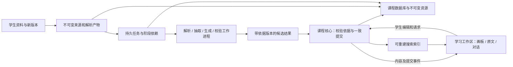

# 架构决策总览

更新于 2026-10-27。完整答案见[系统设计定稿](系统设计定稿.md)：产品取舍与工程合同已由 Robert 整体确认，正式应用尚未迁移。本文件保留决策与验证证据索引；取舍理由归入[设计取舍记录](../adr/设计取舍记录.md)。

**最新设计原则**：Robert 明确要求从产品与第一性原理出发，重新评估交付形态及全部内部技术，不能把现有 Web UI、Python、JSON 或工具兼容成本当成必须沿用的条件。长期架构必须覆盖学生资料导入、解析／知识抽取、内容生成与校验、发布和持续修订；这些后续能力可以分期实现，但其内容身份、来源、执行与恢复关系现在就需要设计。

## 文档职责

| 文件 | 用途 |
| --- | --- |
| [PRODUCT.md](../../PRODUCT.md) | 当前产品规则、范围和已有实现事实；实现事实不自动成为下一版的技术约束 |
| [CONTEXT.md](../../CONTEXT.md) | 领域词汇与边界，仅作词汇表 |
| 本文件 | 当前决策、证据与实施缺口的索引 |
| [系统设计定稿](系统设计定稿.md) | 本会话八个设计分支的完整合同与分阶段验收，已整体确认并定稿 |
| [ADR-0001：独立桌面交付](../adr/0001-independent-desktop-delivery.md) | 已接受的交付形态、理由与平台实施顺序 |
| [ADR-0002：Electron 宿主](../adr/0002-electron-desktop-host.md) | 已接受的桌面宿主、实际取舍与仍独立判断的技术边界 |
| [ADR-0003：TS／Node Worker 核心](../adr/0003-typescript-node-worker-core.md) | 已接受的核心语言、承载与按需工具进程边界 |
| [ADR-0004：每课 SQLite＋资源](../adr/0004-sqlite-course-storage.md) | 已接受的权威存储、交换与资源发布边界 |
| [ADR-0005：React Flow 与独立内容层](../adr/0005-react-flow-learning-workspace.md) | 沿用既有工作区设计，明确画板与完整学习内容的分工 |
| [ADR-0006：Tiptap／ProseMirror／MathLive](../adr/0006-tiptap-prosemirror-mathlive.md) | 已接受的正文编辑器组合及仍须验收的连接 |
| [ADR-0007：可配置历史期限](../adr/0007-configurable-history-retention.md) | 默认 140 天、学生可调的自动历史清理，以及独立保留范围 |
| [内容演进与实时修改协议](内容演进与实时修改协议.md) | 内容身份、批注、局部布局、学生编辑与 Agent 并发的详细合同 |
| [正文编辑与保存衔接设计](正文编辑与保存衔接设计.md) | 正文模型、已选编辑器、草稿序号、正式提交、回执与卸载的连接，以及组合验证 |
| [设计取舍记录](../adr/设计取舍记录.md) | 产品参照、源码核查、备选技术及拒绝方案的理由 |
| [运行交付与进程边界](../research/architecture/运行交付与进程边界.md) | 启动、关闭、课程与应用关系、进程和交付方式的研究 |
| [产品形态与运行架构比较](../research/architecture/产品形态与运行架构比较.md) | 从完整产品需求比较外部浏览器、Electron、Tauri，并给出桌面方向的推荐与验证条件 |
| [后端存储方案调研](../research/architecture/后端存储方案调研.md) | 权威数据、事务、历史、备份与检索的方案比较 |
| [历史管理与恢复设计](历史管理与恢复设计.md) | 成熟产品研究后的最小方案，区分即时撤销、指定修改撤回、历史恢复与草稿，并说明开销 |
| [第一性原理与轻量化架构](../research/architecture/第一性原理与轻量化架构.md) | 从实际学习负载与一致性推导必要能力，重新比较宿主和核心承载成本；修正把组合可行性等同最优性的论证 |

[旧版运行基线与验收](../development/旧版运行基线与验收.md)记录既有版本的用户故事、实现与回归依据，不能代替下一版架构验收。涉及产品行为的冲突先按 Robert 最新明确决定与 PRODUCT.md 对齐；下一版工程合同以总稿为入口，研究文档中的历史候选不作为重新提问的依据。

## 已确认产品规则

| 领域 | 当前决定 |
| --- | --- |
| 使用与规模 | 本地单人，每门课程一张持续扩展的画板；约 500 个完整单元作为增长场景，非硬性上限 |
| 产品交付 | 已接受 Electron 独立桌面，统一课程、窗口与后台任务入口；见 ADR-0001 和 ADR-0002 |
| 核心与数据组织 | 已接受 TS／Node＋宿主拥有的一个 Worker 课程核心，以及每课 SQLite＋课程资源文件；见 ADR-0003 和 ADR-0004。正式应用尚未迁移 |
| 工作区与正文技术 | 沿用 TypeScript／React＋React Flow 和独立 DOM 内容层；正文已选择 Tiptap＋ProseMirror＋MathLive。见 ADR-0005 和 ADR-0006；路线确定不等于完成组合验收 |
| 平台与实施阶段 | 当前先实施和打磨 macOS；Windows 是后续发布推广前必做平台，现在纳入设计，适配、打包与实机验收后做 |
| 内容与身份 | 正常复习必需内容预先备齐；主题、单元、正文块、引用和个人内容有稳定身份；布局不改变知识语义 |
| 输入与阅读 | 鼠标、触控板随时切换；选文、公式、实验操作与相机手势有明确归属；导航不重排全图 |
| 正文编辑范围 | 已接受同一知识单元 B 内普通正文连续编辑，支持跨段选择、改写、插入／拆分与同一次编辑会话内按顺序撤销；底层按块保存，编辑实例按活动范围创建 |
| 局部让位 | 展开或正文增高影响附近对象；手动位置允许临时让位；收起依据最新布局基线，保留期间的新调整 |
| 修改过程 | Agent 的真实修改原位可见，当前输入与选区受保护；完整修改直接生效、可撤回 |
| 同处更新时机 | 已接受离开当前段落或结束编辑后再自动对齐；短暂停顿继续保护当前段落，跨段选区保护实际范围。其他独立部分继续更新，草稿照常保存；解除现场保护不跳过最新输入、版本和任务资格核对 |
| 自动保存 | 正文、公式、草稿、笔记、图形、布局、状态、对话都由系统自动保存；只有真实持久化确认才显示已保存 |
| 历史与撤销 | 已选择正式修改历史＋可恢复草稿，不要求永久逐键／逐 token 回放；⌘/Ctrl+Z 已确认只服务当前编辑会话，关窗重开后通过历史找回，不持久恢复整套撤销栈；指定修改撤回与旧版恢复另行处理 |
| 历史保留 | 正式修改历史默认 140 天、超期自动清理，学生可在设置中调整；当前内容、个人记录、未处理草稿及仍被引用的资料独立保留。见 ADR-0007 |
| 单元历史恢复 | 已确认默认只恢复课程内容；当前布局、个人笔记和掌握状态保留，布局可另选；整课恢复独立 |
| 简约原则 | 功能与机制必须对应真实场景和实际收益；性能、存储增长、系统复杂度共同影响取舍 |
| 轻量化约束 | 已明确记录：正文按阅读范围读取且完整离线可用；阅读采用静态正文／公式、编辑实例按需创建、PDF 按页及有界缓存；流式局部更新、变化对象历史与最新草稿；一个应用管理多课、工具按需启动，不为每课复制运行时或常驻服务。活动输入、选区、保存与恢复必须保持 |
| 跟随控制 | 修改默认跟随；学生导航立即接管；后续输出不抢回；提供返回并继续跟随入口 |
| 新消息 | 设置中选引导／排队，默认引导；Agent 判断语义；输入区不另加下一轮处理按钮 |
| 并发与恢复 | 学生新内容保留；Agent 校准读取依据；停止保留已提交并阻止后续提交；重开不静默重跑 |
| 界面与任务寿命 | 关闭学习界面后任务继续；明确退出本地运行程序才停止；重新打开可接回任务状态 |
| 复杂实验 | 常用组件＋课程内扩展；学生操作声明参数，Agent 修改内部逻辑；默认离屏暂停并保留现场。新定义在操作结束后兼容自动迁移，不兼容保留旧现场询问 |
| 公式批注 | 首版支持符号／子表达式；明确对应才迁移，歧义保留原公式、选中片段与批注 |
| 搜索基线 | 离线关键词、别名与符号匹配，联网 Agent 辅助描述改写并检索真实已有内容；当前不引入本地语义模型 |
| 长期保存 | 课程文件夹包含资料版本、知识、个人内容、布局、对话与历史，能迁移继续学习；内容离线可用 |
| 外部工具写入 | Robert 已明确画板／接口写入与开放格式导入导出足够，不要求直接编辑内部权威文本 |
| 长期内容生产 | 架构覆盖资料导入、解析、知识抽取、内容生成、校验发布及局部修订；功能实现可以分期 |
| 依赖 | 底层库与 SDK 使用宽松开源许可，正常运行不需要额外厂商授权；生成执行器按已有服务边界管理 |

完整细节以 PRODUCT.md、总稿及对应协议为准。上表确认的是行为，不表示已通过正式组合验收。

## 实现选择与证据

| 选择 | 当前状态 | 依据与还需证明的部分 |
| --- | --- | --- |
| TypeScript／React＋React Flow，正文使用独立 DOM 运行层 | 沿用既有设计，有隔离验证；见 ADR-0005 | 保留正文、公式、交互及输入现场；原生输入法、实体鼠标／触控板和正式应用连接仍需实际环境验证 |
| 按可见范围挂载正文，活动输入／选区固定实例 | 机制已在样例验证 | [固定尺寸负载记录](../../experiments/architecture-spike/验证记录.md)：84／500 单元对照、27 项检查及 20 次启动；不能据此推导动态布局或后端性能 |
| 布局基线＋按实际尺寸局部让位 | 隔离功能验证 26 项通过，已补并发负载 | [动态布局记录](../../experiments/architecture-spike/动态布局验证.md)：500 对象下真实尺寸反馈、连锁让位与输入组合通过；7 秒、约 20Hz 正文更新伴随持续相机移动时 rAF P95 16.7ms、最大 100ms。仅固定宽度向下投影，不能宣布实机卡顿已解决 |
| 块身份、变更对应与版本读取依据 | 合同已合并，未完成组合验收 | 普通块拆合、跨块锚点和并发内容更新尚需与最终提交模型集成验证 |
| Tiptap 开源核心＋ProseMirror 事务／history＋自定义 MathLive NodeView | 已选择，未接入；见 ADR-0006 | [候选核查](../research/topics/正文编辑器候选核查.md)支持扩展、ID 与范围历史的机制组合；直接 ProseMirror 为已比较方案。Lexical 默认快照历史对外部修改后的 Undo 有额外适配成本。公式进出、ID 拆合与真实中文输入仍需验证 |
| CourseService 统一读写、操作幂等及停止门禁 | 已有实现可作基线，接口可重构 | 职责继续需要；现有源码不是语言、数据库或跨文件组织优于其他方案的证明 |
| SQLite 管理权威内容、修订与执行记录，外置不可变大产物 | 已接受，正式存储尚未迁移 | [ADR-0004](../adr/0004-sqlite-course-storage.md)；[136 条断言](../../experiments/storage-spike/README.md)覆盖所测事务、进程异常退出、停止竞争、依赖／草稿守卫及有限迁移。目标 Node 绑定另有下述实测；仍不是正式编辑器、Agent 和完整恢复的集成验收 |
| 独立桌面交付 | 产品形态已接受，实际交付仍需验证 | [ADR-0001](../adr/0001-independent-desktop-delivery.md)；macOS 先行，Windows 后续必做 |
| Electron 桌面宿主 | 已接受，正式应用尚未迁移 | [ADR-0002](../adr/0002-electron-desktop-host.md)；[宿主实验](../../experiments/desktop-host-spike/README.md)支持本次 Electron 页面与关窗生命周期的可行性，资源取舍见下行。正式编辑器与完整课程／Agent 仍需集成验收 |
| 同页面宿主资源与动态回调节奏 | 已完成三对有效测量，仍非完整产品排名 | [资源实验](../../experiments/desktop-resource-spike/README.md)：同视口、DPR、可见与聚焦条件下，Electron 动态 footprint 610–615 MiB，WK 391–398 MiB；rAF 间隔 P99 分别约 18ms 和 91–92ms。WK 每轮 16 个大于 50ms 的间隔；这些是回调节奏，不是呈现帧或物理输入延迟 |
| TS／Node＋宿主拥有的一个 Worker 核心 | 已接受；18 场景、4,320 次保存及最终核对通过 | [ADR-0003](../adr/0003-typescript-node-worker-core.md)；[核心承载实验](../../experiments/core-placement-spike/README.md)：Worker 比 utility 少约 11 MiB footprint，短事务下三者宿主定时器接近空载噪声。普通核心使用 Worker，重工具或明确原生故障隔离按需另设进程 |
| 一套正式变更记录＋最新草稿；历史按需展示 | 隔离语义与成本已验证，尚未集成 | [历史实验](../../experiments/history-spike/README.md)37 项检查通过；同轨迹正文历史载荷 30.24→1.86 MB，保存耗时有波动，不作整体性能结论；支持优先记录变化对象，暂不增加压缩／全课快照体系 |
| ⌘/Ctrl+Z 的编辑上下文与画板撤销 | 编辑器事实已测，画板仍缺实现 | [键盘实验](../../experiments/undo-input-spike/README.md)：macOS 合成按键下 textarea／MathLive 撤销重做有效；实际拖动后画板 ⌘Z 不恢复位置。22 项事实检查含缺口复现；正式富文本、核心回执与 Windows 尚未贯通 |
| 统一命令／事件合同，宿主提供传输适配 | 合同已合并，未接入 | 桌面内部采用受限 IPC；有界命令、实际回执、事件续读与慢消费者处理见总稿；不常驻另一个 HTTP 服务 |
| 中文／公式搜索的索引 | 已完成一项隔离召回验证 | [检索实验](../../experiments/search-spike/README.md)：默认 FTS5 与子串基线不同；17 条指定查询用 trigram＋短词回退一致。资料全文、长对话与实时索引仍须验证 |

独立桌面、Electron 宿主、TS／Node Worker 核心及每课 SQLite＋资源分别记录在 ADR-0001 至 ADR-0004；沿用的工作区路线及新确认的正文编辑器记录在 ADR-0005、ADR-0006。具体接口和内部 schema 继续按这些决定收敛，技术决定不代替实现与验收。

## 从完整产品推导的总体架构

组织为**学习工作区＋课程核心＋内容生产运行器＋可替换工作进程**。窗口、数据库和解析库分别位于它们对应的位置；单个框架不承担整个产品的职责。整体先作为本地模块化应用，不为每个阶段拆服务。

| 部分 | 应封装的复杂行为 | 设计与取舍 |
| --- | --- | --- |
| 学习工作区与宿主 | 窗口、课程打开、画板／原文／对话，输入连续性与后台任务入口 | 已选择 Electron；沿用 React／React Flow 与独立 DOM 内容层。接受宿主资源与分发成本、内容层和基础绘图的适配工作；既有比较保留为依据，正式输入与完整工作区仍需验收 |
| 课程核心 | 稳定身份、语义校验、读取依据、学生编辑保护、发布、撤回及回执 | 已选择宿主拥有的 TS／Node Worker，从统一接口提交。重工具及明确原生故障隔离按需另设受管进程；Python 按具体工具收益引入。这里描述已接受设计，正式核心尚未迁移 |
| 生产运行器 | 版本化输入、阶段依赖、尝试、进度、取消资格、恢复和结果登记 | 本地持久任务记录加有界并发；长任务不持有课程写事务，不依赖学习窗口存活 |
| 解析／抽取／生成工作进程 | OCR、文档解析、模型调用、可计算的课程校验 | 工作进程交付带版本的产物及证据，课程核心决定发布；Python 文档处理生态可作为解析实现，不要求整个应用使用 Python |
| 权威存储与资源 | 内容、候选、个人记录、历史、执行事实共同提交；大资源完整发布后登记引用 | 已选择每课 SQLite＋课程资源文件，保持领域逻辑分层；开放格式用于交换，避免双套可写权威。使用目标 Electron 内置 Node 的 node:sqlite；版本化 schema 与完整连接尚需实施验证 |
| 搜索与消费投影 | 面向知识、笔记、对话和来源的索引，保留定位版本 | 索引可重建；中文短词和公式符号有实际差异，不能直接套用默认分词 |

资料处理接口必须保留结构和证据位置，而非只返回一串 Markdown。作为能力参考，Docling 的统一文档可表达文字、表格、图片、层级、可用布局和来源信息，并支持多种课程资料格式；这说明解析器应交付可验证结构，不代表已选定 Docling 或证明其对本课程的准确率。[文档模型](https://docling-project.github.io/docling/concepts/docling_document/)、[输入格式](https://docling-project.github.io/docling/usage/supported_formats/)

未来增加自动抽取时，新增的是阶段执行器与交互能力；课程身份、来源版本、产物、依赖、候选发布和个人内容保护不应推倒重来。现在必须定义这些合同，具体 OCR、模型、提示内容、调度规模和界面可以逐步选择。完整示例与失败边界见[存储研究的长期生产流程](../research/architecture/后端存储方案调研.md#长期生产流程现在稳定边界分阶段实现功能)。

“发布”指内容经过必要校验后进入正式课程修订；在有效的生成／更新请求范围内自动进行，不增加逐块预览采纳步骤。单纯导入新版资料仍不等于请求改写旧画板；后台重算也不能覆盖学生后来编辑的内容。

## 验证顺序与通过标准

执行[总稿的六阶段验收](系统设计定稿.md#9-实施顺序与验收)：一个真实单元的核心与保存 → 完整编辑和空间现场 → 实验、来源与搜索 → 真实 Agent → 完整课程、迁移和 macOS 交付 → Windows 与后续生产能力。每个阶段有明确实际产物与通过场景，不用模拟 Agent、localStorage 或成功 stub 代替所要求的真实连接。

既有隔离结果维持原范围，不重复基准挑更好数字。中文 IME、物理鼠标／触控板、干净环境与 Windows 均保留实际环境验收；macOS 通过不能充当 Windows 通过。只有新连接暴露问题才增加针对性验证。

## 本会话设计收敛清单

Robert 要求按 grill-with-docs 把本会话的设计全部确定好。八个分支现已合并到[系统设计定稿](系统设计定稿.md)，各项产品取舍与工程合同已由 Robert 整体确认并定稿。正式实现和组合验收尚未进行；未实测不再写成未选型。

| 分支 | 确定的行为与合同 | 实施验收重点 |
| --- | --- | --- |
| D1 工作区与空间交互 | React／React Flow＋独立 DOM；连续相机、手势归属、可调整宽度、最新手动基线与局部让位、学生接管跟随 | 真实鼠标／触控板，调宽、增长、拖动、收起与阅读锚点组合 |
| D2 正文、公式与批注 | Tiptap／ProseMirror／MathLive；连续正文、输入保护、范围 Undo；符号／子表达式批注明确对应才迁移 | 中文 IME、跨控件路由、稳定 ID、较早回执、草稿、公式批注与重开 |
| D3 交互实验 | 常用组件＋课程内扩展；分步计算与快照；操作结束后兼容自动迁移，不兼容保留旧现场询问 | 离线资源、离屏停算、暂停超时恢复、旧消息、版本迁移和学习结果 |
| D4 课程核心与历史 | 一个 Worker；每课 SQLite＋资源；共同提交与去重；默认 140 天且学生可调；窗口基线及资源保护 | 真实输入和停止竞争、清理中断、历史重建、恢复与防重复提交 |
| D5 Agent 执行 | 复用本机 Codex 执行器、目标绑定、引导／排队；执行器结束与应用完成分开；关窗继续，退出停止，明确继续 | 实际协议能力、连续工具修改、保护范围候选、断线核对和重开 |
| D6 来源与搜索 | 不可变来源、结构化产物、分层校验与有效请求内自动发布；本地基础检索＋联网描述增强 | 原文版本和定位、完整课程召回、索引滞后、阶段恢复与真实证据 |
| D7 格式、迁移与交付 | 版本化自含课程、开放交换、复制后验证迁移、升级失败保留、一致备份；macOS 先行，Windows 后续必做 | 原数据完整性、备份数据库引用清单、断网复制重开、跨平台路径与实际安装 |
| D8 实施与验收 | 一个真实单元先贯通，再接实验、真实 Agent、完整课程与增长负载，最后扩展平台与生产阶段 | [总稿的六阶段通过条件](系统设计定稿.md#9-实施顺序与验收)，不以隔离样例代替正式组合 |

本会话设计已完成，后续以总稿为实施依据，不再询问已定的宿主、编辑方式、公式范围或历史期限。缓存容量、表字段、批量间隔、库版本和后续解析器属于按合同实施的工程选择；出现新的产品取舍才单独讨论。
