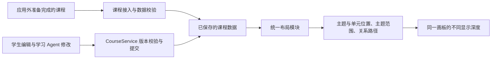

# 画板布局设计

2026-11-01：Robert 已确认主题排布、显示深度、完整主关系与位置稳定的体验规则。本文定义对应的工程合同、接入位置和验收条件。当前实现已覆盖内置示例初排、已发布单元的增量落位、关系投影、局部阅读让位及独立工具中的明确全图整理；这些路径的具体验证和未覆盖项见文末。

产品行为唯一依据为 [PRODUCT.md](../../PRODUCT.md#画板与阅读)，取舍见 [ADR-0009](../adr/0009-readable-overview-with-complete-main-relations.md)。字体、颜色和笔触沿用 [DESIGN.md](../../DESIGN.md)；局部让位、阅读锚点与输入保护继续遵守[内容演进协议](内容演进与实时修改协议.md#局部布局手动基线与阅读投影分别管理)，不在这里另设保存或撤销机制。

## 1. 输入是已准备完成的课程

当前阶段，原始课件、作业、教材到首次可导入课程的加工由 Robert 在应用外完成。本模块从准备完成的正文、主题、单元、正式关系及其来源开始工作，不承担知识抽取、主题分类或关系推断，也不要求调用 AI 才能排版。

导入后的学习 Agent 可以按学生请求增补正文、调整知识结构、修改正式关系或整理布局；学生也可以直接编辑和摆放。所有已生效变化进入同一布局规则。现有课程打开、备份恢复与首次接入新课程有不同语义，不能全部当作新课重新排布。

本次定义布局消费的数据要求与接线，不扩展原始资料加工流程，不借此新增课程生成面板或一套并行的导入格式。

## 2. 统一模块与三种状态

在 `desktop/src/board-layout/` 收纳共享的纯 TypeScript 排布和关系投影；局部阅读投影使用同一职责下的 `desktop/src/layout.ts` 与共享的主题尺寸常量。这些计算不依赖 React、DOM、SQLite 或模型执行器。持久布局规划、临时阅读投影、关系及显示投影分别校验自己的输入，调用者不能通过跳过校验得到“成功结果”。

| 状态 | 拥有的内容 | 何时改变 |
| --- | --- | --- |
| 布局基线 | 主题锚点、单元坐标和宽度、明确的手动摆放、布局规则版本与依据修订 | 首次课程接入、结构增量、明确摆放或整理；经课程核心提交并保存历史 |
| 阅读投影 | 按实际尺寸展开后的单元矩形、主题范围、必要的碰撞连锁让位与路径 | 正文尺寸或展开状态改变；不写成新的手动基线 |
| 显示投影 | A／B／正文的呈现、线条与标签的屏幕尺寸、可见范围与选中强调 | 平移、缩放、选择与显隐；不改布局基线和知识事实 |

布局模块只返回结果与诊断，`CourseService` 继续负责读写资格、事务、历史与实际落盘回执。React Flow 和独立正文层消费同一份投影；renderer 不再自行拼一份主题框、另一份单元位置和第三份关系聚合。

### 输入和输出

输入包括稳定的主题／单元身份与归属、已审核的关系及前置路线、显式阅读顺序、带依据版本的默认阅读尺寸、最近基线、变更对象集合和本次明确摆放约束。课程名称、主题编号、题目内容不参与算法分支。

阅读顺序是已保存的课程元数据，不等同于知识前置。首次接入优先使用外部提供的顺序；既有课程缺少该字段时，兼容读取其已发布顺序并固定保存，不能通过重新解释名称或调用学习 Agent 猜测。没有可靠语义顺序的输入只能采用稳定的显示顺序，不宣称它是推导出的学习路线；并列项用稳定 ID 打破几何计算中的平局。

尺寸来自单元默认阅读状态，包含正常理解必需的正文、公式与图示，不包含默认收纳的完整推导、题解等展开增量。尺寸记录绑定内容修订、宽度和字体／排版配置；只有这几项变化才失效。接入可先用结构化内容估算，再在同一排版配置下有界测量；测量结果校正临时投影，不能因滚动到此前未读单元就静默重写持久位置。

输出包含有效的布局基线或差量、当前单元矩形和主题范围、关系路径及其原始成员、内容范围和可检查的诊断。几何值必须有限且在支持范围内；临时投影和路径可缓存，但不是另一份可写课程权威。

## 3. 排布与走线如何计算

### 首次排布与明确整理

1. 校验输入身份、归属、正式关系端点与阅读顺序；保留原始关系 ID、类型、方向、来源及 AND／OR 路线。不从排列补出知识关系。
2. 在每个现有主题内部安排 B，使用默认阅读尺寸、真实前置与明确顺序，允许多个单元列；得到主题需要的占地和连接端点。没有主题上方的可见容器、分类或导航实体。
3. 将主题作为可变尺寸对象进行初排。真实前置提供主要方向偏好；其他关系只影响邻近和路径成本。先满足有效几何和明确约束，再依次考虑位置稳定、交叉、绕行及紧凑度。初排与明确全图整理可以整体求解，普通浏览不触发此步骤。
4. 建立主题之间的可通行走廊，为关系分配端点、通道和标签位置。走廊可以共用，线段分道；路径避开正文与标题，允许必要的交叉和回向线，不承诺任意图都可零交叉。
5. 对同一输入使用固定的规则版本、确定的遍历与平局顺序，得到可复现结果；通过下方不变量后才形成可提交基线。

单元前置无环不代表主题聚合无环。例如 A 中的 `a1` 是 B 中 `b1` 的前置，`b1` 又是 A 中 `a2` 的前置，单元图合法而主题图出现 A→B→A。内部求解可分析强连通关系，但不为它新增可见层级；反向线按事实绘制，不强求所有箭头朝右。

当前实现使用纯 TypeScript 的稳定拓扑顺序、主题强连通分量、列间平衡和正交避障，没有引入新图布局依赖。算法必须继续经过下方合成样本和真实画面验收；如以后替换求解器，仍需遵守同样的语义、位置稳定与许可边界。

### 增量、手动摆放与恢复

- **增量规划**以已有基线为起点，先尝试当前主题的可用位置，再处理实际碰撞及其连锁影响。无冲突且没有明确修改请求的对象保留原位；关系变更优先重算相应路径，不能因为更短的线就全图重排。
- **手动摆放**表达学生的明确意图，目标位置不被自动美化覆盖。拖动期间固定目标，其他对象按阅读投影让位；松手只提交本次明确改动。后续收起从最新基线计算。
- **碰撞链没有虚构的固定邻居上限**。实际影响可以延伸到多个主题，仍按原相对顺序做必要位移，不借机重新排列整个知识结构；计算分批并保留阅读锚点。只有有界受影响范围的证据，才能宣称无关区域不移动。
- **明确整理**携带请求范围与依据版本。全图整理和局部摆放分别校验，不能通过放宽“目标加两个邻居”来冒充全课权限；改变的基线进入现有可追溯历史。
- **历史恢复与重开**应用保存的几何和兼容转换，不运行自动优化。恢复的语义有效性按已有历史合同核对，不能为了符合最新版式抹掉用户要求恢复的旧布局。

### 关系投影与显示深度

主关系在课程图中只有一份成员集合。B 层显示具体关系；A 层的跨主题关系按端点、类型和方向聚合，同主题关系归入该主题的内部缩略结构。每个投影保留成员 ID，点击聚合线直接定位其成员；无向关系先规范化端点顺序，不因输入先后生成重复聚合。前置路线仍以单元关系及路线组为准，主题聚合不能声称整个主题都是必要前置。

低缩放不清空 B 后留下巨大的不透明空框，而是呈现主题名称和对应位置的单元缩略结构；中间显示深度保留足够的单元与关系阅读区间；近景挂载完整核心正文。隐藏拥挤的标签不等于删除节点或关系；所有关系仍有几何表达及键盘可达的详情入口。可读文字、线宽、箭头与命中范围按屏幕尺寸管理，世界位置保持独立。

平移和普通缩放只消费已算好的几何、可见性及缓存。只有端点、障碍物或显示层级的连接对象发生变化时，才使相关路由失效；不在每个相机帧重算全课排布。当前显示层级之外的关系由相应主题缩略结构承接，离屏裁剪也不能改变全课关系投影的成员集合。

## 4. 接入入口与持久化

统一模块不等于所有操作都调用一次全图排列。兼容与历史恢复先检查身份、引用、值域和格式，保留已记录的基线；不能用最新排布质量标准拒读旧课程或重写恢复结果。新规划和当前阅读投影再执行几何与路由检查。实现必须逐条接入以下不同语义：

| 入口／现有位置 | 接入要求 |
| --- | --- |
| 首次接收外部准备完成的课程；当前图读取在 `core/worker-runtime.ts` | 经统一模型规范化与校验后生成初始基线；不把 fixture 坐标或外部任意坐标当作通用布局规则。接收原生 YiZhi 既有课程／备份时保留其基线 |
| 后续内容、主题或单元增补；现有 `core/generation.ts` 有固定位置追加逻辑 | 在既有修改流程中以结构差量调用增量规划；不扩展原始材料加工能力。移除永久固定追加坐标这一旁路 |
| 正式关系变化；`core/formal-relations.ts` 与 renderer 聚合 | 复用同一成员投影和路由规则；保留关系事实的审核、来源与路线校验，不默认重排已有主题 |
| 学生移动／调宽、画板 Undo；`core/drawings.ts`、`core/local-layout.ts` | 保留既有前值校验、操作回执和历史，只复用几何约束与差量提交；核实并收紧低层 `setLayout` 的调用资格，避免绕过历史与通知 |
| 学习 Agent 明确布局修改；`core/agent-mutations.ts`、`core/command-consistency.ts` | 默认整理提交意图、范围和依据，由模块产生布局差量；明确移动可表达几何约束。仍走命令组的资格校验、并发保护与共同提交 |
| 撤回、单元／整课恢复；`core/formal-history.ts`、`core/restore-state.ts` | 对保存的基线做兼容与引用校验；主题锚点、布局版本和新增字段纳入原历史，不把恢复替换成重算 |
| 旧课程开发迁入、格式升级与备份打开 | 接入统一兼容校验，保留个人摆放；开发迁入继续属于独立工具，不因本布局任务新增学习界面入口 |
| `renderer/local-layout.tsx`、`renderer/workspace.tsx` 与 `layout.ts` | 使用共享投影；正文测量、主题范围、单元位置与关系路线按同一批次版本对齐；删除 renderer 重复聚合和静态主题框的独立决策 |
| 压力样本；`scripts/prepare-growth-fixture.mjs` | 正式布局验收样本调用真实模块；刻意构造的压力几何单独标明，不能拿另一套摆放算法证明正式布局合格 |

持久布局记录规则版本、尺寸配置版本、内容依据修订与布局基线修订。长计算在写事务外完成，提交时重新校验依据；过期结果重算，不覆盖学生之后的位置。普通正文保存不等待全图求解；涉及新增／删除对象的结构提交必须同时具有对应的有效落位，不能发布只有知识节点没有位置的半成品。

现有基线、个人位置与保存历史的权威来源保持唯一。旧数据补版本字段可以自动兼容，但应用升级不会自动采用新算法重排。首次应用本设计到既有课程属于一次明确布局整理，保留可恢复旧基线；后续打开使用已保存结果。

正式初排和明确整理在课程核心的写事务外计算；关系投影在独立渲染 Worker 计算，避免大型布线阻塞阅读主线程。临时阅读投影沿用合并测量批次。测量显示 500 单元合成图的单元关系投影仍有数百毫秒计算量，不能把它作为主线程逐帧操作。

## 5. 由程序检查的布局不变量

以下检查跨所有正式入口复用，不能只在样例生成器中成立。算法升级、规则修订或绕过共享模块的改动必须让对应检查暴露差异。

| 编号 | 可检查条件 |
| --- | --- |
| L1 语义保真 | 输入输出的知识身份、A／B 归属、正式关系端点／类型／方向及前置路线完全一致；布局没有新增上级知识／导航实体 |
| L2 完整关系 | 全部主关系 ID 恰好归入当前投影的具体边、跨主题聚合或主题内部结构，既无遗漏也无重复；选择／聚焦不缩减这个集合；聚合成员可逐条反查 |
| L3 几何有效 | 坐标、尺寸、路径点均有效；稳定后的同级内容矩形无非预期重叠，默认主题范围包含对应单元。父主题包含子单元是合法包含，个人绘图覆盖内容不作为布局碰撞 |
| L4 路由清楚 | 路径经声明端点进入和离开，不穿过无关正文与标题；共享通道分道；有向关系箭头符合原事实；聚合标签位置与成员数一致 |
| L5 显示独立 | 改变视口、选择或关系强调不改持久基线；主题远景含内部结构，中景可识别 B，正文可达；拥挤标签的收纳不删除对象或关系 |
| L6 增量稳定 | 明确请求与实际碰撞链之外的已存对象位置保持不变；输入期间目标不被抢写；展开后手动调整再收起使用最新基线 |
| L7 可复现 | 在显式读序、尺寸、规则版本和约束相同时重复求解结果相同；输入数组重排不改变输出，ID 只用于识别与平局处理，不用于特定课程分支 |
| L8 保存与恢复 | 失败或过期规划不能覆盖有效基线；重复操作不重复提交；重开、撤销、备份／历史恢复不偷偷优化几何；正文与个人状态不因布局变化丢失 |

冲突与不可用输入返回明确的失败或不足诊断，不伪装成功。已有课程保留可读的有效基线；正文真实保存与布局完成状态分别报告。交叉数、绕行长度、占地和受影响对象数是优化指标，不通过删边、反转关系或放宽字体可读性来刷低指标。

## 6. 通用样本与实际画面验收

先用合成课程检查规则，再用真实课程检查阅读体验。合成数据进入可版本化测试夹具，课程名称与内容只承担测试身份；个人课程、副本和日志继续遵守[本地产物管理](../development/本地产物管理.md)。

| 样本 | 需要证明的行为 |
| --- | --- |
| 单主题、无关系、多主题但互不相连 | 没有关系仍可稳定阅读，不生成假前置或依赖固定课程数量 |
| 长前置链、分叉与汇合、高扇出 | 方向真实，全部关系可追溯；空间可扩展，减少交叉不靠漏边 |
| 单元无环但主题聚合成环 | 保留回向线，不拒绝合法单元图，不新增可见分区 |
| 同端点多类型、多方向、无向关系、AND／OR 前置 | 聚合键正确、无重复，成员与路线条件不混淆 |
| 一个很大主题与多个小主题、长标题／公式／表格 | 按内容占地，标题与正文不被路线遮挡，中景仍有单元结构 |
| 新增／删除对象、只改关系、正文增长与连续展开 | 正式增量入口一致，无关位置稳定，临时投影不污染基线 |
| 拖动同时发生内容更新、展开期间调宽再收起 | 保护手势与输入，保留最新手动布局及阅读锚点 |
| 重开、规则版本升级、局部撤回及整课恢复 | 相同保存结果重现，兼容升级不重排，恢复按所选范围执行 |
| 真实数字逻辑课程与约 500 单元合成增长样本 | 实际阅读与负载；测量初排、增量、路由、帧耗时及缓存规模，不用固定例题或样本坐标绕过规则 |

纯计算和持久化组合测试加入 `desktop/tests/*.test.ts`，通过现有构建和 Node／Electron Core 运行；交互、几何与视觉用例加入 `*.spec.ts`，由 Playwright 和现有 macOS CI UI 分片发现。`npm run verify` 目前不包含 UI，因此实现验收还必须运行相应 UI 场景，不能只报 verify 通过。具体命令以 [desktop/README.md](../../desktop/README.md#验证) 与现有脚本为准。

真实画面至少覆盖 1440×900、1024×768、两侧面板展开，以及 A 概览、B 概览、正文、选中关系和材料展开状态。检查可辨认的标题、线宽、箭头、端点、标签与键盘入口，再建立可重复的几何断言和视觉基准。已检查内置示例两种窗口尺寸的全图、正文和关系交互，也检查了本机安装后的现有课程；完整真实课程与增长负载的视觉及实体输入验收仍需单独完成，不能用示意图或局部截图代替。

像素差异只负责发现变化，几何与成员不变量负责判定正确性。后续更换算法或修改规则时同时核对产品合同、策略版本和受影响测试；不能仅更新截图使失败消失。开发检查与质量指标留在测试和工程工具，不成为学生必须操作的面板。

## 7. 实施顺序与完成条件

1. **规范数据和共享接口。** 补阅读顺序、布局版本及尺寸依据，建立统一模块，兼容已有基线；完成 L1、L2、L7、L8 的基础夹具，确认重开和旧个人摆放不漂移。
2. **完成初排、增量与走线。** 用上述合成样本验证可变尺寸主题、聚合环、完整关系、避障和稳定性；算法实现只能通过共享接口使用。通过几何与语义检查后再接完整正文。
3. **接入同一画板的显示与阅读。** 主题轮廓、B 缩略结构、正文与连线使用共同投影，完成屏幕尺寸、点击和键盘访问、阅读锚点及展开／拖动组合验收。
4. **贯通所有正式入口和交付。** 完成接入表中的首次课程、后续修改、手摆、恢复和兼容路径；清理独立坐标生成／聚合旁路，跑必要 Core 与 UI 回归，确认真实课程和增长样本。macOS 需要实际应用验收时，按现有打包安装流程更新 `/Applications/YiZhi.app`。

当前可用的明确全图整理入口是[独立开发工具](../../tools/desktop/README.md)：它保留现有宽度，核对依据版本，记录可恢复的共同历史；普通重开不会调用它。内置示例使用统一初排，来源生成发布新单元使用增量规划；关系显示、手动布局和阅读让位已接入共享投影。旧窄卡片按实际阅读宽度临时让位，基线不因此改写；个别确实无法布线的旧几何保留成员并提供查看入口。

当前尚未实现通用的已准备课程导入流程，因此未来该入口仍须显式调用初排；应用内学习 Agent 的全图整理也尚未接入上述整课规划，现有修改能力仍受目标单元和两个邻居的范围约束。默认高度使用保守估计并由阅读测量校正，还没有完整的内容修订／字体配置尺寸缓存。不能将这些未接入或未测量的部分视为已满足整套合同。

每步报告实际完成的路径、测试与尚未接入的入口。只有共享规则确实覆盖正式写入和呈现路径，并通过通用样本与真实画面验收，才可称为“后续课程会按同一规则排布”；文档或单张示例截图本身不构成这个保证。
