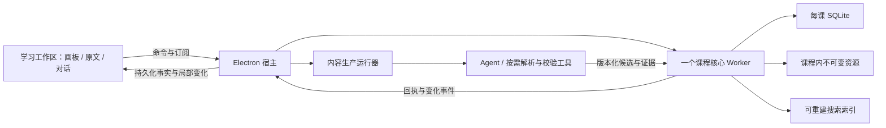

# 下一版复习系统设计定稿

2026-10-27。状态：**Robert 已整体确认，正式定稿，作为下一版实施依据。正式应用尚未按本设计迁移。**

本文件给出本会话全部设计分支的确定答案，作为已确认的实施依据；[PRODUCT.md](../../PRODUCT.md)保存产品规则，[CONTEXT.md](../../CONTEXT.md)只保存词汇，[架构决策总览](架构决策总览.md)汇集决策与证据。下文的工程规则依据已确认体验收敛，不将库字段、缓存阈值或测试参数另交用户审批。后续按此实施，只有实际发现影响产品行为的新取舍才重开讨论。

## 1. 产品范围与技术分工

一个本地应用管理多门课程，每课一张持续扩展的复习画板。完整正文、图示、方法、必要推导、例题和练习解答提前备齐并离线可用；原文与 Agent 用于核对、解惑和修改。知识、布局、个人记录、阅读状态各自维护，正式关系继续遵守来源与价值审核规则。

| 边界 | 确定方案 | 负责的工作 |
| --- | --- | --- |
| 桌面宿主 | Electron，macOS 先实施；Windows 在后续推广发布前完成适配与实机验收 | 课程打开、窗口、后台任务入口、退出、受管工具进程及平台能力 |
| 学习工作区 | TypeScript／React＋React Flow，正文使用独立 DOM 内容层 | 位置与连线、连续相机、原文与对话面板；正文、公式、实验和输入现场 |
| 正文编辑 | Tiptap 开源核心＋ProseMirror 事务／history＋自定义 MathLive 公式控件 | 同一 B 的连续正文、范围修改、即时撤销、公式可视化编辑 |
| 课程核心 | 宿主拥有的一个 TS／Node Worker，多课共享；统一 `CourseService` 边界 | 有界读取、修订与依赖核对、草稿、共同提交、回执、停止资格、历史与恢复 |
| 权威保存 | 每课 SQLite＋课程内不可变资源 | 相关结构化事实共同提交；PDF、图片及实验资源包单独保存后登记引用 |
| 内容生产 | 宿主管理的运行器＋按需执行器／工具进程 | 实际 Agent、文档解析、OCR、生成与校验；长计算在课程写事务外执行 |
| 原文与搜索 | 本地 PDF.js 按页显示；本地基础检索＋联网描述增强 | 原页与版本定位、有界页缓存、真实已有内容的检索 |

宿主、核心、存储、工作区与编辑器决定见 ADR [0001](../adr/0001-independent-desktop-delivery.md)、[0002](../adr/0002-electron-desktop-host.md)、[0003](../adr/0003-typescript-node-worker-core.md)、[0004](../adr/0004-sqlite-course-storage.md)、[0005](../adr/0005-react-flow-learning-workspace.md)、[0006](../adr/0006-tiptap-prosemirror-mathlive.md)。底层库与 SDK 遵守宽松开源许可约束；模型与执行器沿用各自接入边界。

桌面内部使用受限的宿主 IPC 适配统一命令／事件合同，不常驻另一个 HTTP 服务。一个课程只允许核心持有写入资格；重复打开同一课程接回已有会话，另一个应用进程不能同时成为写入者。窗口不持有唯一数据库连接或唯一任务状态。

## 2. 工作区、阅读与空间交互

进入全图画板，目录和小地图默认展开且可收起。导航在同一空间移动；显示深度变化不自行跳到另一个单元或重排全图。先有主题 A，再有可独立复习的单元 B，B 内部保留完整学习材料。原文、画板与 Agent 可同时使用，空间不足时优先当前操作区域，收起其他面板但保留状态。

| 起始目标与动作 | 统一行为 |
| --- | --- |
| 画板上滚轮／双指滑动 | 平移；Shift 加滚轮横向平移，无需切换鼠标／触控板模式 |
| 捏合、macOS ⌘／Windows Ctrl 加滚轮 | 围绕指针或手势中心连续缩放 |
| 默认阅读态，空白处主键拖动 | 超过移动阈值即平移，不等待长按计时 |
| 正文拖动、公式与实验控件操作 | 选择文字或操作当前控件，一次手势中途不转交画板 |
| 选中对象的移动区域／尺寸柄 | 移动或调整对象；选取正文不承担移动对象的职责 |
| 选择工具下空白拖动 | 框选；手形工具、中键或非输入态 Space＋拖动临时平移 |

这沿用[已研究的手势方案](../adr/设计取舍记录.md)。具体移动阈值和平台事件适配在实机验收中调节；不能依赖 `pointerType` 准确区分鼠标与触控板。面板滚动属于面板，文字输入中的空格属于输入。

正文宽度可以调整，高度由内容实际尺寸决定；图示、公式与实验按类型声明可调整方向和最小可读尺寸。固定宽度原型不构成最终限制。知识关系、手画箭头、目录归属和题型步骤分别表达，缩远聚合关系不生成新知识事实。

布局保存学生最近一次明确摆放的基线；展开、收起和内容增高形成临时阅读投影。按新增碰撞及其连锁影响建立局部集合，保留分组与阅读先后，以向下让位为主；调宽碰到邻列时将受影响对象纳入计算，按稳定阅读顺序放到满足间距的可用位置，不全图重排。拖动中的对象作为该手势的固定目标，其他投影不得抢写其位置。收起从最新基线重新计算，保留展开期间的新调整。

相机同时维护阅读锚点、学生手势与跟随状态。局部让位只补偿锚点位移，不重置缩放；学生主动导航立即结束跟随，后续输出不得抢回。返回并继续跟随由学生明确触发，任务结束后入口改为查看结果。尺寸测量与布局批次有界，相机运动不重新测量全课正文。

全图常驻轻量结构；按阅读范围读取和挂载重正文，预读与缓存有界。阅读态静态呈现，活动单元才创建编辑器；活动输入、选区、未确认保存内容和需要续接的实验受保护。完整内容始终在本地，按需读取不等于临时生成。

## 3. 正文、公式、批注与自动保存

### 内容与身份

课程模型拥有稳定的主题、单元、正文块、公式、实验、笔记和引用身份。版本化块载荷保留类型、允许的父子结构及顺序；适当字段可保存 Tiptap／ProseMirror JSON，不再维护另一套同时可写的正文。HTML、DOM、React Flow 节点和编辑器运行时标识都只是投影。

同一 B 的普通正文是一篇连续编辑文档，支持跨段选择、替换、增删和拆合。公式、表格、例题、折叠题解与实验仍保留结构位置和内容身份；未展开材料不能因导出可见内容而丢失。不支持编辑的类型保留原载荷并明确显示，禁止静默丢弃。

修改或移动原内容保留身份；复制产生新身份；拆分保留一个延续身份并建立新块；合并记录存续与退出身份。变更对应只记录可证明的映射，不能靠相同文本猜测跨对象移动。批注始终是一份个人记录，跨段范围可以由有序片段表示。

### 输入、提交与撤销

| 事实 | 合同 |
| --- | --- |
| 输入已响应 | 编辑器先接收输入；每个会话有递增输入序号，立即保护活动段落／选区 |
| 草稿已保留 | 核心持久保存最新未被正式内容吸收的输入、依据与序号；未完成公式也可以保存 |
| 正式内容已更新 | 对完整修改共同提交当前对象、结构对应、必要引用与依赖状态、历史、操作回执及本次消耗的草稿进度 |
| 当前输入已保存 | 实际回执覆盖当前输入序号；不能用输入 12 的确认声称输入 13 已保存 |
| 任务已完成 | 执行结果及应用提交已核对，必要的暂缓修改也已处理；模型结束输出本身不满足此项 |

保存通道按序且有界；合并尚未发送的输入时保留全部尚未确认的脏块和结构变化。正式提交只消耗自己实际覆盖的草稿进度，旧提交不能删除新草稿。响应与事件重复到达时只对齐一次；结果未知的操作先按原 `operationId` 查询或重试，同 ID 不同载荷拒绝。

学生光标仍在当前段落时，短暂停顿不解除保护；跨段选区保护实际范围。其他独立部分可以更新；同处结果等学生离开后，先处理其最新输入，再重核依据、依赖和任务资格，能兼容则自动整合，仅冲突部分询问。没有“离开即采纳旧候选”或逐块采纳步骤。若学生输入尚未到达核心而 Agent 已先提交，双方记录保留后再整合，不宣称 IPC 消除了全部竞争。

正文外部更新使用范围事务维护选区和可映射历史，不以重设全文或重建编辑器作为普通同步。学生即时 Undo 不包含 Agent 动作；同处替换可能使部分旧动作无法对应，仍保留其他有效步骤。⌘／Ctrl+Z 由当前正文、公式、笔记、对话输入或画板上下文单次处理；一段拖动为一步，视口移动不进入内容撤销。关窗重开通过正式历史找回，不恢复整套编辑器 Undo 栈。

MathLive 管理公式内部输入与 Undo，外层正文管理公式对象的位置和插删；外部同步不能在公式输入中反复 `setValue`。公式与已支持的探索共享同一份可计算定义，初期按实际课程逐类实现转换与独立校验。无法转换的编辑仍保存，并将相关探索标为需要核对，不能把旧结果当作新公式结果；不因此自动启动一次 Agent 任务。

### 批注与原语境

正文定位保存对象／块、字段、内容版本、文本投影版本、原选段与前后文、该版本内范围；持久文字偏移使用 Unicode code point，与浏览器 UTF-16 offset 显式转换。图像标记保存相对几何，自由图形保留对象或画板坐标。

**首版支持公式的符号／子表达式批注。** 保存公式身份与版本、原公式、选中片段及该版本内选区和结构语境；MathLive 选区不是 LaTeX 字符偏移，内部 atom ID 也不是永久身份。明确的编辑对应才自动迁移，纯移动直接跟随；整体重写、重复符号或拆合无法唯一对应时保留原语境与笔记，等待重新关联。删除目标不删除个人记录。静态阅读和公式编辑必须指向同一批注对象。

完整流程与场景见[正文保存设计](正文编辑与保存衔接设计.md)、[内容演进协议](内容演进与实时修改协议.md)及[公式机制核查](../research/topics/公式符号批注机制核查.md)。这里确定实现合同，未宣称真实中文 IME、跨控件 Undo 或符号映射已经验收。

## 4. 交互实验的内容与运行合同

常用真值表、波形和参数图使用应用内组件与受限配置；新交互类型允许 Agent 生成课程内 HTML／CSS／JS 资源包。两条路径共同声明输入、学生可编辑字段、资源版本、状态格式和生命周期。扩展包须预构建并携带全部依赖及许可信息，运行时不下载 npm 包或依赖在线 CDN。

| 保存与执行边界 | 确定规则 |
| --- | --- |
| 定义与现场 | 实验定义、当前实例采用的定义版本、输入和现场分别记录；新定义保存不代表旧实例已升级 |
| 资源与状态 | 资源包不可变，保存入口和内容哈希清单；状态记录模型变量、模拟时间、随机种子和完整步序号，不保存线程栈、DOM 或运行堆 |
| 版本 | 资源包版本、运行接口版本、输入／状态 schema 版本各自表达，不能用一个版本号替代全部兼容性 |
| 生命周期 | 统一 `initialize`、`pause`、`resume`、`snapshot`、`dispose` 行为；计算分成可让出的有界步骤，持续产出完整状态 |
| 正常离屏 | 停发新步、等待在途步结束并确认快照，暂停计时、动画和媒体；返回后接着模拟时间继续，不默认补算离屏时间 |
| 明确后台运行 | 学生主动开启后才持续计算，仍保存确认状态；关窗本身不暗中开启该模式 |
| 异常 | 不回应时标明暂停未完成；终止可控制的计算任务后从最近确认快照重建，不把未确认计算声称为已保存现场 |

生成扩展在与宿主不同源的 sandbox frame 运行，不获得 Node、文件系统、SQL、任意 IPC 或 Agent 调用能力。包资源通过登记清单访问，跨源消息核对来源、实例、定义修订和运行代际；销毁后旧消息不得写回。可信课程核心 Worker 不执行生成代码。复杂计算使用浏览器 Web Worker，并由可响应的控制层管理生命周期。

**iframe、sandbox 与隐藏都不保证独立 CPU 进程或真正暂停。** 首版接收满足上述分步、快照、暂停与恢复合同的实验包，不承诺任意网页脚本都可无损暂停。失控生成 DOM 若拖住学习 renderer，宿主仍须能恢复窗口并接回已持久化状态；不承诺一个 frame 卡死时其他 frame 必然流畅。只有实际验收表明此边界无法满足产品使用，才评估独立 webContents 承载，不预建一套任意程序运行平台。机制与待测边界见[实验核查](../research/topics/交互实验运行与迁移机制核查.md)。

Agent 更新产生新定义版本；本次拖动或输入结束后自动尝试升级。先在现场副本中按目标版本声明恢复或执行明确迁移，验证成功后提交新版本引用与现场，再替换实例；失败或不兼容则保留旧定义与现场，只询问是否重新开始。迁移过程的新输入必须使旧迁移结果失效或重新核对，不能覆盖学生刚操作的参数。旧实例显示自己的版本，旧结果不能冒充新逻辑。

新扩展启用前完成离线资源、输入范围、已声明学习结果、暂停／恢复与状态迁移检查。结构合法或资源哈希一致不证明算法正确；生成未完成或未通过必要检查的扩展可保留为工作草稿，不能假装可运行成果。正常完整学习所需实验应在课程内容准备阶段就已备齐。

## 5. 课程核心、历史与恢复

课程核心提供有界读取、草稿保留、正式命令、任务资格、历史预览／恢复与变化订阅。界面、Agent 和工具通过同一行为边界；不把 SQL 或课程目录任意写入能力交给它们。每课短事务串行协调，跨课共享 Worker；长期解析、模型调用、搜索重建和大规模历史预览均分批或移出写事务，避免阻塞其他课程。

SQLite 绑定采用 Electron 内置 Node 的 `node:sqlite`，同步短操作放在该 Worker；随 Electron 固定实际 Node／SQLite 版本，不照搬另一个最新版 Node API。以 WAL、外键约束和 `synchronous=FULL` 作为首期配置；具体连接、退出与备份行为按目标版本验证。既有[核心实验](../../experiments/core-placement-spike/README.md)支持所测组合，API 依据为[对应 Node 24.15.0 文档](https://nodejs.org/download/release/v24.15.0/docs/api/sqlite.html)，不代表正式组合已经通过。

正式命令核对课程代际、操作身份及载荷摘要、实际读取依据、写入范围、最新草稿和任务资格。公式、相关实验及必要引用等一致组共同提交；停止与提交使用同一顺序边界，先停止则拒绝新的提交，先提交则保留并返回其原回执。大文件先完整写入、验证并发布为不可变资源，再登记数据库引用；失败可留下待回收的无引用资源，不能留下正式内容指向半个文件。

事件按提交顺序发布，游标单调递增，消费者按操作身份去重。断连后补读可用变化；超出保留窗口时明确要求重新读取当前状态，不能无声漏更新。慢消费者有界合并通知，以重新读取目标状态赶上；通知与课程正式历史不是两套永久正文副本。

### 历史保留与操作语义

正式历史保存实际变化对象的必要前后内容、结构、作者／任务及共同提交事实；最新未完成输入单独保留。历史展示可以合并活动，不改变原变更组。日常读取使用当前内容，不重放整课历史。

**正式历史默认保留 140 天，学生可在课程设置中调整正整数天数，设置随课程迁移。** 超期自动清理；当前正文、个人笔记、学习对话、未处理草稿和仍被引用的来源、实验版本及资源独立保留。当前存活的这些对象之旧修改记录仍服从历史期限，不能因“笔记保留”暗示每次笔记修改都永久可恢复。见[ADR-0007](../adr/0007-configurable-history-retention.md)。

按正式提交时间计算清理边界，以完整变更组为单位。先建立窗口起点所需对象状态并验证窗口内可重建，再短事务切换边界；未完成恢复、有效草稿、个人原语境和运行实例的引用继续保护资源。分批清理不进入每次输入的等待路径，中断后可以继续，不留下半条历史链。调大期限不能找回已清理明细，调小按新期限处理；界面展示实际可恢复范围。

课程代际、事件序号与操作身份不因清理或恢复倒退。旧操作只保留防重放所需的最小身份、摘要和结果事实，不无限保存请求中的旧正文；超期重试可返回需重新读取的状态，但不能当新操作执行，也不能声称当前输入已保存。独立备份不随当前课程的历史清理被改写。

| 操作 | 作用范围与保护 |
| --- | --- |
| 即时 Undo／Redo | 当前编辑会话的学生动作，结果继续自动保存；不混入 Agent 修改 |
| 撤回指定修改 | 对原一致组构造受版本核对的逆操作，保留后来无关正文、笔记和布局；同处后续改动明确冲突 |
| 撤回整个任务 | 核对目标提交集合并逆序处理；尚在运行则先停止，不能边撤回边继续提交 |
| 恢复单元旧版 | 默认只恢复课程内容，保留当前布局、个人笔记、掌握状态与对话；布局可另选，必要一致范围先说明 |
| 整课历史恢复 | 独立入口，恢复明确选择的学习范围；生成新代际并使旧任务资格失效，不倒退执行事实或删除新导入资料 |

恢复本身是一项新的正式修改，其覆盖前状态进入同一历史体系；预览后若相关内容变化，执行前重新核对。过期历史不再承诺可恢复，当前保留的草稿与个人原语境不能因历史清理而丢失。详细冲突规则与已有证据见[历史设计](历史管理与恢复设计.md)。

## 6. Agent 的实际执行、停止与继续

首个执行器沿用本机已登录 Codex CLI 的独立 app-server 会话，通过适配器接入；启动时核对版本与所需协议能力，读取／引导／停止／状态恢复以实际接口返回为准。复用正常登录，不复制凭据。缺失执行器只影响生成，离线学习仍可用；未来执行器替换不改变课程命令合同。现有实现为[协议适配基线](../../legacy/review-board/reviewboard/codex_executor.py)，不是下一版已经连接的证明。

任务固定提交时目标与选段；后续浏览不更换目标。普通问答在侧栏回答，明确修改请求或加入画板才写内容。同课程独立修改任务按顺序开始并重读最新内容，阅读与问答继续；输入消息的引导／排队设置与课程写顺序分开，默认引导，由 Agent 处理补充、纠正或新事项。

运行器保存任务、attempt、执行器 thread／turn、恢复所需的实际工具输入与输出、提交身份、消息和状态。工具先读取带版本的对象，按实际变化保存工作草稿和一致修改组，经课程核心写入；运行器无课程文件绕写通道。回答增量、工作草稿、正式提交和执行状态分别流转，只显示实际收到的内容与已确认事实。

原始工具载荷只为有效任务恢复、明确证据引用或保留期内历史服务；用途结束后随清理移除重复正文，仅保留必要身份、摘要与结果事实。不把完整读取结果或修改参数另存为永久历史来绕过 140 天策略。学习对话中实际可见的消息独立保留，执行诊断与隐藏工具转储不因此永久保留；未完成任务仍需的恢复材料有明确引用和状态。

学生同时修改时，Agent 接收变化并以最新内容调整；通知送达不代替提交时版本检查。完成说明实际改动及同时修改的处理，即便顺利整合也保留说明。受保护范围尚有候选时，任务显示等待当前编辑结束；执行器已经结束也不能提前标记应用任务完成。解除保护后可在原仍有效意图内重新核对、必要时继续整合，不要求用户再次采纳；真实冲突才进入需要输入。

关学习窗口前先把其最新输入持久交给核心；任务继续运行，新窗口接回状态。**明确退出也必须完成保存屏障：**先停止接纳新任务、撤销未完成任务的继续提交资格并排空已获得顺序的提交，再收齐所有窗口最新输入和在途保存，取得实际持久确认后才关闭工具、窗口及核心。保存失败则保留输入现场并明确提示，不能把正常退出实现成丢弃未确认尾部。意外退出或执行器断线后，先核对实际执行状态和提交回执；还在运行的原任务可以重新连接，已中断的剩余工作由学生选择继续，不能静默重新执行。无法核对的外部执行结果记录为未知，不用再次生成冒充恢复，也不宣称模型调用绝不会重复。

窗口异常消失解除的只是临时现场保护，已持久保留的草稿仍参加同处写入核对。保存失败时明确提示并保留未确认输入，不能以关窗成功或模型成功显示已保存。未收到持久确认的最后输入不保证在异常退出后找回。

## 7. 来源、内容生产与搜索

每份资料有稳定来源身份和不可变版本；原件、解析产物、人工修正及所依赖证据版本可回查。引用至少指明资料版本、页／区域或原文片段及文本投影约定。PDF 页序与书上印刷页分别保存；旧引用不能随新版导入变成指向新内容。

首期复用现有可靠资料与解析入口，PDF 阅读采用本地 PDF.js display API 和按页 worker／资源，限制页缓存；文字提取使用实际文本层。扫描页没有可靠文字时携带原页或选区并说明，不能假装取得精确选段。PDF.js 是显示与提取基线，OCR 是按需解析工具，不能把二者混同。[PDF.js 官方入门](https://mozilla.github.io/pdf.js/getting_started/)

长期流程现在按以下合同建立，自动整课抽取可在后续阶段实现：

1. **导入版本化来源。** 先保留新资料，再决定是否根据新版更新画板；只导入不授权重写旧内容。
2. **解析并登记结构化产物。** 保留文字、表格、公式、图片、层级和原页定位；记录输入版本、工具／配置版本、输出摘要及失败，不能只有一段 Markdown。
3. **抽取／生成候选。** 记录实际输入与读取集、目标正式修订、学生编辑基线、任务尝试及论断证据；已有身份不因重新生成而无故更换。
4. **分层校验。** 所有内容检查结构、身份、引用、版本和课程不变量；可计算内容再做相应独立检查；解释、推导与关系核对具体来源和含义。读取过文件不是论断已获支持，模型自称完成也不是校验记录。
5. **自动提交有效一致组。** 在学生有效修改请求内，重查依据、草稿和任务资格后自动发布；有失败、无法判断的必要依据或真实矛盾则保留候选并指出问题，不增加逐块采纳流程。

校验能力按内容类型记录，不用一个“通过”掩盖不同含义。普通讲解不被要求先转成可计算形式；真值表、布尔式、明确状态转换等适用对象应使用独立计算验证，并区分穷举范围与样例检查。首期支持范围以现有完整课程为验收清单；新增实验类型同时补其有限输入下的正确性与离线检查，不把不支持的算法宣称为已验证。

阶段任务记录输入／输出、尝试、状态、失败及版本依赖，可从已确认产物继续。只重算有实际依赖的范围；依赖不足则扩大并说明，旧正式内容与旧引用仍可读。长处理在事务外完成，完成登记与发布仍受停止资格约束。具体 OCR、模型和解析器可随阶段实现选择，不改变这条链的身份、证据与恢复边界，也不先部署分布式任务服务。

搜索默认覆盖知识、个人笔记、学习对话和来源原文，按范围筛选；结果返回真实身份、版本、摘录与定位。离线基线是关键词、别名、符号匹配，采用 FTS5 trigram 与短词／符号的字面匹配回退；匹配投影保留到原文的定位映射，不因归一化丢失公式差异。索引可重建、分批更新，保存后暂未索引的当前变化用有界直查补齐，并区分未索引、不可读与无命中。

联网时 Agent 可改写描述、组合查询或重排已有命中；不能生成一个并不存在的“搜索结果”。当前不引入本地语义模型，断网复杂描述召回可以较弱。既有[17 条检索实验](../../experiments/search-spike/README.md)只支持该样例，完整课程原文、长对话与定位另验；正常搜索与输入不能等待全课重建。

## 8. 课程格式、迁移、备份与交付

课程文件夹自含数据库、不可变来源与资源、实验包及所需格式说明；应用独立安装，一个运行时管理多课。数据库格式版本、最低读取能力、正文载荷版本与实验接口版本各自记录。持久引用使用稳定 ID 和课程内相对路径；窗口路径、浏览器缓存和编辑器堆不是可迁移数据。

| 场景 | 操作合同 |
| --- | --- |
| 从当前实现迁移 | 读取现有权威 JSON、布局与状态数据库、资料版本等，在新课程目录转换；保留稳定身份、引用、个人内容、对话、阅读状态、有效任务／草稿与承诺保留期内历史；验证后才发布可打开的新课程，原目录保留 |
| 应用内格式升级 | 先创建一致备份，在工作副本升级并核对结构、引用和内容；成功后切换，失败保留旧版本和诊断；不原地把唯一课程改成半迁移状态 |
| 打开新版本课程 | 不支持写入的格式拒绝写入；只有证明可完整解释时才开放相应只读／导出能力，不忽略未知内容后继续覆盖 |
| 开放导入／导出 | 使用带版本的交换格式保留身份、载荷、关系及所需资源；声明包含范围。内容交换包与完整课程备份分别标识，不把仅正文导出称为完整备份 |
| 迁移到另一设备 | 目标安装兼容应用后打开完整课程；重建可丢弃索引，核对资源与版本，恢复已保存上下文；任务先核对再由学生继续 |

初次迁移先盘点当前实际历史、草稿和来源；旧数据不足以表达的信息明确记录缺口，不编造历史。已有历史保留原时间，不因迁移全部重置为当天。转换失败不改变旧课程的权威性，也不把只搬了正文称为迁移完成。路径大小写、中文、空格、相对路径和资源清单按 Windows／macOS 可移植规则处理；Windows 运行结果仍须后续实机验证。

**迁移和升级切换期间，原课程必须停止写入。** 先收齐最新输入并获得持久确认，暂停该课程新任务／写入，排空在途提交，再取一致源副本；从旧版应用迁移时正常关闭其服务并确认写入锁释放。转换、核验和切换完成前不向旧课程继续写入，其他课程可以照常使用。持久记录原目录、目标目录、源版本与切换阶段，以完成标记和应用当前课程指向确定唯一有效目录；发布前中断继续以原目录为准，发布后中断接回已核验目标。旧目录保留为迁移前副本，切换成功后才恢复当前课程写入，不能因重开又同时接回两份可写权威。

### 应用内一致备份

首期提供手动完整备份，不引入定时云同步。备份使用目标 Node 版本支持的 SQLite backup API 取得一致数据库副本；备份期间暂停资源回收或建立等效保护。**从备份数据库读取其引用清单**，复制对应不可变资源并核对摘要，最后发布完成标记；不能拿备份前后的不同 live 清单混用。读取与任务通常可继续，批量复制不持有长期写事务。

失败或中断留下未完成备份，不能显示备份成功；重试按清单核对。独立备份包含该时点保留的数据与历史，不由当前课程自动清理策略追删。手动直接复制课程目录只在所有写入者正常关闭后作为安全路径；活动 WAL 数据库不能只复制一个主文件。应用内备份成功后还须实际打开副本验证。

## 9. 实施顺序与验收

设计确认与实现通过分别记录。现有隔离实验保留其原范围，不重跑基准挑更好数字，也不将新文档写成已经交付。下一版按以下顺序形成可运行切片，每阶段先解决新连接中的问题再扩展。

| 阶段 | 实际交付 | 必须通过的关键场景 |
| --- | --- | --- |
| I. 核心与一个真实单元 | Electron、一个 Worker、SQLite、版本化块、草稿／正式提交、回执与重开 | 旧回执不误报新输入；旧提交不清新草稿；响应丢失重试一次生效；失败回滚；停止与提交有确定顺序 |
| II. 完整编辑与空间现场 | Tiptap／MathLive、连续正文、跨段及公式局部批注、画板 Undo、DOM 阅读与局部布局 | 真实中文 IME；跨控件快捷键只执行一次；学生 Undo 保留 Agent 独立修改；同处停顿保护；调宽、展开、拖动、收起与相机连续；重开保留已确认内容 |
| III. 实验与来源／搜索 | 内置实验与一个新生成扩展、定义／现场迁移、本地 PDF、索引与定位 | 离屏真实停算、返回续接、旧消息拒绝；兼容自动迁移、不兼容保留旧现场；断网清缓存重开；公式与计算一致；资料版本与命中位置准确 |
| IV. 真实 Agent 全链 | 实际 app-server、引导／排队、工具读写、保护范围候选、停止和继续 | 真执行器修改；同时编辑整合说明；模型结束但候选未处理时不误报完成；关窗继续；退出收齐未确认输入；断线核对及明确继续，无重复提交 |
| V. 完整课程与交付 | 当前 84 单元课程完整迁移、约 500 单元增长负载、备份／升级、macOS 应用 | 完整内容与个人记录核对；历史 140 天及改期清理、工具载荷去重与窗口重建；迁移切换不漏最新保存，中断只接回一份权威；备份副本打开；干净环境启动；实际鼠标／触控板和持续输入可用 |
| VI. Windows 与后续生产能力 | Windows 适配、打包与实机验收；按已定接口扩展资料解析与自动抽取 | Ctrl 路由、路径、资源、执行器启动与恢复在 Windows 实机通过；新生产阶段保留证据、失败恢复和个人内容保护 |

阶段 I–III 可使用明确标记的可控 Agent 注入定位竞争；阶段 IV 必须真实执行器。真实中文 IME 与物理设备行为需要实际环境证据，合成事件只能作为自动回归。性能记录包含设备、版本、视口、负载和实际指标；出现新瓶颈再定向测量，不能用 rAF 间隔替代物理输入延迟或完整呈现验收。

每阶段运行与其修改相称的检查；通过后推进下个阶段。可逆文字或索引整理不新增复述实现的测试。临时样例、下载和构建缓存完成任务后按用途清理，保留可复现源与有效证据。

## 10. 设计完成状态

D1 工作区与空间交互、D2 正文／公式／批注、D3 交互实验、D4 核心／历史、D5 Agent 执行、D6 来源／搜索、D7 格式／迁移／交付、D8 实施／验收均已形成完整合同。公式局部批注、实验兼容现场自动迁移、基础离线搜索加联网增强，以及 140 天可配置历史是本轮新增明确决定；既有宿主、存储、画板和输入保护路线沿用。

Robert 已确认这份总稿准确表达共同理解，八个分支均已定案，本轮没有剩余产品设计问题。尚未实施的验证是明确的交付条件，不是未选择的架构分支。缓存容量、批量间隔、具体表字段、工具版本和后续解析器按上述合同实施与测量，不影响本轮设计完成，也不预设需要新一轮用户审批。
