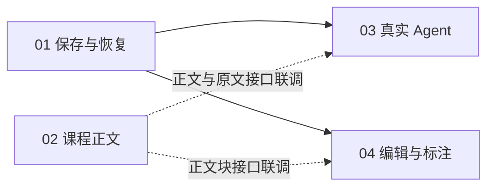

# 本地复习画板：四张实施票

2026-10-25。按 Robert 的最新要求合并为 **4 张主票**，相关工作保留在同一张票的验收项中；章节和单元不再拆出独立票。**01–04均已完成；2026-10-26通过20主题、84单元及真实Agent/编辑/保存/迁移联合验收。** 实时进展以各票Status为准，证据见[整课验收](../../../../legacy/review-board/验收/整课联合验收-2026-10-26.json)。

先读 [任务规范](../implementation/01-正式版任务规范.md)、[共享合同](../implementation/02-数据与行为合同.md) 和 [并行实施规则](../implementation/03-并行实施与验证.md)。[plan.json](plan.json) 保存四票依赖、60 条需求映射与 84 单元覆盖。

## 任务拆分

1. **[01 · 打通保存与恢复](issues/01-persistence-and-recovery.md)**

   **Blocked by:** None。沿用当前真实样本，实现阅读、记笔记、标记复习状态；关闭网页和本地服务再打开，恢复已保存内容和阅读位置。

   可与 #02 同时开始。#01 的基础保存验收通过后，#03 和 #04 可领取；不需要先等 #02 的 84 单元全部写完。

2. **[02 · 并行补齐课程正文](issues/02-course-content.md)**

   **Blocked by:** None。按章节扩充现有知识单元，补齐讲解、图示、例题和练习，让学生主要在画板内完成完整复习；持续遵守已确认的阅读规则。

   与 #01 并行开始资料准备、正文合同和迁入；正式应用读写及最终合流使用 #01。#03/#04 只需早期稳定的样本正文/引用接口，不等待本票所有章节完成。

3. **[03 · 接入真实 Agent](issues/03-real-agent.md)**

   **Blocked by:** #01。先实现选中内容后在侧栏向真实 Codex 提问，再接入内容修改、撤回和任务恢复；复用已有协议验证和统一课程读写边界。

   #01 基础读写通过后开始；与 #02/#04 并行，优先问答与样本修改。原文、完整正文和编辑器按合同陆续接入，最终组合验收再使用实际完整界面。

4. **[04 · 补齐编辑与标注](issues/04-editing-and-annotations.md)**

   **Blocked by:** #01。接入可视化公式编辑、文字与笔记编辑，以及直线、波浪线、荧光笔等已定功能；标注能随内容移动，保存、撤回和重开后保留。

   #01 基础读写通过后开始，与 #02/#03 并行；早期在当前样本和稳定正文合同上验证，后续接完整正文与实际 Agent 事件。

## 并行关系

实线是开工前置；虚线是工作中的接口交接，不要求 #02 全部 84 单元先完成。#01 与 #02 现在可并行；#01 基础读写通过后，#03 与 #04 可接入。正文线先迁入已有四个样本并交付读取合同，再按章节扩充；其他工作线可围绕样本先跑通真实行为。

## 交接与完成

每张票可由一位主负责人连续推进，也可按内部职责安排 subagents；不为这些分工新增独立票。先按实施规则领取所有权，公共接口和权威数据串行合入，不能各自搭一套存储、正文库或任务队列。

最终一起验收：完整课程阅读 → 笔记和状态 → 原文选段问答 → 真实修改与同时编辑 → 撤回保留个人内容 → 关闭重开 → 课程迁移。组合验收写回这四张票，不另开总验收票。

给另一位 agent 的提示：

> 实施本地复习画板第 NN 号票。先读取任务规范、共享合同和该票，核对前置并领取。沿用已经确认的产品规则，只改分配范围；通过真实本地服务和浏览器验证。相关工作在同票内完成，不再细拆票据，记录实际完成项、接口交接和未验证部分。

未配置外部 issue tracker。当前本地文件可直接跟踪实施；以后需要远端 issue 时再运行 /setup-matt-pocock-skills 配置目标，不猜仓库或标签。

