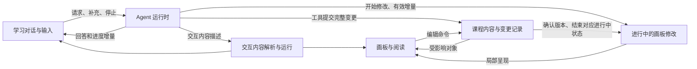
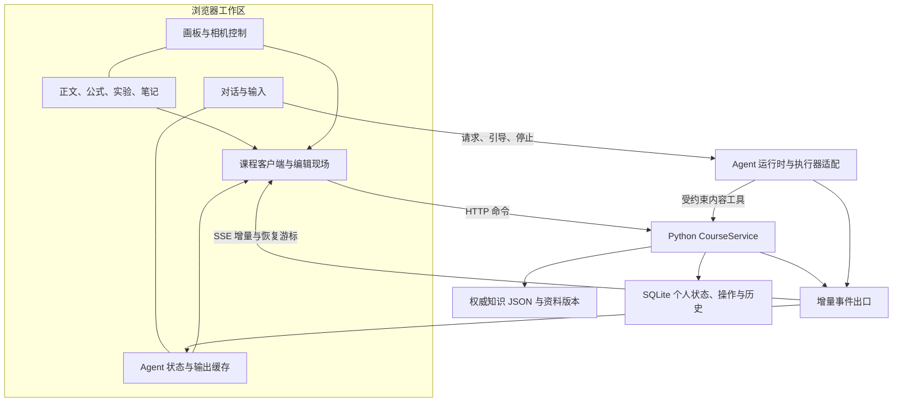

# 系统架构讨论

2026-10-27 开始。状态：讨论中；已进行独立样例验证，未替换正式应用。当前状态以[架构决策总览](../architecture/架构决策总览.md)为入口；本文保留逐轮研究与证据。已确认产品规则与候选实现分别标注，样例不等于整套架构已验收。

## 本轮目标

Robert 要求共同讨论确定系统架构，重点是画板性能、交互体验、显示效果，以及画板阅读、Agent 对话和修改等高频场景。现有实现用于提供事实，不自动作为必须延续的架构。

既定产品规则沿用根目录 `PRODUCT.md`、`CONTEXT.md` 和本目录《复习系统设计讨论》：每课一张持续扩展的画板，完整内容原位阅读，知识身份稳定，个人笔记保留，Agent 修改可撤回。视口规则按本轮反馈收敛为默认跟随修改、学生主动浏览立即接管；跟随不能覆盖学生操作。

## 已确认的问题与现场证据

- Robert 实际使用时经常遇到缩放、平移卡顿，并报告间歇性画面抽动和闪烁。这些是已报告的体验问题；具体原因尚须分别验证。
- 在 `http://127.0.0.1:8769/` 查看 KU-027 阅读状态，页面有 26,988 个 DOM 元素、1,070 个段落和 250 个 SVG；页面显示课程规模为 20 个主题、84 个单元。此计数说明当前挂载规模，不是帧率测试。
- 在本次浏览器窗口中，点击“主题总览”后显示 3%；再点击一次“放大”后显示 86%，由总览直接进入单元阅读。`复习画板/web/app.js` 的 `zoom()` 在总览越过阈值时调用 `focusUnit()`，主动改变目标与阅读尺度。这复现了一类缩放跳变，不代表已解释全部卡顿和闪烁。
- 既有 `复习画板/验收/audit-2026-10-27/results.json` 明确没有真实硬件 FPS、启动时间或负载基准。

## 当前实现中与体验相关的事实

| 路径 | 当前行为 | 架构讨论需要处理的边界 |
| --- | --- | --- |
| 阅读与画板显示 | HTML 正文与 SVG 图形；`renderBoard()` 挂载全部单元；离屏正文未卸载 | 全课数据的存在与当前需要渲染的内容应分别管理 |
| 平移与缩放 | 通过 rAF 调度相机变换；显示层级切换会重新布局，总览缩放还会触发定位 | 相机运动、显示深度和主动导航应有各自清楚的职责 |
| 正文修改 | `refreshContent()` 读取整课、重新构建画板，再恢复阅读状态 | 局部变更的更新范围，以及选区、焦点、展开状态与阅读锚点的延续 |
| Agent 回答 | 前端定时获取任务和对话，消息变化时替换消息区域；后端频繁保存完整对话 | 对话增量、持久化频率与画板更新应独立调度 |
| 内容提交 | 手动编辑与 Agent 共用课程提交机制，已有版本、幂等、冲突及恢复检查 | 优化显示与同步时保留已建立的内容保护语义 |

这些事实来自代码核查。除上述缩放跳变外，本轮尚未通过性能追踪把某一具体卡顿或闪烁归因到其中某条路径。

## 候选方向

优先划分三条可以独立更新的路径：

1. 手势与显示：相机连续运动；按可见区域与显示深度组织呈现；导航与跟随决定定位，学生手势始终优先，显示深度变化本身不触发跳转。
2. 内容与布局变更：用稳定知识身份定位局部变化，维护阅读锚点，局部内容变动不默认重建整板。
3. Agent 执行与保存：对话输出、任务进度、内容提交和恢复各有明确时机，不让回答增量牵动画板重建。

这是供讨论的职责划分，不预先决定前端框架、渲染引擎、进程拆分或存储替换。

## 第一轮已明确的方向

Robert 在本轮回复中明确：

1. **规模收敛到约 500 个完整知识单元。** 当前真实课程是基本验收样本，约 500 单元作为增长场景；无需为没有需求支撑的 1,000 单元目标过度设计。500 是容量规划目标，不是课程硬性上限；测试还需说明正文、公式、图片和交互内容的实际负载。
2. **鼠标与触控板均为高频输入。** 支持随时切换，无需用户手动选择设备模式；操作应自然、连续。设备事件如何映射到平移和缩放仍须根据平台能力与实际偏好明确。
3. **内部选型可以重新评估。** 当前实现主要用于试验验证，不要求延续现有渲染、编辑、同步或后端技术。保留课程内容、个人笔记、历史和已确认产品行为。
4. **允许生成新的交互学习内容，但生成必须受到引导。** 采用工具、skills 或其他明确机制指导 Agent，参考 OpenAI Intelligent UI、CopilotKit/OpenIntelligentUI、thesysdev/open-intelligent-ui。尚未决定直接采用哪个项目或哪种内容表示。
5. **流式输出和对话界面性能属于架构重点。** 需要同时考虑 Agent 输出、输入编辑、历史阅读、画板操作和内容修改，不能只验证最终回答或静止画面的显示效果。

## 参考核查：生成交互内容

核查日期为 2026-10-27。以下是参考项目公开资料与源码的当前情况，不等于本系统已经采用其技术。

| 参考 | 已核实的机制 | 对本产品的启发与限制 |
| --- | --- | --- |
| [OpenAI Intelligent UI](https://openai.com/index/gpt-6-for-everyone/#how-intelligent-ui-works) | 原生可流式组件库，配合在生成过程中处理界面的编译器；模型学习如何组合内容、布局与交互 | 参考可逐步呈现的受约束表达；公告没有公开可直接照搬的协议实现 |
| [Thesys Open Intelligent UI](https://github.com/thesysdev/open-intelligent-ui/blob/main/README.md) | OpenUI Lang 1.0 描述组件、状态、表达式和动作；开发者注册带 schema 的组件；流式生成并渲染；HtmlView 提供沙箱 HTML 扩展 | 常用交互可由可验证的积木组合。演示的浏览器 localStorage 保存方式不满足课程文件夹备份与迁移目标；解析器性能须单独测试 |
| [CopilotKit OpenIntelligentUI](https://github.com/CopilotKit/OpenIntelligentUI/blob/main/docs/architecture.md) | Agent 通过 skills 与工具生成有序 CSS、HTML 和 JS 字段，渐进预览后进入最终沙箱；宿主提供有限、校验过的回调 | 借鉴生成流程和受限的宿主连接。其后续回答是独立快照，没有通用跨轮原位修改旧界面的接口；任意内部控件状态也不会自动同步给 Agent |

候选做法是采用两层表达：常规内容使用受约束组件与动作，特殊交互使用有明确输入、输出、状态和生命周期的扩展。skills 指导何时采用交互、如何教学与呈现；工具和内容格式校验负责实际写入规则；运行时负责呈现、状态和资源管理。语法合法不代表课程知识正确，来源与语义验证继续走课程规则。

无论选择哪个参考库，稳定知识身份、画板坐标、来源版本、笔记锚点、撤销与课程迁移仍由本产品维护。交互实例应能保存与恢复状态、离屏暂停；使用 iframe 本身不能当作性能隔离已成立的证据。

## 参考核查：鼠标与触控板

[W3C Pointer Events](https://www.w3.org/TR/pointerevents3/#the-primary-pointer) 说明触控板与外接鼠标通常共享同一个鼠标指针，不能据 `pointerType` 可靠区分二者。[MDN deltaMode](https://developer.mozilla.org/en-US/docs/Web/API/WheelEvent/deltaMode) 只定义像素、行和页单位；[MDN ctrlKey](https://developer.mozilla.org/en-US/docs/Web/API/MouseEvent/ctrlKey) 说明触控板捏合也可能产生带 `ctrlKey` 的 wheel 事件。增量大小、精度和频率只能作为线索。

### 成熟产品的实际规则

2026-10-27 根据官方文档核查；以下是产品规则对照，尚未在各设备上逐项实测。

| 参考 | 平移、缩放与拖动 | 可借鉴的部分 |
| --- | --- | --- |
| [FigJam](https://help.figma.com/hc/en-us/articles/1500004414582-Pan-and-zoom-in-FigJam) | 默认滚轮上下平移，Shift 加滚轮横向平移，Mac 的 ⌘／Windows 的 Ctrl 加滚轮缩放；触控板双指平移、捏合缩放；手形工具按住拖动平移，Space 临时切换手形。设置中可改成滚轮缩放 | 鼠标与触控板可以共用平移优先的语义；按住拖动无需等待长按计时 |
| [Miro](https://help.miro.com/hc/en-us/articles/360017731053-Using-Miro-with-a-mouse-trackpad-or-touchscreen) | 默认自动切换设备；鼠标滚轮缩放、右键拖动平移，触控板双指平移、捏合缩放。官方建议鼠标与触控板混用时选 Trackpad 模式，此时滚轮平移、修饰键加滚轮缩放。选择工具下拖动可框选；触摸屏上长按再拖动用于选对象 | 自动识别与固定语义是不同选择；桌面的按住拖动与触摸屏的长按有不同含义 |
| [tldraw 相机](https://tldraw.dev/sdk-features/camera)与[输入选项](https://tldraw.dev/sdk-features/options) | 可配置滚轮平移或缩放；用户输入模式可以覆盖这一规则。拖动距离阈值与长按计时分别配置，默认鼠标拖动阈值为 4px，长按为 500ms | 用移动距离识别拖动，以时间识别长按；这些数值是参考产品默认值，不是本产品已定参数 |

成熟产品没有统一默认值。针对本产品频繁混用鼠标与触控板、阅读多于排版的用途，仍推荐 FigJam 式平移优先规则；依据是跨设备一致性与阅读场景，而非把任何一款产品的默认值当作唯一标准。无需手动选择设备模式；代价是鼠标缩放需要修饰键或缩放控件。具体平台快捷键、触控板惯性和 Safari 手势路径留到硬件验证。

### 本产品候选手势表

| 起点与操作 | 推荐行为 |
| --- | --- |
| 画板上滚轮／触控板双指滑动 | 平移；Shift 加滚轮横向平移 |
| 画板上捏合／Mac 的 ⌘ 或 Windows 的 Ctrl 加滚轮 | 以指针或捏合中心为锚点连续缩放；不自动跳到某个单元 |
| 默认阅读状态，在画板空白处按住主键后拖动 | 平移，超过小幅移动阈值即开始；不要求等待 500ms。触控板的点按拖移、三指拖移等沿用操作系统生成的拖动事件 |
| 正文内按住后拖动 | 选择文字；双击、编辑入口与公式编辑另按内容类型处理 |
| 交互实验的滑块、节点等控件上拖动 | 由该控件处理，拖出其边界也不在中途变成画板平移 |
| 对象被选中后，拖动其移动区域或控制柄 | 移动或调整对象；不以拖正文代替对象移动入口 |
| 选择工具激活时，在空白处拖动 | 框选对象；手形工具或 Space 临时切换后拖动仍用于平移 |
| 中键拖动／画板获焦且非文字输入时 Space 加主键拖动 | 临时平移；输入框内的空格保持输入用途 |
| 主键按住但未移动 | 不触发平移；右键单击保留上下文菜单，首版候选不增加桌面计时长按动作 |

这里的“按住拖动”包含通常口语所称的“长按拖动”，但不靠按住时长判断。真正等待一段时间再触发的长按应单独设计。Miro 的触摸屏长按框选仅作参考；当前电脑端范围无需因此新增触摸屏承诺。手势由起始目标与当前工具决定，并在同一次拖动中保持归属，避免正文选区、实验操作和画板相机互相抢事件。

## 候选架构：分别调度三类增量

以下是职责设计建议，尚未决定框架、存储格式或传输协议。

这表示可以独立更新的职责，不要求为每个框分别部署服务。生成中的交互显示与课程正式内容提交有各自状态；普通回答仍按既定规则留在对话，明确修改请求或“加入画板”才写课程。

| 高频场景 | 候选实现约束 | 可观察的验收行为 |
| --- | --- | --- |
| 回答持续输出 | 按消息和内容块接收增量，短时间片合并刷新；已稳定内容复用，只处理变化部分 | 文本持续出现，输入和画板手势保持响应；不因新 token 重建整个消息列表 |
| Markdown、公式与交互逐步出现 | 保留未完成尾部与完整块的不同状态；复杂节点完成必要校验再启用；为媒体与复杂块保留尺寸 | 不反复闪烁、跳高或把不完整代码作为可运行内容 |
| 阅读历史回答 | 只在用户跟随末尾时自动跟随；上翻后保留消息与内部位置锚点，选区和正在操作的交互不被卸载 | 新输出不抢滚动位置；需要时提供回到最新输出的入口 |
| 同时输入和切换对话 | 输入框、中文输入法组合过程、草稿与引用上下文独立于流式消息更新；草稿按对话保存 | 流式输出不打断输入、不误发送，切换后能接着原草稿继续 |
| Agent 修改画板 | 进行中的内容按有效增量原位呈现；按依赖一致的变更组自动保存；仅更新受影响对象；默认跟随且学生操作优先 | 学生看到实际内容逐步变化；公式与可执行实验在结构完整时更新或启用；选区、输入、展开状态和个人批注保留，手动接管后不被拉回 |
| 长对话与复杂画板并存 | 分别按可见范围挂载，保留当前焦点、选区和活动交互；复杂计算按实测移出主线程 | 负载主要随当前呈现内容增长，不随全部历史和全部单元一同重绘 |
| 停止、断线与重开 | 区分执行状态、显示增量与已保存提交；由应用维护事件序号/快照及恢复核对，不能假定执行器会重放全部 delta | 停止能及时反馈；重连不重复文字或重复写入；已有阅读持续可用 |
| 多个区域争抢滚动或拖动 | 明确当前交互目标：输入控件、可滚动内容、画板相机；手势开始后保持一致处理 | 对话滚动不带动画板，拖动交互滑块不变成平移，画板缩放不变成整页缩放 |

[Codex App Server 官方文档](https://learn.chatgpt.com/docs/app-server) 已提供消息 delta、任务生命周期、`turn/steer` 和 `turn/interrupt`；说明现有执行器具备候选能力，不代表当前应用已贯通这些交互。其他执行器须通过明确能力映射接入，不能把浏览器界面绑定到某一个模型事件格式。

## 实时修改与自动保存：已明确行为和候选实现

Robert 已明确要求能看到 Agent 修改画板的过程，且保存完全由系统自动完成，不让学生承担额外保存操作。本轮按所选推荐项，以原位更新、保护正在输入或选择的片段作为后续设计基线；完整部分持续自动保存，无需学生确认或采纳。

自动保存覆盖学生的正文、公式、笔记、标注、布局、复习状态、学习对话与输入草稿，也覆盖 Agent 的生成和修改。输入法仍在组合、公式尚不完整等临时内容可先自动保留为编辑草稿；成为完整有效内容后由系统自动更新正式内容。显示增量、草稿保留与正式保存可以有不同节奏，不能把它们变成学生需要逐项操作的流程。只有收到实际持久化结果才能认定已保存，失败时保留待保存内容并明确提示。

例如请求“补上这张电路图的解释”：目标区域出现轻量的“正在修改”状态，说明文字逐步出现，实际形成的元件、连线及标签分步更新；每组完整改动保存后结束对应的进行中状态，Agent 继续处理下一部分。状态提示、当前修改位置和已完成部分来自实际执行事件，不用模拟光标或假打字制造进度。

| 情况 | 候选处理 |
| --- | --- |
| 文本生成 | 可在“正在修改”的内容块中显示未完成的文本尾部；稳定的段落不随每个增量重新创建 |
| 公式、关系与电路图生成 | 到达可解析的公式或依赖完整的图形片段后再呈现；关联纠错按一致的变更组生效，避免正式内容暂时互相矛盾 |
| 交互实验生成 | 完整布局可先出现；状态、动作及代码满足运行条件后再启用，学生不操作半成品逻辑 |
| 正在改写已有内容 | 目标位置显示新内容，并标注正在修改；所依据的已保存版本仍可恢复。学生正在输入或保有选区的片段暂缓替换，其他部分继续更新 |
| 体积增长或对象移动 | 新内容保留合理占位，合并局部布局更新；保持当前阅读锚点，避免每个 token 推动周围对象。具体布局策略需以真实课文验证 |
| 修改发生在视野外 | 默认跟随到当前修改内容；学生主动平移、缩放或导航后立即让出视口，之后只提示进度并显示“返回并继续跟随”按钮，不因下一次输出重新接管 |
| 停止、失败或断线 | 保留已保存部分。断线时未完成部分的状态须核对，不能伪装成已保存；停止后正式内容保留最近已保存版本，未完成草稿与正式内容分别处理。撤回已保存修改仍是另一个操作 |
| 学生同时编辑 | 学生当前输入、已提交修改与个人笔记优先保留；Agent 获知最新版本后调整，同一对象的旧增量不能直接覆盖学生的新内容 |

由此产生的架构要求：Agent 通路需要传递开始修改、对象增量、保存确认与中断等事件，关联任务、稳定对象、依据版本及事件顺序。仅在工具整包结果返回后刷新一次无法满足全过程可见。显示增量与课程正式保存有各自节奏；事件与状态的具体实现仍待选型，不预设每个字都写入课程历史。断线后的显示与恢复须核对真实保存状态，不能把连接结束当作修改完成。

### 跟随修改的控制规则

| 事件 | 视口行为 |
| --- | --- |
| 学生主动发起画板生成或修改 | 默认跟随当前实际修改的对象；普通聊天回答不引发画板跟随 |
| 当前对象内继续生成 | 对象仍可读时保持相机；确需让新内容进入视野时才平移，不随每个增量重新适配整张对象或缩放 |
| 学生主动平移、缩放或通过目录／搜索导航 | 立即中断跟随，以学生位置与尺度为准，显示“返回并继续跟随”按钮；同次任务后续增量、松手、短暂无操作、切换到下一对象都不重新接管 |
| 学生在目标内容中输入、选择文字或操作实验 | 保持当前操作所需的视野和内容节点；不能用跟随把正在操作的内容移出视野 |
| 学生点击“返回并继续跟随”，或再次主动提出修改 | 定位当前实际修改的对象并恢复跟随；定位目标随执行进度更新，不固定为学生离开时的旧对象。新的工具步骤或后台排队任务开始本身不替代这一用户意图 |
| 修改结束或停止 | 保持结束时的视野，不额外跳转；已有结果时将返回入口改为“查看修改结果”，点击只定位结果 |

上述行为要求相机控制与内容更新分别管理。Agent 的增量只声明当前工作对象；是否移动视口由跟随状态、用户手势和可读范围共同决定。学生移动鼠标指针但未操作视口不算接管。自动跟随与原位更新也不取消对当前输入、选区和笔记的保护。

## 输入与修改规则的收敛记录

1. **输入手势——已有参考与完整候选**：参考 FigJam、Miro、tldraw 后，推荐上表的平移优先规则，补齐按住拖动、文本选择、控件操作与对象移动。具体技术选型不能自动覆盖这些产品行为。
2. **Agent 运行时发送新消息——已明确**：在设置中选择“引导／排队”，默认“引导”。引导消息可能补充当前工作，也可能提出独立事项，由 Agent 根据消息理解和响应；聊天输入区不另外增加“下一轮处理”入口。该设置决定消息何时交给 Agent，不决定消息语义，也不替代课程内容提交的一致性规则。
3. **新生成交互的手工编辑深度——本轮设计基线**：按本轮所选推荐项，首版把复杂实验作为完整学习内容，学生调整参数和声明可编辑字段，内部逻辑与结构交由 Agent 修改；普通正文、公式和基础图形继续可直接编辑。
4. **阅读目标正在被修改时的显示——本轮设计基线**：目标原位显示增量并保持局部阅读锚点；学生正在输入或选择的片段暂缓替换。默认跟随与学生接管按上表管理。
5. **保存与跟随——已明确**：自动保存是系统职责；默认跟随修改，学生主动移动后以学生操作为准。
6. **恢复跟随与底层许可——已明确**：手动浏览后提供“返回并继续跟随”按钮；底层库与 SDK 必须宽松开源且无需额外生产运行授权。

接下来比较具体渲染方案、内容与布局模型、Agent 通路、持久化和迁移。只有实际达成共识且存在长期取舍的选择才进入 ADR；领域术语明确后同步 `CONTEXT.md`。

## 第三轮已明确要求

- 画板在 Agent 修改过程中实时呈现变化，让学生跟进修改过程；具体候选见上文。
- 输入手势参考成熟产品实际行为，补齐按住拖动、长按拖动、文字选择、对象移动的区别；核查结果与推荐表见上文。
- 运行中发送新消息在设置中选择“引导／排队”，默认“引导”；引导消息的语义与响应由 Agent 判断，输入区不另设“下一轮处理”入口。
- 复杂实验整体对象方案随后在第四轮作为设计基线继续细化。

## 第四轮收敛

- Robert 明确自动保存应实时、自动完成，保存不应成为学生的额外操作门槛。
- Robert 将跟随规则改为默认自动跟随；学生主动移动视野时，以学生操作为准。
- 本轮选中了原位更新并保护输入／选区、复杂实验整体对象两项推荐，后续按这两项作为设计基线推进。

## 第五轮收敛

- Robert 明确要求提供返回并继续跟随修改的按钮，让学生自行决定何时返回；任务结束后入口用于查看结果。
- Robert 明确底层依赖必须宽松开源、无需额外运行授权。这是硬约束，当前 tldraw SDK 排除出采用候选，其交互与扩展设计仍可作为参考。
- Robert 进一步明确仍应阅读 tldraw 的代码与实现原理，帮助本产品设计。依赖采用与源码研究分别处理；研究结论用于独立设计，实际引入的库继续满足许可硬约束。

## 画板底座与内容呈现：候选核查

2026-10-27 核查官方文档和官方仓库。以下记录初始接口能力与许可比较；随后开展的独立负载验证见下文，接口核查本身不作为性能证明。

| 方案 | 与本产品的适配判断 | 主要代价或待验证点 |
| --- | --- | --- |
| React Flow ＋自定义 DOM 学习内容（当前优先验证候选） | [核心库为 MIT](https://github.com/xyflow/xyflow/blob/main/LICENSE)，所需基础 API 不依赖生产授权密钥；[自定义节点](https://reactflow.dev/learn/customization/custom-nodes)可承载 React 表单、图表等交互内容，适合由本产品提供完整正文、公式与实验 | 需补齐课程编辑状态、跟随控制及标注；[官方白板说明](https://reactflow.dev/learn/advanced-use/whiteboard)表明它提供可扩展基础，完整标注工具并非开箱即用。所需能力使用核心 API 与自有实现，不依赖 Pro 示例 |
| tldraw SDK ＋自定义学习内容（因许可约束排除） | [自定义形状](https://tldraw.dev/sdk-features/shapes)提供 React 内容、HTML／SVG 容器、命中几何、编辑与交互钩子，适合承载知识单元及实验；[相机](https://tldraw.dev/sdk-features/camera)提供手势、定位和可被用户操作中断的动画。接口适配较强是本轮判断 | [离屏裁剪](https://tldraw.dev/sdk-features/culling)默认保留 DOM 并设置 `display:none`，不能据此认定内容已卸载或实验已暂停；生产许可不符合第五轮明确的硬约束，仅保留为参考 |
| Excalidraw 嵌入 ＋富内容扩展 | [公开 Props](https://docs.excalidraw.com/docs/@excalidraw/excalidraw/api/props/)有 `renderEmbeddable`、`customData`、`onChange`，[场景 API](https://docs.excalidraw.com/docs/@excalidraw/excalidraw/api/props/excalidraw-api)可更新场景、控制历史捕获和定位；可复用其现成画板体验 | 已确认富内容嵌入入口，但所查公开 API 未见与 tldraw `ShapeUtil` 对等的任意类型、命中几何及生命周期注册能力；这不等于无法扩展或必然需要 fork。离屏嵌入内容的挂载与状态行为尚未核实 |
| 自行组合 DOM 富内容与 SVG／Canvas 图形层 | 可围绕课程阅读、长正文、局部展开与实时修改直接设计，保留文本选择与原生控件。这是架构推断，不是性能结果 | 需自行承担相机、手势归属、空间索引、选择、标注、对象关系和历史适配；当前原型的体验问题不能靠换一层渲染技术自动解决 |

[tldraw 许可文档](https://tldraw.dev/community/license)明确默认许可仅用于开发，生产需要有效的 trial、commercial 或经批准的 hobby license；hobby 使用须显示水印，生产密钥可离线验证。它是 source available，并非宽松开源。[Excalidraw 官方许可](https://github.com/excalidraw/excalidraw/blob/master/LICENSE)为 MIT。此处记录直接影响依赖选择的已知条件，尚未申请许可或购买服务。

按第五轮明确的硬约束，当前 tldraw SDK 不进入采用候选。候选底座与所需扩展功能均须满足宽松开源、无需额外运行授权；可选商业支持不等于运行依赖，不能把必需能力寄托在另行授权的组件上。任何方案都须用完整学习内容证明性能，不能用几百个简单矩形代替。

### 推荐候选：React Flow 空间底座与学习内容分工

推荐理由是本产品的主要负载为完整正文、公式、图示与实验，空间对象和关系线服务这些内容。React Flow 的自定义 React 节点可承载真实 DOM，提供已有的对象与视口操作；本产品继续控制内容、学习语义和保存。相较之下，Excalidraw 可复用更多现成画板工具，但本轮证据下，完整富内容与内部状态的扩展入口不如 React Flow 直接。这是适配判断，尚未作为已通过性能验证的技术决定。

| 部分 | 候选做法与边界 |
| --- | --- |
| 空间对象 | 主题、知识单元和关系投影为节点与边，位置来自独立布局；节点引用稳定课程身份。React Flow 的导出结果不替代权威知识、个人内容或课程历史 |
| 正文与交互 | 自定义 DOM 内容呈现完整单元，保留文本选择、可视化公式编辑与实验控件；按既有稳定正文块 ID 更新。草稿、实验输入与展开状态存于组件之外，重新挂载后可恢复 |
| 输入归属 | 使用 [nodrag／nopan／nowheel](https://reactflow.dev/learn/customization/utility-classes)及对象拖动区域划分编辑、控件与画板操作；这些 API 提供机制，中文输入法、选文与手势共存仍须实测 |
| 标注 | 通过自定义 SVG 对象或共享相机坐标的标注层提供直线、波浪线、高亮、基础形状和个人箭头。文本高亮保存片段锚点，不能仅保存屏幕坐标；知识关系与个人标注继续分开 |
| 显示范围与资源 | [onlyRenderVisibleElements](https://reactflow.dev/api-reference/react-flow#viewport-props)可按视口筛选节点和边，但有额外计算开销，也不提供编辑器状态保留保证。候选策略为保留稳定对象壳体、按显示深度挂载重内容、保护当前输入与选区、暂停离屏实验；由实测决定是否启用库级筛选 |
| 相机与跟随 | 应用统一管理跟随／学生接管／返回恢复。库的 [视口方法](https://reactflow.dev/api-reference/types/react-flow-instance)可定位和更新视野，但公开接口未明确提供独立动画取消方法；需要验证中断正在执行的动画，不能只停止发出新跟随请求。库中聚焦等自动平移也须遵循同一控制权规则 |
| 自动保存与局部更新 | 通过已有课程命令与版本合同自动写入，再向受影响对象发布更新；输入增量、显示更新、正式保存及撤回分组各有节奏。当前单人本地使用不因选用节点库而新增多人同步系统 |

由此需要验证的不是“能否画出节点”，而是完整阅读与编辑操作能否在空间移动和 Agent 流式修改中保持连续。优先检查：中文输入／公式光标／选文不受对象操作破坏；学生手势真正中断跟随；正文增长后连接线与片段标注不偏移；约 500 个完整单元下的帧时间、输入响应、内存和离屏实验负载。

### tldraw 源码参考：可迁移的实现原则

按 Robert 要求阅读实际源码，固定于 [`7b7e23946c3d3f28391cf568edc07d2bb0d7c3d3`](https://github.com/tldraw/tldraw/commit/7b7e23946c3d3f28391cf568edc07d2bb0d7c3d3)。下表区分已读实现与面向本产品的设计判断；本轮研究不引入 tldraw SDK 依赖。

| 已读源码中的机制 | 对本产品的设计启发 |
| --- | --- |
| [DefaultCanvas 的层变换](https://github.com/tldraw/tldraw/blob/7b7e23946c3d3f28391cf568edc07d2bb0d7c3d3/packages/editor/src/lib/components/default-components/DefaultCanvas.tsx#L97)直接更新 HTML 层变换；[Shape](https://github.com/tldraw/tldraw/blob/7b7e23946c3d3f28391cf568edc07d2bb0d7c3d3/packages/editor/src/lib/components/Shape.tsx#L66)比较几何与样式再写入；`InnerShape` 单独缓存内容渲染，内容比较关注 `props` 与 `meta` | 相机移动、对象位置改变、正文变化应触发不同的最小更新范围。移动时优先更新外层变换，内容节点复用；Agent 改一段正文时只更新对应内容块 |
| [ContentElementSlot](https://github.com/tldraw/tldraw/blob/7b7e23946c3d3f28391cf568edc07d2bb0d7c3d3/packages/editor/src/lib/components/Shape.tsx#L176)为应用持有的 DOM 提供稳定挂载与释放生命周期，要求复用元素并在销毁前交还；源码明确以稳定身份保护嵌入状态 | 编辑器、选区和实验实例的生命周期应独立于排序与位置变化。稳定 ID 之外，还需验证实际 DOM 是否被重建或迁移；移出视野的编辑现场与实验状态由应用明确保留，不能只依赖 React key |
| [CullingController](https://github.com/tldraw/tldraw/blob/7b7e23946c3d3f28391cf568edc07d2bb0d7c3d3/packages/editor/src/lib/components/default-components/DefaultCanvas.tsx#L243)集中订阅裁剪集合；[updateCulling](https://github.com/tldraw/tldraw/blob/7b7e23946c3d3f28391cf568edc07d2bb0d7c3d3/packages/editor/src/lib/hooks/useShapeCulling.tsx#L63)遍历注册容器，只对可见性改变的对象写 `display` | 集中管理可见性，避免每个单元都订阅所有相机变化。源码减少了订阅和样式写入，但仍遍历容器，并非整体 O(1)；隐藏 DOM 不会自动卸载重内容或停止实验计算，本产品要另外管理这些资源 |
| [stopCameraAnimation](https://github.com/tldraw/tldraw/blob/7b7e23946c3d3f28391cf568edc07d2bb0d7c3d3/packages/editor/src/lib/editor/Editor.ts#L3970)触发取消并移除动画帧监听；[stopFollowingUser](https://github.com/tldraw/tldraw/blob/7b7e23946c3d3f28391cf568edc07d2bb0d7c3d3/packages/editor/src/lib/editor/Editor.ts#L4678)另外退出持续跟随并清理订阅。该跟随原本面向协作者视口 | 中断当前动画与撤销持续跟随权限分别处理。学生接管时同时取消在途动画、清除待执行跟随定位，并让旧回调失效；“返回并继续跟随”或新修改意图才恢复控制权。应用跟随的是 Agent 工作对象，不需要引入多人协作模型 |
| [事件已处理标记](https://github.com/tldraw/tldraw/blob/7b7e23946c3d3f28391cf568edc07d2bb0d7c3d3/packages/editor/src/lib/editor/Editor.ts#L10913)统一 React 事件与原生事件身份；[画板指针入口](https://github.com/tldraw/tldraw/blob/7b7e23946c3d3f28391cf568edc07d2bb0d7c3d3/packages/editor/src/lib/hooks/useCanvasEvents.ts#L26)在捕获指针前检查归属；[滚轮入口](https://github.com/tldraw/tldraw/blob/7b7e23946c3d3f28391cf568edc07d2bb0d7c3d3/packages/editor/src/lib/hooks/useGestureEvents.ts#L67)先让位于符合条件的内部滚动内容 | 在一次交互开始时明确由文字、公式、实验控件、对象移动还是画板导航处理；控件接收的拖动不再被画板重复处理。选择文字或操作实验时冻结跟随移动；只有实际导航意图才进入持续手动接管 |
| [键盘处理](https://github.com/tldraw/tldraw/blob/7b7e23946c3d3f28391cf568edc07d2bb0d7c3d3/packages/editor/src/lib/hooks/useDocumentEvents.ts#L103)按应用焦点与活动元素筛选快捷键，同时保留特殊按键分支。本次已读文件未发现统一的 `isComposing` 检查 | 不能把成熟产品的焦点判断当作中文输入兼容证明。我们的输入会话需显式保护 composition、公式光标、选文和实验操作；期间相关按键交给当前输入控件，并纳入实际验证 |

基于这些证据，候选架构中需要明确三种状态：课程内容与已保存版本、当前编辑／实验现场、相机控制权。它们分别更新，稳定身份负责关联。这样才能让 Agent 持续输出、内容自动保存和学生手动浏览同时进行，而不靠反复重建界面来同步。

### 无论底座如何选择，都需要的职责边界

| 职责 | 本产品负责的内容 |
| --- | --- |
| 画板视口与空间操作 | 相机、手势、可见区域、对象选择与移动；默认跟随、学生接管由统一控制规则管理 |
| 学习内容呈现与编辑 | 正文、公式、图示、笔记与实验按内容类型呈现；稳定对象与内部片段身份用于定位、引用及局部更新；可编辑正文保留真实文本与输入控件 |
| 交互实验运行 | 组件与参数合同、内部状态保存、开始／暂停／恢复；离屏停止不必要计算，不能只隐藏画面 |
| 课程内容与自动保存 | 学生和 Agent 的修改走同一内容边界，核对依据版本、保护个人内容、记录可撤回变更并自动持久化；引擎场景不另立一份课程权威正文 |
| 对话与 Agent 执行 | 按消息和内容块呈现增量，管理引导／排队、真实修改进度和恢复；输出更新不重建整板或整段历史 |

验证优先覆盖三个组合场景：500 个完整单元与持续生成并存；选文、中文输入、公式编辑和实验拖动与画板手势并存；学生接管后持续生成、局部自动保存、离屏往返与重开恢复。独立样例覆盖情况与仍未覆盖部分见下文；不能以简单矩形或静态截图代替完整负载。

## 第六轮：后端核查与整套架构建议

Robert 要求继续下一步后，本轮开展隔离的技术验证和后端现状核查，未修改正式应用。前端候选为 TypeScript／React＋React Flow＋独立学习内容运行层。Python、知识 JSON、SQLite 是当前实现及比较基线，HTTP 命令＋SSE 是同步候选；后端尚未完成方案比较，不能据本轮核查定案。

### 渲染验证给出的依据

[独立样例](../../experiments/architecture-spike/README.md)复用完整的 84 单元正文，复制成 500 单元合成负载；[验证记录](../../experiments/architecture-spike/验证记录.md)和[原始数据](../../experiments/architecture-spike/results.json)保留方法与边界。最终资源完整版本在 Apple M5、Chrome headless 下得到：

| 500 单元合成负载 | 全量挂载正文 | 保留壳体、按需挂载正文 |
| --- | ---: | ---: |
| 首屏就绪 | 1,675.8ms | 163.5ms |
| 首屏 DOM 元素，不含 Shadow DOM | 137,431 | 6,157 |
| 阅读＋模拟修改 rAF P95 | 16.7ms | 16.7ms |
| 概览＋模拟修改最大 rAF 间隔 | 250.1ms | 33.3ms |

这支持把相机、内容生命周期和局部更新分开管理。两种方案在常规阅读移动时都较平稳；收益集中在启动和缩远长帧，不证明只是换框架就能修复当前所有卡顿。测量每种场景一次，500 个单元不是独立真实内容，自动化浏览器也不替代物理输入设备验收。

27 项资源、页面与交互检查通过，覆盖跟随动画中断、后续输出不抢回、返回最新工作对象、选文保护、草稿与公式光标、离屏状态恢复和移动后定位；额外 20 次交替启动检查通过。中文输入采用已填入文字和合成 composition 事件；真实输入法、复杂拖动实验、局部让位、长聊天、正式持久化与真实 Agent 尚未获得此样例证明。早期缺原页图片的测量不采用；一次就绪超时在资源完整版本中未复现，记录保留这一限制。

### 后端哪些值得保留，哪些需要调整

[HTTP 入口](../../legacy/review-board/reviewboard/http.py)、[CourseService](../../legacy/review-board/reviewboard/service.py)、[AgentRuntime](../../legacy/review-board/reviewboard/agent_runtime.py)、[SQLite 存储](../../legacy/review-board/reviewboard/storage.py)、[内容协调器](../../legacy/review-board/reviewboard/content_commands.py)与[接口合同](../../legacy/review-board/接口.md)共同支持以下判断：

- 课程读取、学生编辑和 Agent 修改已有统一入口；知识 JSON、稳定 ID、来源版本、个人 SQLite 状态和跨存储 journal 已形成恢复链。未发现必须立即更换 Python 或把知识全部迁入数据库的事实。
- 当前 `/events?after=` 返回排序后的 JSON 批次，默认至多 200 条，带 `hasMore`，不是 SSE。它提供可复用的已保存事件游标；增量传输不需要改变课程权威来源。
- Agent 的回答 delta 约每 150ms 触发一次整份 conversation 保存，`_put()` 还读取全量状态；知识提交也包含整份 JSON 校验与 checkpoint。这些是明确的重复工作，但尚未通过后端基准证明其各自耗时占比。
- Agent 直接访问存储私有事务和操作表，内容协调器也调用私有事务方法。应补齐提交回执、操作查询、任务输出追加等公开接口，减少跨层了解表结构；当前存储并非已经可无成本替换。
- 现有 `steer` 主要用于把学生已修改内容通知执行器；不能据此声称产品要求的通用“引导／排队”设置已经贯通。

### 模块分工

这些是一个本地应用内的职责边界，不要求拆成多个部署服务。

| 部分 | 建议负责 | 明确不由它代替的内容 |
| --- | --- | --- |
| 画板与相机 | 空间坐标、关系线、对象操作、显示范围、跟随控制权；集中接收真实用户导航并取消在途与未来跟随 | 不存另一套正文；显示深度不决定知识是否存在，也不暗中发起导航 |
| 学习内容运行层 | 稳定块 ID 对应的正文／公式／图示；输入现场、片段选区、实验状态及生命周期；按可见范围挂载重内容 | 不能把 React 组件、DOM 或引擎场景直接当作可迁移课程格式 |
| 课程客户端 | 按对象缓存已确认版本、编辑草稿和进行中的 Agent 修改；发出可重试命令、应用局部回执、保持阅读锚点 | 页面上已经显示不等于服务端已保存；课程服务继续决定正式提交结果 |
| 对话与 Agent 客户端 | 按消息／内容块消费增量，保留稳定历史节点；输入草稿、历史阅读、引导／排队和任务状态独立更新 | 新回答不能重建整段历史或连带刷新整板 |
| CourseService | 统一读取、校验、版本比较、保存、撤回与恢复；学生和 Agent 使用相同的内容边界 | 不让各个渲染插件直接写知识文件或个人数据库 |
| Agent 运行时 | 请求上下文、执行器能力映射、消息递送、真实工具修改事件与停止恢复；按小段追加输出 | 不把模型厂商事件名散入每个 UI 组件；导航选择变化不悄悄改任务目标 |
| 事件出口与存储接口 | 按序投递、断线续读、心跳和慢消费者处理；公开提交回执及操作查询 | SSE 本身不提供持久化、去重或崩溃恢复；这些继续来自操作账本和恢复协议 |

### 内容、现场与布局的关系

知识主题、单元、正文块和语义关系仍按既有稳定身份组织。React Flow 节点引用这些身份和独立布局，完整正文由学习内容运行层呈现。学生输入、公式光标、选区和实验运行现场存于组件生命周期之外；离屏卸载前保留状态，正在操作的实例不卸载，返回后恢复。长期保存只记录可序列化的内容和参数，不把组件实例写入课程。

普通正文、公式和基础图形继续可直接编辑；复杂实验按已确认规则作为整体对象。常用交互使用带版本的组件描述、输入参数和可保存状态；特殊扩展附带必要资源和明确的宿主接口。Agent 可以修改内部逻辑，工具校验结构，运行层管理启用、暂停、恢复。是否采用某个现成生成 UI 语言仍取决于实际扩展需要，当前不必让整个画板依赖一套新 DSL。

布局继续遵守已确认规则：按理解顺序组织，导航不重排；展开或增补只在附近让位，保持当前阅读位置，收起可恢复紧凑。后续已补[动态布局验证](../../experiments/architecture-spike/动态布局验证.md)：固定宽度、向下让位的 26 项组合检查通过，并测量持续增长伴随相机移动的负载。任意布局、关系线绕行和持久片段锚点仍未由此证明。

### 两类实际更新如何穿过系统

1. **学生输入**：输入现场立即更新，系统自动保留草稿；内容有效时生成带对象身份和依据版本的命令。CourseService 保存成功后回传回执，客户端只更新受影响对象。组合输入和未完成公式可以继续作为草稿存在，不要求学生点击保存。
2. **Agent 修改**：运行时报告实际正在处理的对象；收到有效修改片段后局部呈现，完整且相互一致的部分自动提交。被学生选中或正在编辑的片段暂缓视觉替换，其他部分继续；旧版本不能覆盖学生新修改。相机只收到“工作目标变化”，由独立控制规则决定是否跟随。

当前执行器以完整工具调用交付修改参数，不能凭现有工具返回就承诺逐 token 的画板修改。建议工具支持开始编辑、追加／替换有效片段、完成变更组的连续小步操作；只有执行器确实提供可用的参数增量时才进一步细化粒度。显示的进度来自这些真实事件，不模拟 Agent 光标；独立样例的模拟输出也不作为执行器已经贯通的证据。

### 同步与自动保存

- 命令保留 `operationId`、依据 revision／hash、generation 和提交回执，按操作身份和序号合并，不能重复应用。HTTP 是现有实现；新桌面候选优先使用宿主 IPC，是否增加 HTTP 入口由产品形态决定。
- 持续订阅从确认的游标继续；发现代际变化、缺口或无法重放时取得权威状态再对齐。慢消费者不能阻塞课程提交，队列积压时改走恢复读取。SSE 仅是外部浏览器入口的候选，不能代替这些合同。
- 回答按内容小段追加，避免每个 delta 复制整段历史；界面可按帧合并更新。保存游标只在实际落盘后推进，未确认尾部保留待保存状态。完整知识变更按一致的变更组进入历史，不为每个 token 建一次课程撤销记录。
- 断线、停止与任务完成分别表示。已保存 operation 核对与不静默重跑是持续要求；现有跨 JSON／SQLite journal 只是实现事实，未来是否需要跨文件提交协议取决于存储选择。更换传输不会自动完成恢复。

### 实施顺序建议

早期曾建议用现有课程 API 作为集成验证入口。重新从完整产品设计后，应先确定课程核心的命令、提交与恢复合同，再选择最小适配器接通候选前端；现有服务可以作为对照，但不强制复用。正文、学生编辑与保存重开贯通后，再检查真实 Agent 小步修改、停止、长历史、断线与课程迁移。具体顺序和依赖统一见[架构决策总览](../architecture/架构决策总览.md)。

## 第七轮：内容模型、布局与更新时序

进一步核查发现，现有块树、笔记引用与停止门禁可复用，但普通块拆合、高亮随文字换行、跨对象读取依据和进行中的学生输入还不能只靠稳定 ID 或 `steer` 通知保证。

详细方案见[内容演进与实时修改协议](../architecture/内容演进与实时修改协议.md)：明确块结构对应与批注定位、布局基线和临时阅读投影、工作草稿与正式提交、编辑事件及六个并发／恢复场景。推荐采用块级内容校验加本组读取依据，保留现有统一提交与日志，不把浏览器场景当课程权威数据。

Robert 随后接受两项推荐：手动位置参与临时让位，收起按最新手动基线恢复；实验默认离屏暂停，确需持续运行时再明确开启。交互示意用于说明行为，不是实际课程布局算法或性能验收。

## 讨论完成度与后端研究范围

Robert 指出后端与数据库尚未得到同等深度讨论，这一判断成立。前面的源码核查确认了现有提交、停止与恢复机制，并不证明现有语言、数据组织或传输方式优于其他方案。前端独立负载数据也不能支持后端选型结论。

| 范围 | 当前状态 |
| --- | --- |
| 画板阅读、编辑、跟随、局部让位与实验默认行为 | 本轮产品规则已收敛 |
| React Flow 与内容生命周期 | 固定、动态和 macOS 隔离宿主已有验证；物理输入与真实后端闭环仍需验证 |
| 内容演进与更新协议 | 可审查草案，需与后端设计共同校准 |
| 后端、存储与运行部署 | 已补运行形态、完整生产流程比较，以及搜索、SQLite 事务和 macOS 宿主实验；候选尚未正式定案，详见总览 |

后端研究按问题依赖推进：

1. **运行与交付边界**：支持的电脑环境、启动和升级、应用与课程文件夹的关系、服务／Agent／实验计算的进程边界。
2. **权威存储组织**：比较 JSON＋SQLite、SQLite 统一权威内容并导出开放格式、其他确有必要的方案；考察完整生产流程的事务、来源、修订和恢复边界。已明确接口／开放交换足够，不以旧格式兼容成本决定长期架构。
3. **自动保存、历史与恢复**：草稿／正文／对话的写入模型，撤销与快照／日志取舍，跨文件一致性、异常退出和备份恢复；以实际混合负载与故障验证比较。
4. **执行与传输**：持久阶段任务、停止与引导、模型适配、慢消费者；先定义合同，再按宿主比较 IPC 或 HTTP／SSE／WebSocket，不先锁死协议。
5. **查询与资料**：搜索索引、全文检索、来源版本与大文件生命周期；检验读取延迟、历史增长和重建成本。
6. **语言与框架选型**：结合上述边界、已有知识模块和交付成本比较 Python 与 TypeScript／Node 等候选；不以现有实现或语言偏好代替证据。

当前单人、本地、课程可迁移和宽松许可等约束继续有效。后续研究不默认扩大到多人协作或云服务。选型结论形成前，不新增声称后端已定案的 ADR，也不以讨论收口代替实际验收。

## 平台阶段与桌面推荐依据的后续确认

Robert 明确没有必须通过浏览器或无法安装应用的场景，同时追问独立桌面推荐的理由；这不是接受桌面或 Electron 的决定。后续说明应比较完整课程使用路径中的入口、文件和任务管理，区分桌面形态、Web 呈现技术与具体宿主框架，并列出安装、更新和资源成本，不能以性能未经验证的优势作理由。推导与比较已补到[产品形态与运行架构比较](../research/architecture/产品形态与运行架构比较.md)。

平台顺序已确认：当前初期先在 macOS 实施与打磨；Windows 是后续发布推广前必做平台，现在纳入依赖、课程可移植格式和平台边界设计，适配、打包与实机验收后做。此决定不要求当前并行开发两端，也不允许核心能力长期绑定 macOS 专属条件。

说明取舍后，Robert 明确同意独立桌面并要求继续研究推进，已记录[ADR-0001](../adr/0001-independent-desktop-delivery.md)。这次确认仅收敛交付形态；Electron／Tauri、存储、语言和物理进程组织仍分开研究。当前转向 macOS 宿主的实际内容与任务生命周期实验，以及课程提交的并发／停止／故障恢复实验。

## 历史研究、简约原则与恢复默认范围

上述两类隔离实验已完成有界验证，当前结果统一列在[架构决策总览](../architecture/架构决策总览.md)，不能视为真实课程／Agent 已连通。Robert 随后选择“正式修改历史＋可恢复草稿”，要求深入研究成熟产品，提供 Notion 历史界面截图，并强调真实收益、性能、存储和系统复杂度，特别区分 ⌘/Control+Z。

[历史管理与恢复设计](../architecture/历史管理与恢复设计.md)据 Notion、Figma、Obsidian 和 VS Code 的官方资料提出最小方案：当前数据、一套正式变更记录与最新草稿，按需生成历史列表和旧版预览；即时撤销、撤回指定修改、旧版恢复各守范围，不先建设分支、逐键永久回放或复杂快照／压缩体系。内部数据结构与快捷键细节仍是候选，不由第三方产品直接决定。

Robert 已确认单元旧版恢复的默认范围：只恢复课程内容，保留当前布局、个人笔记与掌握状态；布局可另选，整课恢复独立。此规则已同步 PRODUCT。历史合并间隔、长期保留和优化应由真实使用及增长测量决定，不把尚未发生的空间压力变成预先建设整套管理系统的理由。

随后已补[历史语义与成本实验](../../experiments/history-spike/README.md)与[实际键盘撤销实验](../../experiments/undo-input-spike/README.md)：数据侧支持同一套记录表达逆操作与单元恢复，对象粒度减少重复历史；键盘侧确认现有编辑器短期 Undo 有效，也确认画板移动 Undo 尚不存在。两条证据尚未连成正式课程闭环，接下来应处理真实的路由与保存连接，不重复已有基准或增加完整版本控制平台。

## 第一性原理与轻量化的重新推导

在提出 Electron＋TypeScript／Node 及每课 SQLite 的组合后，Robert 要求说明依据、判断是否契合真实场景，并在尽量保证效果和性能的同时轻量化；对存储明确要求从第一性原理设计研究。这不是接受两项选型。

[第一性原理与轻量化架构](../research/architecture/第一性原理与轻量化架构.md)重新从实际学习负载、原子修改、窗口与任务寿命推导最低必要能力；[官方机制核查](../research/topics/轻量化架构机制核查.md)分别核对 Worker／utility、同步 SQLite、系统 WebView 及按需加载。关键修正是：关窗继续不要求独立课程核心进程，固定 Chromium 也不是保证复杂编辑效果的唯一途径。SQLite 的推荐仍较强，依据是小范围一致提交可减少自建恢复机制；同样不以局部实验称其为无条件最优。

研究补充同页面宿主资源和同 Node SQLite 负载承载方式的有界测量，并保留条件失败的记录。它们用于解释和调整建议，不作为正式课程、中文 IME、真实 Agent 或 Windows 的验收。当前实现、平台顺序、离线阅读、自动保存及已经确认的历史范围均不因候选比较改变。

两组补测已完成：同页面三对有效测量中，Electron 动态 footprint 约 610–615 MiB、WK 391–398 MiB，rAF 间隔 P99 分别约 18ms 和 91–92ms；这是内存与回调节奏的实际取舍，不是呈现帧或不可修复性结论。真实 Electron Node SQLite 的 18 场景、4,320 次保存全部通过，Worker 比 utility 少约 11 MiB footprint，短事务定时器接近空载噪声。推荐据此修正为 Electron＋一个宿主拥有的 TS／Node 核心 Worker＋每课 SQLite 与必要资源；重解析和确需原生故障隔离的工具按需另起进程。结果及局限汇总在第一性原理文档，原始记录和最终清理留在两实验目录；没有把推荐写成已接受的选型。

## Electron 宿主决定与轻量化约束

在上述研究与取舍说明后，Robert 明确回复“接受，那就用electron”。宿主决定已记录为 [ADR-0002](../adr/0002-electron-desktop-host.md)，当前入口与 PRODUCT.md 同步为 Electron 独立桌面；核心语言／承载、SQLite 和正式编辑器继续按各自依据确定。

Robert 同时对四项轻量化建议要求“记得记下来”：正文按阅读范围读取且保持完整离线内容；阅读采用静态正文和公式、编辑实例按需创建、PDF 按页与有界缓存；流式局部更新、历史记录实际修改、最新草稿恢复；一个应用管理多课、工具按需启动，避免每课复制运行时或常驻服务。这些要求已进入 [PRODUCT.md 的资源与轻量化约束](../../PRODUCT.md#资源与轻量化)，作为后续实现依据，并保留活动输入、选区、保存和恢复边界。此轮记录决定，没有把原型数据当成正式实现已完成的证明。

## Electron 确定后的讨论：课程核心与权威存储

Robert 要求继续讨论。宿主与轻量化约束已有决定，本轮收敛两个可独立判断的技术选择；不重新询问离线阅读、关窗任务继续或历史范围，也不以新的重复基准替代选择。以下仍为待讨论方案。

**课程核心推荐 TypeScript／Node，由 Electron 宿主拥有的一个 Worker 承载。** 它统一处理课程读取、版本与任务资格检查、修改提交、草稿、历史和回执；界面与 Agent 都通过同一个接口请求这些行为，不各自了解数据库表或实现撤回规则。宿主负责窗口和应用寿命，课程核心不承担 OCR 或长解析，工具交付带版本的产物后由核心判断能否提交。

正常路径可以复用 Electron 已交付的 Node，不必另外部署 Python 运行时或本地 HTTP 服务。Worker 将同步校验与存储调用移离宿主事件线程，并可跨学习窗口关闭继续；它与宿主共享原生故障边界，管理者仍需处理线程退出和持久状态恢复。独立 utility process 是需要更强进程隔离时的替代承载，现有同负载实测多约 11 MiB footprint，没有短事务响应收益的稳定证据。Python 仅在具体资料处理工具确有收益时引入，不由此排除其使用。

**权威存储推荐每课一个 SQLite 数据库＋课程内资源文件。** 数据库共同管理相关内容、个人记录、正式变更、最新草稿和任务／操作结果；逻辑上继续分开知识、布局和个人内容。PDF、图片与大型产物按不可变资源管理，完整发布后登记引用。正文按内容对象保存结构化载荷，不把整课塞进一个持续重写的大对象，也不为每个富文本属性建一列。

例如 Agent 同时修正公式和例题，核心在提交时重查两者依据及任务资格，将这组实际变化、撤回材料和成功回执一并提交；学生同时写的无关笔记保留。界面收到持久化回执后才显示已保存，收到课程增量后只更新受影响对象。重活在事务外完成，关窗只取消界面订阅。大资源文件的发布仍需应用协调，SQLite 不自动解决编辑冲突、内容正确性或备份。

代价分别是维护 Worker 消息与恢复，以及维护课程格式升级、开放交换和一致备份。不可变正文文件＋事务性引用也是可成立的替代存储，但当前没有直接文件创作需求，大量小正文外置会增加文件发布和回收机制。已有实验证明的是所测机制可行，不是正式课程／编辑器／Agent 已贯通。两个选择确定后，下一步讨论正文对象、编辑会话、持久保存和撤销如何衔接。

## 核心与存储已接受，进入正文编辑范围讨论

Robert 对两个独立问题分别选择“TS／Node＋Worker”和“SQLite＋课程资源文件”。决定已记录为 [ADR-0003](../adr/0003-typescript-node-worker-core.md) 和 [ADR-0004](../adr/0004-sqlite-course-storage.md)，并同步当前架构入口；正式应用与权威课程数据尚未迁移。

下一轮先讨论同一知识单元内部的普通正文是否连续编辑。当前 UI 缺少通用跨块选区只是现状，不能推定为产品上限。推荐同一 B 内支持跨段选取、替换、增删段落及同一编辑会话的连续撤销，独立笔记、画板和复杂实验保持各自操作上下文；底层稳定块身份与按需编辑实例继续保留。具体比较进入[内容演进协议](../architecture/内容演进与实时修改协议.md#编辑范围同一单元连续编辑)，在该轮提问时仍为待讨论方案。

活动编辑范围确定后，再讨论 Agent 整合后的同处更新何时进入学生仍在操作的正文。学生暂停思考不等于同意替换当前现场；但“等离开后自动对齐”的具体范围依赖上述编辑选择，故本轮不提前定案。自动保存、真实持久化回执、学生新内容优先与 Agent 重新读取均沿用已定规则。

## 同一单元连续编辑已接受

Robert 明确选择“同一单元连续编辑”。PRODUCT.md、内容演进协议和历史设计已同步为：同一 B 的普通正文支持跨段选取、改写、插入／拆分，并在同一次编辑会话内按动作顺序跨段撤销；底层按块保存、编辑实例按活动范围创建，独立笔记、画板及复杂控件保留各自上下文。

当前继续讨论[同处更新时机](../architecture/内容演进与实时修改协议.md#同处更新与输入保护)。建议不把学生在原段落的短暂停顿当成结束编辑，同处结果暂缓进入，离开保护范围后重新校验并自动对齐；其他独立部分继续，草稿仍持续保存。这是待讨论的体验默认，不是重新询问自动保存或学生优先，也不增加“预览后采纳”的门槛。编辑器的选区与撤销映射能力另作官方机制核查，不把旧文档中“外部修改后撤销失效”的粗粒度候选直接沿用为必须行为。

## 同处更新时机已接受，修正撤销处理前提

Robert 随后明确选择“离开当前段落后自动更新”。短暂停顿继续保护当前段落／实际选区，其他独立部分继续更新；离开后依据学生最新输入重新核对并自动处理，不增加采纳步骤，草稿保存不暂停。PRODUCT.md 与当前协议已同步，正式界面尚未实现该机制。

[官方编辑事务核查](../research/topics/编辑事务与并发现场机制核查.md)同时修正一条旧候选：外部修改不需要按整个单元统一使旧 Undo 失效。范围事务可以维护选区及本地历史的位置对应；结束分组与清空历史不同。该机制不保证同处删除／替换后的原撤销语义，也不自动保护所有中文 composition 或 MathLive 现场，不能取代依据重核。后续具体编辑器选择将据这些要求验证，不因本次查阅 ProseMirror 源码就将其视为已选技术。

## 继续研究：编辑器候选与真实保存衔接

Robert 询问设计讨论研究是否还有后续。核对已定规则后，本轮没有重复询问宿主、存储、自动保存或输入保护，而是检查仍未连接的正文编辑、公式、草稿、正式提交与撤销。

[正文编辑器候选核查](../research/topics/正文编辑器候选核查.md)以官方文档和固定上游源码比较直接 ProseMirror、Tiptap 开源核心与 Lexical。优先建议验证 Tiptap 开源核心＋ProseMirror 范围事务／history＋自定义 MathLive NodeView，直接 ProseMirror 为备选。Lexical 默认快照历史需要额外解决外部修改与局部 Undo 共存；此判断来自源码，不是实测淘汰。Tiptap 是 ProseMirror 扩展层，不是独立引擎；必要 ID 和自定义内容入口可使用已核对的开源能力。

[正文编辑与保存衔接设计](../architecture/正文编辑与保存衔接设计.md)给出同一单元的完整输入路径，要求较早回执不误报较新输入已保存、较早提交不删除新草稿、拆合和粘贴维持可证明的身份、范围更新保留可用 Undo，并保留公式与未展开内容。用一个真实单元、真实 Worker／SQLite 和可控模拟 Agent 验证这些连接，比再做一轮宿主资源比较更能缩小当前不确定性。

本轮只形成研究和候选设计，未安装依赖、运行新实验、改正式应用或迁移课程数据。随后研究复杂实验的可迁移内容合同、真实 Agent 的局部修改与恢复、完整课程迁移与交付；具体技术细节按证据推进，出现真实体验取舍时再讨论。

## grill-with-docs：收敛本会话全部设计

Robert 明确要求开始讨论并确认本会话全部设计。当前八个分支及结束条件记录在[收敛清单](../architecture/架构决策总览.md#本会话设计收敛清单)，已确认产品行为沿用，技术事实由研究补齐，不把尚未实测误写为尚未设计。

第一轮误将画板底座重新列为二选一。Robert 指出之前已设计、应查看文档；复核既有 React Flow＋独立 DOM 内容层设计及固定／动态样例后，撤回重复问题，沿用该路线并记录 [ADR-0005](../adr/0005-react-flow-learning-workspace.md)。总览中的旧“候选”标签不再作为重复询问的依据。

Robert 同轮明确选择“Tiptap＋ProseMirror＋MathLive”，已记录 [ADR-0006](../adr/0006-tiptap-prosemirror-mathlive.md)，同步 PRODUCT.md 与编辑保存设计。正式应用尚未迁移，组合验收单独保留。

[交互实验机制核查](../research/topics/交互实验运行与迁移机制核查.md)进一步支持前文的常用组件＋特殊扩展两层表达，并明确 iframe 宿主能力隔离不等于独立计算进程、隐藏不等于暂停、状态快照不等于保存运行堆。Robert 随后确认：新实验逻辑在当前操作结束后自动迁移兼容现场，不兼容时保留旧现场并只询问冲突；搜索采用本地关键词／别名／符号检索＋联网描述增强；正式历史按期限自动清理，保留天数继续确认。

历史保留期限随后确定为**默认 140 天，学生可在设置中调整**，记录在 [ADR-0007](../adr/0007-configurable-history-retention.md)。期限针对正式修改详情与恢复记录，当前内容、个人笔记、对话、未处理草稿和仍被引用的资料独立保留；窗口起点基线、完整变更组和去重事实继续满足恢复合同。

Robert 最后选择首版支持公式的符号／子表达式批注：移动时跟随，有明确对应的改写才自动迁移，有歧义时保留原公式、选中片段与批注并提示重新关联。[公式机制核查](../research/topics/公式符号批注机制核查.md)说明选区数值及内部 atom ID 不能直接当作跨版本持久身份；这些实现边界进入组合验收，不撤回已接受的批注范围。各分支随后合并为[系统设计定稿](../architecture/系统设计定稿.md)，由整体复核确认后作为下一版实施依据。

总稿的一致性复核补齐三处工程边界：迁移／升级前收齐输入、暂停旧课程写入并持久记录权威切换；明确退出同样必须确认保存全部窗口的最新输入；原始工具载荷按恢复与证据用途清理，不能绕过历史期限永久保存重复正文。相关合同、产品入口与实施验收已同步，本地链接、章节锚点及代码块完成检查。

Robert 随后明确回复**“确认，按总稿定案”**。本会话八个设计分支全部确定，总稿、PRODUCT.md、架构索引及正文／内容／历史协议均标记为已确认。接下来按总稿的实施顺序执行；设计确认不代表正式应用已迁移或组合验收已通过。本轮只修改设计、领域词汇和决策文档，没有改写正式应用或课程权威数据。
