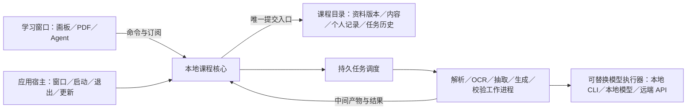

# 产品形态与运行架构比较

核查日期：2026-10-27。范围：本地服务＋外部浏览器、Electron 独立窗口、Tauri 独立窗口＋必要 sidecar。本文保留下一版宿主选择的比较依据；Electron 已接受，内部实现仍有候选，不代表已经实施或验收。

**最新产品决定**：独立桌面交付已接受，见[ADR-0001](../../adr/0001-independent-desktop-delivery.md)；在第一性原理研究和资源比较后，Robert 又明确选择 Electron，见[ADR-0002](../../adr/0002-electron-desktop-host.md)。目标平台为 macOS 与 Windows；当前只实施和打磨 macOS，Windows 现在纳入设计，适配、打包和实机验收在后续发布推广阶段完成。

后续核心与存储也已分别确定：TS／Node＋宿主拥有的一个 Worker，见 [ADR-0003](../../adr/0003-typescript-node-worker-core.md)；每课 SQLite＋课程资源文件，见 [ADR-0004](../../adr/0004-sqlite-course-storage.md)。下文保留已比较的替代路径，正式应用尚未迁移。

## 1. 结论：采用 Electron，按实际工作量控制资源

**补充资源比较后，已选择 Electron，但不称其为轻量化最优解。** 同一 500 单元原型、相同视口与聚焦条件下，Electron 在正文增长伴随相机移动时的 rAF 间隔长尾更稳定，动态 footprint 也比系统 WK 高约 212–222 MiB；阅读阶段的内存关系反转。这是具体负载的取舍，不是完整产品或物理输入排名。它还提供可控引擎版本，但需承担随应用交付 Chromium／Node.js 的成本。完整依据、数据和局限见[第一性原理与轻量化架构](第一性原理与轻量化架构.md)，四项轻量化要求已纳入 [PRODUCT.md](../../../PRODUCT.md#资源与轻量化)。

**Tauri＋Rust 是本轮认真比较过的替代方案。** 比较标准包括目标 macOS／Windows 的中文 IME、MathLive、复杂 DOM、选文、触控板与 PDF 并排，以及完整运行资源和兼容维护成本。这些要求同样适用于已选择的 Electron，局部实验不等于完整验收。小包体不能代替运行资源数据，跨引擎差异也不能代替阻断缺陷的证据；当前不并行实施第二套宿主。

**本地服务＋外部浏览器具备完成全部核心能力的技术可行性，但不作为默认产品交付。** 它将“应用还在不在运行”拆给启动器、服务和浏览器共同表达，增加长期学习工具的生命周期设计成本。如果用户明确希望长期在浏览器标签页学习、与其他网页组织在一起，并接受一个可见的本地服务管理入口，它才值得升为首选。

独立桌面窗口仍可以使用 HTML／JS 实现画板；它不会天然改善 500 个丰富单元的性能。三种形态都必须解决正文按需读取与挂载、稳定选择与编辑、增量布局、实验暂停、保存和任务恢复。**任务需要可核对的持久状态；重计算应离开界面和宿主事件线程，额外进程按原生故障隔离与工具需求决定。** 等待远端模型响应本身不要求新增计算进程，也不构成采用云 SaaS 或分布式微服务的理由。

### 1.1 为什么推荐独立桌面交付

需要区分三个决定：**桌面或外部浏览器决定产品如何进入和管理运行；Web／原生控件决定界面怎样实现；Electron／Tauri 等决定宿主怎样实现。** 固定 Chromium 是偏向 Electron 的理由，不是所有桌面应用都具备的优势，也不单独证明应当选桌面。

本产品的持续对象是课程：资料、知识、笔记、历史和生产任务共同演进。学生会打开课程、导入资料、开始生成、关掉学习窗口、重新进入并继续。这条完整路径要求明确“课程在哪里、程序是否仍运行、任务属于谁、何时彻底退出”。独立应用可以把它们统一在同一个可识别的产品入口中。

| 从需求推导的比较点 | 桌面推荐的具体收益 | 浏览器方案与代价 |
| --- | --- | --- |
| 关闭学习界面后任务继续，明确退出才停止 | 应用统一管理窗口和工作进程，并提供后台状态、重新进入和退出入口 | 本地服务也能继续运行；需协调标签页、服务管理入口和退出状态，浏览器关闭不等于产品退出 |
| 课程文件夹长期保存、反复导入本地资料 | 打开课程、最近课程、文件选择、恢复和版本升级都由同一个宿主组织 | 服务可以访问本地文件，功能并不缺失；仍需在浏览器与本机运行组件之间管理课程身份和状态 |
| 复用本地执行器，逐步增加解析与生成流程 | 宿主统一启动、监管并更新所需本机组件，使学生面对一个应用 | 外部浏览器不能免除本机组件的交付；完善启动器和后台管理后，也会承担相当一部分桌面宿主工作 |

由此推荐桌面，是对完整使用路径与维护边界的判断。浏览器的优势仍然成立：可融入已有标签页工作流、复用已安装的浏览器，界面迭代和调试方便。Robert 已排除必须用浏览器的场景，减弱了它作为默认交付的产品理由；并不意味着浏览器不可行。

桌面的额外成本是应用安装、分平台打包、系统集成和更新维护；若采用 Electron，还需分发和维护其运行时。桌面壳也不自动提供保存正确性或流畅交互。若这些成本在完整产品实测中大于入口与运行管理的收益，应重新评估本地服务＋浏览器方案；当前没有桌面更快或更省资源的实测结论。

## 2. 从产品不变量出发

本次只读取根目录 `PRODUCT.md` 了解产品行为，并以本轮用户明确要求重新开放交付形态选择。其当前启动命令、运行语言和内部接口名称均不作为约束。

| 产品不变量 | 对运行架构的直接要求 |
| --- | --- |
| 单人、本地为主；一门课程持续使用一张画板，规模按 500 个丰富单元考虑 | 权威数据留在课程目录；浏览器缓存不能成为唯一副本；课程规模与同时挂载的复杂 DOM 数量分开处理 |
| 完整正文、MathLive 公式、交互实验；频繁鼠标／触控板操作与中文输入 | 阅读、文本选择、公式编辑和画板手势要协调；输入组合期间不能被布局更新或 Agent 改写打断 |
| 原文 PDF 并排，选文问 Agent、请求改写后继续学习 | 画板与 PDF 保留各自视口、引用与选段身份；任务绑定提交时的内容版本，而非当前相机位置 |
| 自动保存、失败重开、笔记随内容演进 | 保存确认来自真实持久化；个人记录与生成内容分开维护；撤回不能覆盖后来笔记 |
| 离线读写、课程整体迁移 | 本地资源齐备；正文、引用、资料版本、任务与个人记录可一起迁移；凭据和平台二进制不应成为课程可读性的依赖 |
| 从学生资料到正式画板的完整生产流程 | 来源版本、中间产物、依赖、重试、局部重算、校验和发布边界必须有位置，不能只做一个调用模型的聊天侧栏 |
| 宽松开源、正常运行无额外厂商授权 | 框架与实际打包依赖分别核对；模型调用费用、执行器账户与框架运行授权分开判断 |

最需要控制的是三件事：学生正在操作的连续性、课程记录的可信保存、生产任务失败后的可理解恢复。安装包大小影响分发，但现有目标没有给出必须压到某个体积的硬限制，不应先于这三件事决定架构。

## 3. 已核查事实：八项官方来源

下表中的“事实”是官方资料直接支持的能力或限制；后续章节的推荐、边界与产品行为均是据此作出的设计推论。没有用官方宣传语推导本产品性能，也没有运行或安装任何框架、模型。

| 编号与官方来源 | 已核查事实 | 不能据此宣称 |
| --- | --- | --- |
| [S1：Electron Process Model](https://www.electronjs.org/docs/latest/tutorial/process-model) | 主进程管理窗口与应用生命周期；窗口内容运行在 renderer；界面使用 Web 技术。可创建 Node.js utility process 承载 CPU 密集或易失败组件，并通过 IPC 通信 | 使用 Electron 就不会卡顿；统一 Chromium 就能消除 OS、字体、GPU 和输入法差异 |
| [S2：Electron Application Packaging](https://www.electronjs.org/docs/latest/tutorial/application-distribution) | 分发需要把应用与 Electron 二进制打包；macOS 与 Windows 的交付目录不同，官方提供打包工具和手工打包路径 | 拷贝网页即完成跨平台产品交付；打包机制自动解决数据迁移和任务恢复 |
| [S3：Electron LICENSE](https://github.com/electron/electron/blob/main/LICENSE) | Electron 自身为 MIT 许可，允许使用、修改和分发，要求保留相应版权及许可声明 | 整个安装包中的第三方组件都只有这一份 MIT 许可 |
| [S4：Tauri Webview Versions](https://v2.tauri.app/reference/webview-versions/) | Windows 使用基于 Chromium 的 WebView2；macOS 使用 WKWebView，其 WebKit 更新随 OS 更新 | 两个平台有相同 renderer；更新 Tauri 应用就能统一 macOS 系统 WebKit |
| [S5：Tauri Embedding External Binaries](https://v2.tauri.app/develop/sidecar/) | 可随应用嵌入其他语言的可执行程序；`externalBin` 要准备对应目标平台／架构的二进制 | sidecar 不需要打包维护；启动外部程序等于具备可靠任务调度 |
| [S6：Tauri Windows Installer](https://v2.tauri.app/distribute/windows-installer/) | WebView2 可采用在线引导、离线安装器或固定运行时等部署方式；缺失运行时而跳过安装会无法运行 | 默认小安装包可以保证无网首次安装；壳体大小等于完整离线产品大小 |
| [S7：Tauri 官方仓库](https://github.com/tauri-apps/tauri#licenses) | 代码许可声明为 MIT 或 MIT／Apache-2.0，按具体部分适用；提供桌面打包与更新能力。Logo 的许可另行规定 | 全部资源、插件、系统运行时和商标都适用同一宽松代码许可 |
| [S8：Chrome File System Access API](https://developer.chrome.com/docs/capabilities/web-apis/file-system-access) | 支持的浏览器可以经用户授权直接读写文件／目录；跨会话权限不总是保留，需检查；文档列明浏览器支持边界 | 浏览器绝对不能读写本地文件；这一套目录访问行为可无条件覆盖所有浏览器 |

## 4. 三种形态的实际差别

以下是**针对本产品的设计推论**，不是已完成的跨平台性能测试结果。

| 比较维度 | 本地服务＋外部浏览器 WebUI | Electron 独立桌面窗口 | Tauri 独立桌面窗口＋必要 sidecar |
| --- | --- | --- | --- |
| 日常进入与窗口归属 | 可双击启动器自动开浏览器，并不必让学生手敲命令；但标签页、浏览器窗口与服务是不同生命周期 | 单一应用入口，可统一课程打开、窗口恢复、菜单与退出语义 | 同样可做单一应用入口；系统窗口能力并不要求改成原生控件正文 |
| 关窗与长任务 | 关标签页不应被解释为服务退出；要另有服务状态、停止／后台入口和重连机制 | 产品可以区分关窗与退出，决定主进程和工作进程如何处理；仍需自行实现 | 也能区分关窗与退出；Rust 宿主和 sidecar 的存活、清理与重连要显式设计 |
| 文件夹与资料导入 | **本地服务可在自身权限范围内读写文件**，再通过接口给 UI；可用上传／目录选择／启动器选目录。不必把 File System Access API 当必需条件 | 宿主原生对话框与文件操作接入直接；renderer 通过有限 IPC 请求导入，不直接掌握任意磁盘操作 | 宿主命令／文件插件可接入目录导入；必要工具交给 sidecar，仍要定义导入事务 |
| 资源工具与模型执行器 | 服务可启动 OCR、解析器和本地 CLI，技术能力完整；要自己管理进程树、端口与服务版本 | JS／Node 任务可放 utility process；本地 CLI、OCR 等用外部工作进程；不能把重活塞进主进程 | Rust 核心可处理合适的任务；其他生态通过 sidecar 接入；若大量依赖 Node／Python，完整运行时仍要交付 |
| 中文 IME 与 renderer 一致性 | 若支持默认浏览器，要覆盖不同引擎、版本、扩展与快捷键；限定 Chromium 可缩小矩阵，但增加使用条件 | 随应用固定 Chromium 版本，便于复现和回退；Windows／macOS 输入法仍须分别验 | WebView2 与 WKWebView 是两条引擎路径；MathLive、组合输入、焦点和选择必须双平台实测 [S4] |
| 鼠标／触控板与复杂 DOM | 浏览器滚动、页面缩放、历史导航等行为需要与画板约定；本地服务不改变这些行为 | 可控制更多应用菜单与窗口行为；DOM、合成和事件冲突依然存在 | 具备窗口控制，但系统 WebView 的事件／选择差异进入维护范围；Rust 不会替 HTML 正文布局加速 |
| PDF 并排与选文 | 可以在应用页面内做统一 PDF 阅读区；不应依赖另开浏览器 PDF 标签页承接可靠的选段上下文 | 可以在同一窗口内保留双区，也可做辅助窗口；重点仍是阅读器的页码、选段和引用协议 | 同样可自带阅读器；不要把不同 WebView 内置 PDF 行为当成统一产品能力 |
| 自动保存 | UI 经本地接口提交，服务落盘后确认；刷新／多标签页／重连要去重和核对版本 | IPC 提交到本地核心，落盘后确认；renderer 崩溃不能丢掉已确认记录 | 命令／IPC 提交到本地核心，规则相同；不能把 WebView 缓存当课程权威状态 |
| 失败与重开 | 浏览器、服务、工作进程三类故障要分别表达；重复启动应重连既有服务，避免重复写入 | 可集中呈现窗口与工作进程故障；主进程故障仍需靠持久记录恢复，框架不会代劳 | 同样要从持久记录恢复；宿主与 sidecar 协议、版本不匹配是额外需要覆盖的边界 |
| 应用、引擎与 OS 依赖 | 服务更新和浏览器更新相互独立；不自带引擎可减少应用分发，但会使用已安装浏览器的资源 | 自带运行时减少对已装浏览器的依赖；渲染引擎修复随应用发布承担；仍受 OS／驱动等影响 | 复用系统 WebView，把部分运行时部署与更新交给系统；Windows 仍需考虑 WebView2 缺失 [S6] |
| macOS／Windows 分发与更新 | 仍需交付服务运行时、启动器、停止入口和工具包；要处理端口占用、旧服务仍在运行、资源版本不一致 | 随应用交付 Chromium／Node.js，安装及更新载荷通常更大；工作进程与资源仍需分平台构建 [S2] | 壳体可省去自带整套浏览器，但 sidecar、OCR／模型资源与离线 WebView2 会改变总量；每个目标架构都有交付工作 [S5][S6] |

### 4.1 为什么 Electron 暂列第一

产品的主要交互既不是简单表单，也不是只读知识图，而是中文编辑、公式、PDF 选段和复杂 DOM 同时处于可操作状态的空间。此时，把“用哪个引擎、哪个版本复现问题”纳入发布控制，比先节省壳体体积更接近问题本质。Electron 的收益是缩小运行环境变量，而不是保证更高帧率。

它的成本也是真实的：产品要维护随包运行时的更新，承担安装／更新载荷与空闲资源开销，并防止把所有逻辑堆进主进程。如果目标设备资源不足，或者 Tauri 通过相同交互验证且完整产品成本明显更低，这个推荐应被证据推翻。

### 4.2 为什么不默认 Tauri，也不排除它

Tauri 的原生宿主、系统 WebView 和 sidecar 能容纳完整产品；不存在“只能做轻量网页”的限制。但本产品的复杂度集中在编辑与阅读 renderer，系统 WebView 差异正落在最敏感的位置。加一个本地计算 sidecar 不能消除这类差异。

如果解析工具最终主要来自其他运行时，Tauri 可能成为 Rust 宿主＋JS 界面＋工具运行时的组合。是否值得，应计算完整交付与维护成本；反之，也不应为了维持单语言口号而把成熟解析工具全部重写。sidecar 只在依赖生态、故障隔离或资源控制确有需要时引入，不要求每个模块一个进程。

### 4.3 本地浏览器方案的真实位置

浏览器方案不缺本地能力：页面请求本机服务，由服务扫描目录、读 PDF、提交课程更改、调度执行器即可。浏览器不能直接任意访问磁盘，与本地服务能否访问磁盘是两个问题。[S8] 讨论的是页面直接访问文件的另一条路径，不是本地服务方案的能力上限。

它更适合“学生主动以浏览器为工作空间，服务有独立且清楚的管理入口”的产品。若为了隐藏服务，又补做托盘、单实例、关窗策略和版本协调，实际上已经在承担一部分桌面宿主工作，而仍无法控制外部浏览器版本。仅为沿用旧网页而选它不成立。

### 4.4 纯托管 Web／PWA 为什么不作为本轮主方案

PWA 可以设计离线资源与本地存储，支持的浏览器也可直接访问经授权的课程目录，不能笼统说“Web 不能离线”。但本产品还要求可迁移的完整课程目录、本地工具／执行器和长任务恢复。仅有页面离线缓存并没有提供这套本地运行环境；直接目录访问还需处理权限和支持差异。[S8]

若改成远端保存与远端执行，会改变本地为主、无网可读写的产品边界；若另装本地伴随程序，就应按“本地服务＋浏览器”重新评价。未来可把只读分享或轻量访问做成 Web 消费端，不需要现在让它承担完整本地学习与生产职责。

## 5. 推荐架构：单机模块化核心，按资源与故障边界拆进程

以下为**建议边界**，不锁定具体前端框架、存储库或工作进程语言，也不要求继承已有实现。最初可只有应用宿主、renderer 和少量按需启动的工作进程，不部署服务集群。

### 5.1 交互与课程权威边界

- **renderer 负责学习交互。** 知识身份、引用和笔记锚点不绑定 DOM 节点；正文按阅读范围挂载，远景保持概览，选中／正在编辑的对象保持稳定。实验默认离屏暂停，保留现场。不能为了性能把完整复习退化成摘要或跳转链接。
- **本地课程核心负责课程行为与提交。** 正文、个人记录、布局、学习状态和历史分别维护；读取快照与有序增量由核心提供。Electron 可通过受限 preload／IPC 接入，Tauri 可通过宿主命令接入，浏览器可通过本地 API 接入；传输方式不定义课程语义。
- **一个课程只有一个写入协调者。** 学生编辑、Agent 改写和生产流程发布都通过同一提交入口，携带目标 ID、基准版本和操作 ID；多窗口共享它。工作进程产出结果，不直接覆盖权威文件。没有必要为单人课程引入多人实时协作基础设施。

自动保存按“本地编辑／生成增量 → 核心提交 → 持久化确认 → 显示已保存”设计。输入中的中文组合串先保护为草稿，不能为抢先保存而破坏 IME；完成组合后提交正文。保存失败保留待提交内容并说明状态，不等关窗才保存。renderer 重载需要恢复未确认草稿；已确认记录必须能从课程目录恢复。

### 5.2 完整生产流程如何容纳长任务

建议从一开始保留下列数据边界，界面和自动化程度可以分期实现：

| 阶段 | 必须保留的信息 | 失败、重试与局部重算 |
| --- | --- | --- |
| 资料导入／版本 | 来源身份、原始文件快照、内容哈希、版本与导入清单 | 导入失败不伪装成完整版本；新增资料不隐式改画板 |
| 解析／OCR | 输入版本、页码／区域映射、工具与配置版本、可复用产物 | 按文件／页分块；失败块可重试，已完成块可复用 |
| 知识抽取 | 来源锚点、候选知识、关系与依赖 | 只重算受输入／配置变化影响的部分；保留不确定与失败状态 |
| 内容生成／校验 | 内容草稿、模型／提示／配置标识、校验报告、目标内容基准版本 | 复用持久产物不等于再次模型生成会相同；重试另记尝试，校验失败不进入正式内容 |
| 发布到画板 | 发布范围、知识 ID 映射、目标版本、提交记录、个人记录处理结果 | 提交前核对学生最新改动；分批发布也需明确完成单元边界，失败不能留下假完成状态 |

任务采用持久状态机和阶段依赖，记录 `jobId`、输入版本、阶段、尝试次数、检查点、错误和结果提交 ID。来源哈希＋工具／配置版本决定产物能否复用；上游变化只使依赖它的下游失效。可先用本机持久任务表实现，不需要消息中间件。

执行与提交分开：模型超时后先核对执行器状态与提交记录，再决定重连或重试；同一操作重放不能重复改画板。取消阻止后续提交，保留已提交内容；工作进程崩溃只影响所属阶段。重开后呈现未完成任务，由学生明确继续，不能因为恢复启动而静默重跑。

新版资料先形成版本和候选变更；学生选择依据新版更新后才修改既有画板。交互改写可以按完整部分增量提交，但持续保护当前输入和选择；完整生产流程不能把未通过校验的半成品当作正式复习正文。笔记保存原引用与语境，无法确定新锚点时保留待关联，不靠整份旧快照回滚个人记录。

### 5.3 进程、执行器和资源管理

本地核心的逻辑职责不要求 HTTP 服务；本轮已选择 TS／Node Worker 承载。启动、课程锁、工作进程监管由宿主协调；OCR、重解析等放在可取消、可重启且有限并发的工作进程。重计算不进入 renderer 或窗口事件主循环。宿主拥有的 Worker 隔开同步调用并跨关窗继续；utility process 提供额外进程故障隔离，本次多约 11 MiB footprint，未显示短事务响应收益。依据及边界见[第一性原理与轻量化架构](第一性原理与轻量化架构.md#5-逻辑核心不等于独立进程)。

执行器适配层只依赖启动／连接、流式事件、取消、状态核对和恢复能力；每种执行器如实声明能否恢复，不假定所有 CLI 都支持会话重连。本地 CLI、嵌入模型或远端 API 可替换，课程内容格式不存放某一家执行器的专属运行对象。凭据由机器侧管理，课程迁移不复制账户登录状态。

按阅读优先限制后台并发与资源占用。即使采用 Electron，也不等于 OCR／模型必须用 Node；即使采用 Tauri，也不等于所有解析必须用 Rust；已有 Python 只可能是某个工具的实现选择。长任务支持的是有边界的本地生产能力，不预设 GPU 模型、云依赖或常驻后台服务。

### 5.4 窗口关闭、退出和更新

Robert 随后明确：关闭学习界面后任务继续运行，明确退出本地运行程序才停止，已提交结果保留。这要求提供可重新进入的后台状态与停止入口；完全退出时停止接收新任务，结束／中止受管进程并持久记录检查点。该行为独立于浏览器或桌面窗口形态，不再采用此前关窗默认暂停的候选。

窗口关闭、应用退出、OS 休眠、进程崩溃不是同一事件。宿主正常退出可以协调收尾，但强制结束不保证回调执行，因此可靠性来自运行期间的持久提交与检查点。下一次启动核对课程锁和进程身份，不能只凭旧 PID 判断任务仍活着；异常子进程清理需要覆盖各 OS，不能假设父进程退出自然清理全部后代。

应用、工具包和课程数据分开版本化。升级前停止新提交并形成一致恢复点，宿主与 worker 握手核对协议版本；升级失败不能把“旧应用＋新数据格式”当作可直接回退。支持离线安装包手动升级，自动更新可以后做。更新下载并不要求把课程交给云服务。

## 6. 交付、许可与迁移的边界

### 6.1 macOS 先行，Windows 作为确定的后续目标

当前开发与体验验收集中在 macOS，Windows 的实现、安装器和实机验证后做。现在需要完成的设计工作是避免课程与核心逻辑依赖 macOS 的偶然条件：

- 课程格式、资源身份、修订和任务记录不包含只在一台机器成立的绝对路径；文件路径、大小写和资源定位通过统一文件访问边界解释。
- 文件选择、应用数据位置、窗口／退出、系统快捷键与进程管理由少量平台适配承担；macOS 体验可以单独打磨，不将其菜单、Command 键或信号语义写进课程规则。
- 必需依赖与工作进程须有可行的 Windows 构建／替代路径；选择只有 macOS 实现的关键组件时，现在就明确后续替代成本，不能在临近发布时才发现核心能力无法交付。
- macOS 现阶段验证课程核心与完整学习路径；Windows 后续补实际输入法、路径与锁、进程终止、安装更新和课程迁移验收。跨平台框架支持不代替这些验证。

这些边界不要求当前实现整套 Windows 适配，也不要求把所有代码抽象成平台插件。先隔离确实存在的系统差异，保持课程格式和核心行为可共享。

### 6.2 完整交付成本、许可与迁移

**交付比较应统计完整产品。** 对每个支持的 macOS／Windows 架构，记录下载／安装体积、初次启动依赖、空闲内存、500 单元场景资源和更新载荷；OCR 工具、字体、PDF 阅读资源、可选模型及其缓存单独列账。浏览器方案也要计入服务运行时与所用浏览器资源，Tauri 不能只报壳体，Electron 不能只报 renderer。[S2][S5][S6]

Windows 的 Tauri 离线首次安装要明确 WebView2 处理方式；在线引导不等于离线安装，固定 WebView2 也不能统一 macOS 的 WKWebView。[S4][S6] Electron 可控制随包引擎版本，但仍需承担运行时修复发布；两类桌面产品都要安排分平台构建、签名／系统安装体验和更新后的资料可读性验证。这里不填写未经本机和 Windows 设备测量的体积、内存或速度数字。

许可结论如下，属于本次已核查事实与对应采用边界：

- **Electron 自身的 MIT 许可满足宽松开源及无框架运行许可密钥要求。** 分发需保留声明；随包 Chromium、Node.js 及其他依赖仍按各自许可处理。[S3]
- **Tauri 的代码许可按组件适用 MIT 或 MIT／Apache-2.0，满足本产品对框架代码的方向要求。** 不能把整个仓库笼统写成“所有内容都是 MIT”；Logo 和第三方依赖另论。[S7]
- **本地服务＋浏览器不是一种软件许可。** 是否满足要求取决于选择的服务运行时、库和工具；不能因为网页免费打开就认定依赖合规。
- 系统 WebView、已安装浏览器属于运行环境，不自动成为本项目的宽松开源代码；若随包再分发 WebView2，还需按对应再分发条款处理。这与向应用索取厂商运行许可密钥不是一回事。[S6] 如果用户要求“连系统运行时都必须宽松开源”，这将改变 Windows／macOS 支持前提，不能靠换壳解决。
- “无额外运行授权”不等于模型服务免费或免账户；模型权重、OCR 二进制、编辑器扩展和 SDK 需要逐项选择。必要能力不得用另购 Pro 组件补齐；云模型与既定 CLI 执行器保留独立服务边界。

**课程是迁移单元，应用是分平台运行环境。** 建议课程目录自含资料快照、正式内容、个人记录、布局、对话、任务和必要历史；路径以课程内相对引用为主。程序与平台工具可独立安装，不要求用户把 macOS 二进制复制到 Windows。这个建议调整的是交付方式，不改变完整课程可整体迁移的产品目标。

迁移时要形成一致快照：暂停写入后复制，或由核心导出一致版本，不能直接把写到一半的数据文件当备份。跨平台打开后，已保存正文、公式、PDF、笔记与状态应离线可用；缺少某个可选生成工具只影响对应任务继续，不应阻断课程阅读。正在运行的进程不能迁移，迁移的是任务记录与可复用产物，继续前重新核对执行环境。

## 7. 五个最小可判别验证

以下为候选宿主的验证设计，**并非全部验收已执行**。已补同一丰富内容页面的 macOS 宿主与关窗生命周期隔离实验，见下方结果；物理输入、完整交付和生产流水线仍未覆盖。表内 Windows 项目留到 Windows 阶段。先用同一份内容和交互路径比较，避免把不同 renderer 实现的差别误记为壳体差别。不重做整个产品，也不以框架示例首页通过代替验收。

| 验证 | 最小情景与观察 | 如何改变选择 |
| --- | --- | --- |
| 1. 真实编辑与画板交互 | 同一份 500 丰富单元数据，包含长 DOM、MathLive、实验和并排 PDF；在目标 macOS／Windows 上实际进行中文组合输入、选文、公式编辑、触控板缩放与 Agent 增量改写。记录丢字／失焦／错误选段、输入延迟、交互帧耗时和峰值内存；测远景、阅读景和局部展开，不强求全部复杂正文同时挂载 | 组合输入、选段或手势有阻断缺陷即不通过；若只有系统 WebView 路径失败且修复代价高，支持 Electron；若三者同样卡顿，先修 renderer。通过后才比较资源，不能仅凭启动内存选壳 |
| 2. 启动与生命周期 | 从桌面入口打开课程，重复启动，关窗／关标签页、杀 renderer、重启服务或宿主、休眠再唤醒；浏览器方案另模拟端口占用。观察是否出现重复写者、看不见的任务和“界面关了但不知道程序是否还在”的状态 | 若浏览器方案必须靠学生开终端排障才能恢复，不符合默认独立产品体验；若明确服务管理入口在真实习惯中成立，可重新提升优先级 |
| 3. 保存与故障恢复 | 在输入、已发命令未确认、确认落盘、Agent 分批修改等边界强制结束进程，并模拟磁盘写失败；重开核对内容、未确认草稿、笔记和任务。恢复后再发同一操作 | 已确认保存的数据不得丢失；不能重复提交、静默重跑或覆盖后来笔记。三种壳体用同一标准，失败指向提交／恢复设计，不能靠换壳宣称已解决 |
| 4. 生产流程断点 | 少量资料跑通导入→解析／OCR→抽取→生成→校验→发布；用可控假执行器先覆盖超时、取消、阶段失败。随后变更一页资料和一条学生笔记，再重开与局部重算 | 必须只重算受影响依赖，保留可复用产物与笔记；校验失败不发布，取消后不再提交。若只能整课重跑或依赖窗口常开，架构尚不能容纳长期目标 |
| 5. 完整离线交付与迁移更新 | 干净目标设备无开发工具、无网安装并打开课程；Tauri 覆盖缺 WebView2，浏览器方案覆盖无已支持浏览器的处置。再进行应用／工具升级、失败恢复和 macOS→Windows 课程迁移。记录完整包体、依赖、更新载荷、路径差异和工具缺失表现 | Tauri 若交互均通过、完整资源成本显著更合适且维护可接受，可替代 Electron；若任一方案离线阅读依赖补装网络资源或原机路径，则交付不成立。首次安装是否必须离线需与用户确认 |

目标平台与阶段已确定，最低 OS 和响应性／资源预算随实际设备进一步确定。当前 macOS 的交互和运行管理验证可以推进；Windows 实测后做。上述不是性能承诺；目前没有足以宣布 Electron、Tauri 或浏览器在本产品中更快的实测结果。

## 8. 真正需要向用户确认的产品问题

本轮新增的 [macOS 宿主实验](../../../experiments/desktop-host-spike/README.md)中，Electron 40.10.6 的 8 项正文交互和 5 项宿主检查通过，实际窗口关闭后同一个模拟 worker 继续、重开读取而不重新启动；明确退出后该 worker 结束。WKWebView 原样页面 7/8，通过临时 `-webkit-user-select:text` 诊断恢复正文选文，原样失败继续保留。它不是完整 Tauri 实现，也不是物理中文输入、触控板、持久任务恢复或等视口性能排名。运行时／临时依赖已清理；框架仍未选定。

不需要问“喜欢 Electron 还是 Tauri”。需要确认的是以下会改变架构或验收的行为；可以先按建议默认继续设计，不把实现细节全部转交用户。

| 应确认的真实行为 | 建议默认与影响 |
| --- | --- |
| 日常进入方式 | 已确认 Electron 独立桌面交付；正式编辑器与内部实现继续分别确定 |
| 关闭学习界面与明确退出 | 已确认关闭界面后任务继续，明确退出本地运行程序才停止；不要求退出后继续，更不等于开机自动运行 |
| 平台与开发顺序 | 已确认 macOS 先实施打磨，Windows 必做但后续实施；现在纳入平台边界与依赖选择。最低 OS、资源预算和无网首次安装尚未另行指定 |
| 课程迁移与应用分发 | 轻量化要求已明确课程自含数据、应用独立安装，一个应用管理多课。仍按一次编辑一个权威副本设计；当前没有多副本并行编辑的需求依据，不能将其新增合并需求伪装成普通复制 |
| 云生成不可用时，只需继续阅读编辑，还是导入／生成也必须全部在本机完成？ | 已有内容的离线读写必须保证。若全部生成必须离线，需额外确定模型资源、硬件和许可边界；仅这一新要求不足以直接决定窗口框架 |

Electron 独立桌面宿主、TS／Node 核心 Worker 和每课 SQLite＋资源文件现已分别确定。依据 Robert 对效果、性能、轻量化及系统复杂度的追问，两组有界资源测量已完成，完整推导见[第一性原理与轻量化架构](第一性原理与轻量化架构.md)。目标 SQLite 绑定已实际运行短事务并核对结果，真实输入与完整保存路径仍未完成集成验收。未来若增加远端算力，先替换相应工作执行位置，课程保存与个人记录的位置仍按产品需求决定。
