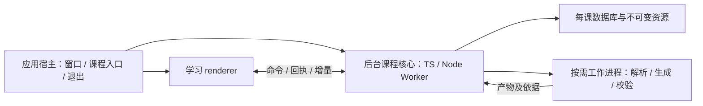

# 运行交付与进程边界

2026-10-27。状态：研究与设计依据；宿主、核心语言／承载和存储已确定，完整运行、迁移与备份合同已合并到[系统设计定稿](../../architecture/系统设计定稿.md)，具体连接尚需实施。证据入口见[架构决策总览](../../architecture/架构决策总览.md)，本文件未替换正式应用。

## 问题与当前事实

学生需要直接进入学习工作区，课程可以长期保存、离线阅读编辑并整体迁移。应用升级不应丢失课程，学习窗口断开也不能制造重复任务或虚假的保存成功。这里要决定交付形态、工作进程由谁启动和结束、课程与程序怎样组织，以及哪些工作独立于学习窗口存活。

**下一版已确认 Electron 独立桌面交付、TS／Node Worker 核心及每课 SQLite＋资源文件。** 交付形态、宿主、核心和存储分别见 [ADR-0001](../../adr/0001-independent-desktop-delivery.md)、[ADR-0002](../../adr/0002-electron-desktop-host.md)、[ADR-0003](../../adr/0003-typescript-node-worker-core.md)、[ADR-0004](../../adr/0004-sqlite-course-storage.md)。下文现状只提供观察与负载，不能作为沿用浏览器或 Python 的理由；未来资料解析、知识抽取、内容生成与校验管线也纳入应用生命周期设计。

当前源码提供以下基线：

| 事实 | 证据 | 对设计的含义 |
| --- | --- | --- |
| 每个课程目录用文件锁限制服务实例；重复启动检查课程和实例 ID 后打开已有地址 | [start.py](../../../legacy/review-board/start.py) | 同课多标签页可共用提交服务，不需要每个页面启动一个数据库写者 |
| 服务绑定回环地址；课程可用参数选目录；Ctrl-C／SIGTERM 结束服务，finally 关闭服务与资源 | [start.py](../../../legacy/review-board/start.py) | 页面与服务寿命目前分离；新的关闭策略需要明确，不能由连接断开猜测用户意图 |
| 正文与状态由 CourseService 管理；Agent 延迟创建 | [service.py](../../../legacy/review-board/reviewboard/service.py) | 无 Agent 登录时仍应能读取和编辑课程，不能把模型连接当启动前置 |
| Codex 由独立子进程运行，采用 stdio 请求与通知，关闭时 terminate 并在超时后 kill | [codex_executor.py](../../../legacy/review-board/reviewboard/codex_executor.py) | 执行器可替换，退出时要先封闭提交资格再处理子进程；进程退出本身不是任务成功 |
| PDF 解析／页面渲染等路径会调用本机工具；知识适配器从课程目录加载课程查询模块 | [sources.py](../../../legacy/review-board/reviewboard/sources.py)、[knowledge.py](../../../legacy/review-board/reviewboard/knowledge.py) | 单独打包启动脚本不能证明课程不再依赖开发目录、外部工具或课程内程序版本 |

当前启动入口主要在 macOS 开发环境验证。代码存在 Windows 文件锁分支，不等于 Windows 安装、运行与退出已验收。

本轮平台阶段已明确：当前先实施和打磨 macOS；Windows 是后续发布推广前必做的平台，现在审查依赖与设计边界，具体适配、打包和实机验收后做。课程格式与核心行为可共享，文件访问、窗口／退出、快捷键和工作进程管理保留明确的平台边界，避免把 macOS 偶然行为固化为课程合同。

## 页面、课程服务与工作进程

建议把职责分为三层，具体进程数量按测量决定。下文“页面”包含桌面的 renderer，“课程服务”表示逻辑核心，不预先要求常驻 HTTP 服务：

- **页面**呈现画板、输入与学习对话，持续发送草稿与命令，保存未确认尾部。页面重开后按课程状态和任务记录对齐。
- **课程服务**持有本课写入资格、提交顺序与任务记录；多页面与 Agent 共用相同版本检查。服务的生命周期由启动入口和明确退出操作管理。
- **工作进程**执行模型调用、PDF／OCR 或确需重计算的工作。长任务不占用课程提交锁等待完成；结果带目标版本返回后重新校验。实验是否放进 Worker 或其他隔离运行环境由组件能力决定，不能把 iframe 等同独立计算进程。

浏览器的关闭事件并不可靠，因此自动保存必须在编辑过程中持续发生；不能等到 `beforeunload` 才保存或用它作为停止任务的唯一依据。`visibilitychange` 可辅助刷新待发送内容，但隐藏也可能仅表示切换标签页，不能据此断言课程已退出。[MDN beforeunload](https://developer.mozilla.org/en-US/docs/Web/API/Window/beforeunload_event)、[Chrome 页面生命周期](https://developer.chrome.com/docs/web-platform/page-lifecycle-api)

Robert 已确认“关闭界面后任务继续，明确退出本地运行程序才停止”。因此页面／窗口连接只是订阅；重新打开读取任务状态并从有效游标继续。明确退出先停止接纳新工作、封闭旧任务提交资格，再完成已获得提交顺序的操作及已接收草稿的持久化，最后关闭执行器和存储。异常断电则走日志与操作回执核对，不把正常退出流程当崩溃保证。

不采用“最后一页关闭就停”的候选。后台状态、重新打开和明确退出需要可见入口；这不意味着开机自动运行或应用退出后仍保留一个不受控守护进程。

### 桌面方向下的物理进程候选

当前最小逻辑组织是：**应用宿主＋学习 renderer＋后台课程核心＋按需工作进程**。后台核心已确定采用宿主拥有的 TS／Node Worker：关窗继续和同步 SQLite 本身不要求独立进程，同负载实测 utility 多约 11 MiB footprint，未显示必须增加进程的短事务响应收益。最新取舍见[第一性原理与轻量化架构](第一性原理与轻量化架构.md)。它尚未与正式课程完成集成；隔离实验分别检查宿主和提交合同，不能把各自通过当作完整链路已通过。

- 宿主管理应用及系统集成，不执行正文全量校验、OCR、数据库长操作或大文件解析。学习 renderer 保留输入和阅读现场，不能直接打开权威数据库。
- 课程核心持有课程写入资格，管理短提交、回执、编辑草稿和任务记录。初期只需一个后台核心；课程隔离是数据与操作身份的要求，不要求每门课提前分配一套常驻进程。
- 工作进程在事务外读取明确版本的输入并产生结果，核心在提交时重新检查资格和依赖。并发有界，当前学习与保存优先；不按解析、抽取、生成、校验的每个概念阶段各部署一个永久服务。
- 学习窗口关闭只取消其订阅；核心与有效任务继续。应用退出先使提交资格失效并核对已接收写入，再结束工作进程与核心。核心异常重启先核对持久记录和独占资格，未完成生成不自动重新执行；旧工作进程迟到结果不能恢复原写入权。

宿主拥有的 Worker 线程已经可以把同步磁盘／校验调用移离宿主事件线程，并与窗口生命周期分离；父侧正确处理 worker 错误时，普通未捕获 JS 异常不等于宿主必然退出。独立进程额外提供原生崩溃等进程级故障边界，也增加进程资源和管理成本。二者都需要消息、任务核对及恢复，不能把 utility process 的收益概括成“有它才可后台运行”。应按实际承载的原生组件与负载决定，不为了逻辑分层先增进程；也没有证据需要把核心拆成网络服务群。[机制核查](../topics/轻量化架构机制核查.md)

Electron 的 `utilityProcess` 提供带 Node.js 与消息端口的子进程，本轮已经在隔离实验中实际运行同一 SQLite 适配；需要进程故障隔离时仍可采用。这不是正式课程拓扑的完整验收。[utilityProcess](https://www.electronjs.org/docs/latest/api/utility-process)。官方性能文档强调避免在应用主进程或 renderer 中执行阻塞工作。[Electron 性能说明](https://www.electronjs.org/docs/latest/tutorial/performance#3-blocking-the-main-process)

### 课程核心应隐藏的复杂行为

课程客户端与执行器需要知道课程身份、自己的读取依据和命令结果，不需要知道数据库表、文件 journal 或宿主消息对象。建议用少量领域入口承载完整行为，名称仅为讨论形状：

| 入口 | 调用者得到的完整保证 |
| --- | --- |
| 打开／连接课程 | 核对课程身份、格式兼容与写入资格，返回当前代际和恢复状态；同一路径不会启动互相竞争的独立写者 |
| 读取学习内容／来源 | 返回请求范围的内容、稳定身份、版本观察与定位信息；避免为读一块先搬运整课正文 |
| 执行领域命令 | 保存草稿、正文变更、学习状态、开始／停止任务等使用明确类型；核心完成校验、排序、持久化与回执，调用者不自行组合多次数据库写入 |
| 查询操作结果 | 同操作同载荷可取回原结果；超时后的未知状态不被自动当作未提交，同 ID 换载荷明确拒绝 |
| 订阅／恢复课程变化 | 快照与游标衔接，不漏提交；慢客户端可重读状态，持续输出不把整个历史反复发送 |

命令提交沿用[内容演进协议](../../architecture/内容演进与实时修改协议.md)中的对象身份、读取依据、编辑会话和尝试资格。具体顺序需要满足：先识别可重放的既有回执；新操作在同一提交事务中检查课程代际、当前尝试资格、依赖版本和学生已保存草稿，再写正式内容、历史、必要事件与回执。耗时生成和复杂校验在事务外完成，其输入摘要／版本与结果在提交时重新核对。

停止后的旧操作若早已成功，可以读取原回执；这不构成停止后的新写入。真正的新操作仍受停止资格限制。学生尚未同步到核心的本地输入不能被核心提前获知，因此客户端必须保留待确认草稿，收到并发提交后重新整合；不能把它描述为不可能发生的竞态。

生成的交互内容通过声明的参数、状态与动作接口运行，不直接获得课程写库或宿主通用能力。课程客户端只接受合同内的操作；特殊实验的暂停、恢复和计算隔离继续由学习内容运行层处理，不能把普通 iframe 当作独立计算进程。

## 交付方式与后端语言分别比较

| 路径 | 已核实能力 | 对本系统的限制 |
| --- | --- | --- |
| Python 服务随运行时发布 | PyInstaller 可携带解释器与依赖，用户不必安装 Python；产物针对构建系统与架构 | 需要分目标构建和实际干净环境验收；动态加载的知识模块、资料工具和静态资源必须显式包括。打包能力不能证明现有 Python 服务最合适 |
| TypeScript／Node 服务随运行时发布 | Node SEA 可向未安装 Node 的机器分发，支持打包资源 | 当前官方文档仍标记相关能力处于开发中；原生扩展等有实际文件要求，必须在选定版本与目标平台验证；采用 React 不意味着后端必须 Node |
| 本地网页配轻量启动管理入口 | 可复用系统浏览器，无需再嵌入一份浏览器 | 需要清楚显示服务是否运行、打开课程和退出入口，以及浏览器版本支持范围；这是候选优势而非既定结论 |
| 独立桌面窗口 | 可统一文件选择、工作区、后台任务与窗口／进程管理 | 需承担分发与更新，比较 Electron 的固定 Chromium 和 Tauri 的系统 WebView；不能凭桌面形态推定更流畅 |

来源：[PyInstaller 运行方式](https://pyinstaller.org/en/stable/operating-mode.html)、[Node SEA](https://nodejs.org/api/single-executable-applications.html)。这是能力核查，未制作上述分发包或进行跨系统比较。

PyInstaller 的许可证是 GPL 加例外，官方允许生成物按依赖许可分发；它本身不能被称为宽松许可库。鉴于已有底层依赖约束，当前仅将其作为打包能力参考，不直接列入已接受依赖。[官方许可说明](https://pyinstaller.org/en/stable/license.html)

PDF.js 提供浏览器中的 PDF 解析、呈现与信息读取，采用 Apache-2.0，可作为减少本机 PDF 工具依赖的候选；资源须随应用本地提供。它不能自动解决扫描件 OCR、已有教材页码映射、版本引用与中文选段定位，这些须在真实资料上验证。[PDF.js 官方入口](https://mozilla.github.io/pdf.js/)、[分层与集成说明](https://mozilla.github.io/pdf.js/getting_started/)

### 语言按核心职责与宿主组合选择

| 候选组合 | 实际收益 | 实际代价与适用条件 |
| --- | --- | --- |
| Electron＋TypeScript／Node 课程核心，必要时 Python 工作进程 | 可使用宿主已交付的 Node 运行环境；课程命令与 UI 消费合同易共用定义；纯阅读编辑不必为了核心再启动 Python | 必须核查 Electron 内置 Node、SQLite 绑定及原生依赖的真实兼容；输入数据仍需运行时校验。Python 工具一旦采用，依然要单独交付和管理 |
| Electron＋Python 课程核心 | Python 解析／计算组件可直接进入同一语言环境；SQLite 与文件操作有标准库支持 | 日常读写也依赖 Python 运行时，宿主到核心增加一层跨语言协议；即使同语言，重解析仍须移出提交过程。不能仅因现有代码使用 Python 就胜出 |
| Tauri＋Rust 核心，必要时其他语言工作进程 | 可围绕宿主的 Rust 能力组织本地逻辑与系统集成 | 需实际承担领域逻辑和工具协议实现；系统 WebView 交互及完整依赖交付仍需验证。Rust 本身不能改善正文 DOM 布局 |

Electron 宿主与第一项 TS／Node 核心现已选定，由宿主拥有的 Worker 承载；理由是正常学习路径所需运行环境与核心合同的组织成本，不以“前端用了 TS”或未经测量的速度比较作依据。上表保留已比较选项。资料处理器用什么语言，按其真实能力、许可和交付成本分别决定，不要求全部改写成同一种语言。

截至本轮核查，Node 官方当前文档将 `node:sqlite` 标为 release candidate，数据库接口同步执行；Electron 随包 Node 版本未必等于这份最新文档或开发机版本。[Node SQLite 文档](https://nodejs.org/api/sqlite.html)

原 [macOS 宿主实验](../../../experiments/desktop-host-spike/README.md)只核对了 Electron 40.10.6 内 Node 24.15.0 可以加载 `DatabaseSync`。新增[核心承载实验](../../../experiments/core-placement-spike/README.md)已实际创建同一 500 单元数据库，主线程、Worker 与 utility 共执行 18 场景、4,320 次保存；SQLite 3.51.3 的外键错误回滚、重复回执、结束承载后重开及独立最终内容核对均通过。这补齐了目标绑定的真实运行证据，仍不证明长期稳定性、断电持久性或正式 CourseService／Agent 闭环。

## 应用升级与课程迁移

建议区分应用版本、课程格式版本和资料版本。应用升级替换程序；课程迁移只改变明确声明的数据格式；资料新版本保留旧引用。三种变化不应共用一个含义模糊的 version。

课程目录应能在另一份兼容应用中打开，不依赖浏览器缓存或原机器绝对路径。独立桌面形态已确认，推荐应用独立安装、课程自含数据；便携包与格式升级失败时的恢复边界另行设计。当前“复制包含应用的整个目录”是既有版本的备份操作，不是未来架构必须把每门课绑定一份程序的结论。

打开来自新版本的课程时先判断兼容能力，不能默默改写为旧格式。备份必须得到一致的课程视图；数据库、附件和历史怎样一起形成该视图，由[存储方案研究](后端存储方案调研.md)确定。课程所需凭据不应随着学习资料复制，执行器在新机器按其接入方式配置。

## 命令与持续事件的通信候选

先确定命令与事件的语义，再按宿主选择通道。独立桌面窗口不必为了继承旧接口而启动 HTTP 服务：Electron 可用 preload 暴露有限的课程命令与订阅，通过 IPC 接入本地核心；Tauri 使用对应宿主命令。若需要外部浏览器或网络客户端，再增加本地 HTTP／流通道。以下三种网络方案的比较只适用于需要网络边界的入口，不能当成全架构必须选择 SSE 的结论。[Electron IPC 官方说明](https://www.electronjs.org/docs/latest/tutorial/ipc)

命令携带操作身份、读取依据与目标；回执以实际提交为准。订阅携带课程与游标，窗口重开重新对齐；宿主 IPC 同样需要有界积压、去重和恢复，不能只靠消息已经发送推断持久化。这些合同独立于 Electron／Tauri／HTTP，核心不向领域代码暴露某个宿主的消息对象。

持久提交事件和对应内容在同一事务完成；通知发送失败不改变提交事实。快照返回与读取视图对应的游标，随后补读该游标之后的事件，避免订阅建立期间漏掉修改。临时预览可以丢弃过期片段并取得最新工作草稿，正式提交不能静默丢弃；消息积压时明确转入恢复流程。PDF、图片和解析大产物传递课程内资源身份与版本，按需读取内容，避免把大文件放进每次消息。

当前 `/api/v1/events` 返回按序号分页的 JSON，`/api/v1/agent/state` 返回任务／对话状态，尚非 SSE。课程事件已经具有顺序与操作身份，可以保留语义而更换投递方式。[当前 HTTP 出口](../../../legacy/review-board/reviewboard/http.py)、[事件读取](../../../legacy/review-board/reviewboard/storage.py)

| 方案 | 适合与代价 | 本轮判断 |
| --- | --- | --- |
| 短轮询＋HTTP 命令 | 可复用现状；请求频率与刷新延迟互相制约；返回整段历史会放大工作量 | 保留为对照或连接降级候选；不能仅缩短轮询间隔解决整段重建 |
| SSE＋HTTP 命令 | 服务向页面持续投递文字、状态与提交；命令沿用请求回执；EventSource 提供重连与 Last-Event-ID | 与当前主要事件方向匹配，优先验证；游标不自动产生事件日志，恢复仍由服务实现 |
| WebSocket | 一条连接双向通信，适合持续双向流；也要自行定义请求回执、重连和恢复 | 目前没有必须使用持续双向流的场景，先保留比较；不能把连接建立视为可靠提交 |

[WHATWG SSE 规范](https://html.spec.whatwg.org/multipage/server-sent-events.html)定义 UTF-8 事件、事件身份与自动重连；[MDN SSE](https://developer.mozilla.org/en-US/docs/Web/API/Server-sent_events/Using_server-sent_events)指出单向投递及 HTTP/1 多标签页的连接数限制。因此候选出口按页面复用一条课程事件流，避免每个消息、内容块或任务各开连接；多个页面／课程仍需实际验证，不能直接假设浏览器连接数无限。

[MDN WebSocket](https://developer.mozilla.org/en-US/docs/Web/API/WebSockets_API)说明常用 WebSocket API 不提供自动的接收背压。无论选 SSE 还是 WebSocket，本产品都需要有界队列、消息大小上限、慢消费者处理和恢复读取；更换协议不能省略这些设计。

候选事件合同保留三类独立进度：已持久化的课程提交序号、已持久化的对话／草稿内容位置、当前任务尝试中的临时显示序号。临时显示可以按帧合并；正式提交不能静默丢弃。游标过期或代际改变时回到明确的快照与续读位置，不让旧尝试的迟到片段覆盖新内容。

要证明 SSE 候选成立，最小验证是：一个客户端放慢读取不拖慢保存；断线后从中间游标续读不重复；HTTP 回执与事件乱序仍只应用一次；积压转快照恢复；停止生效后迟到输出不会新增提交；多个标签页与原页读取同时工作。语言和存储选择不会替代这些检查。

## 本轮问题与后续验证

原先以“沿用 Web UI”为前提的问题已作废。Robert 已确认 Electron 独立桌面交付、关闭学习界面后任务继续、接口写入／开放格式导入导出即可、macOS 先行且 Windows 后续必做。在第一性原理研究及两组资源比较后，Electron、一个 TS／Node 核心 Worker 与每课 SQLite＋资源文件均已成为明确决定。四项轻量化约束见 [PRODUCT.md](../../../PRODUCT.md#资源与轻量化)，具体证据见[第一性原理与轻量化架构](第一性原理与轻量化架构.md)。后续细化编辑会话、提交、事件与撤销的衔接。

隔离宿主已证明本次 Electron 窗口真正关闭后同一模拟任务继续、重开经只读 IPC 读取既有状态、明确退出后子进程结束；该任务只保存在仍存活宿主的内存中。跨次启动、崩溃和任务持久恢复没有因此成立；与 [SQLite 实验](../../../experiments/storage-spike/README.md)仍是两条独立证据，尚未整合为真实 CourseService／Agent 闭环。

可判别验证应覆盖：干净环境启动与依赖缺失；包含中文及空格的新目录；重复启动和两页面；正在保存时退出；页面关闭与服务重开；执行器卡住或退出；应用升级后旧课程打开；复制课程后原页、引用、笔记与历史一致。当前先完成 macOS 范围，Windows 实机与交付验证后做；每项记录系统、应用和课程格式版本，不用 macOS 通过代替 Windows 验收。
