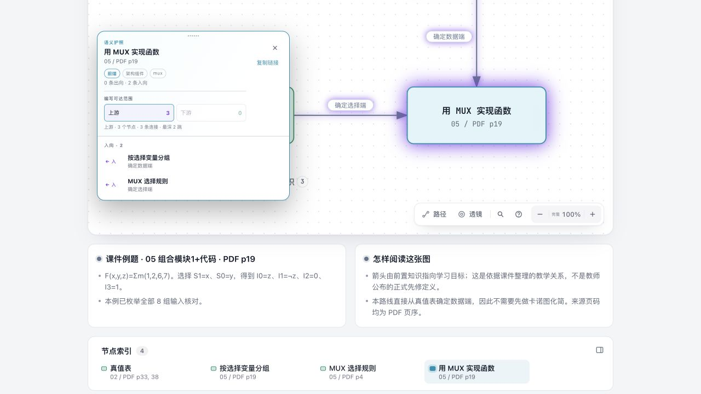
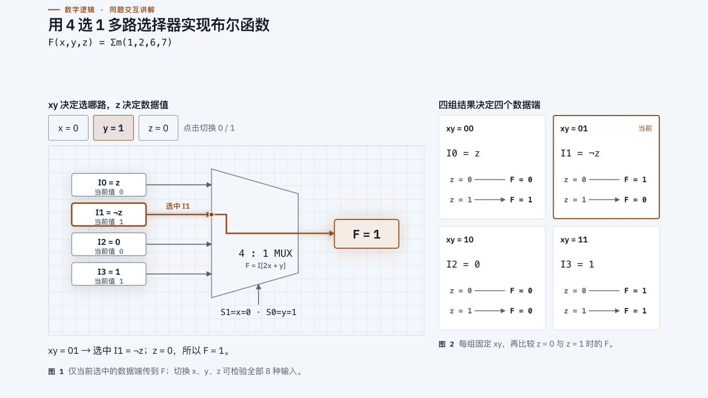
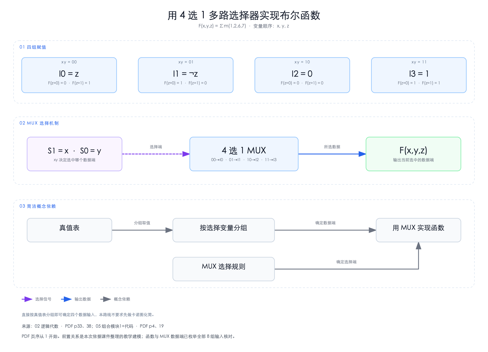
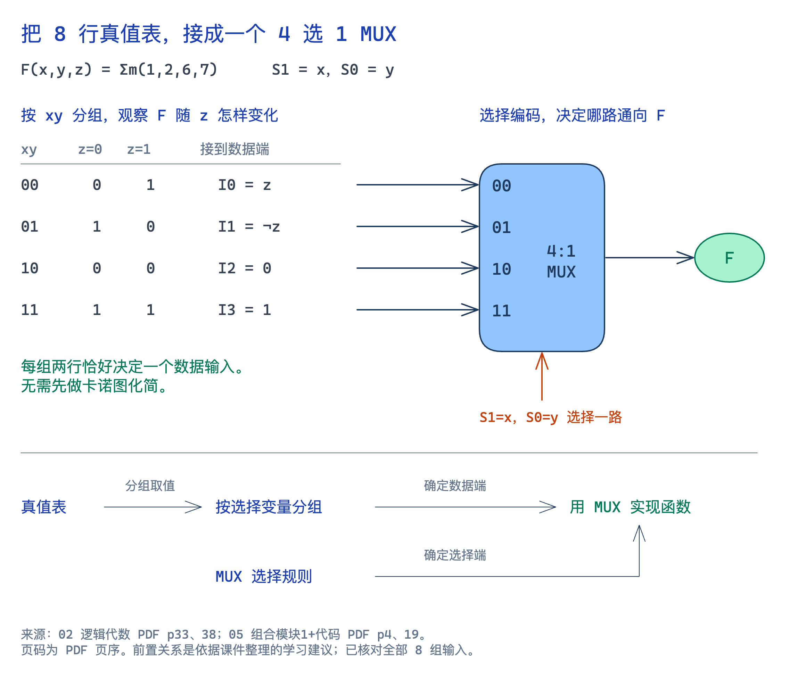

# 本地复习系统：工具调研与可借鉴设计

整理日期：2026-10-24。当前目标是设计自己的本地复习看板，先服务数字逻辑 01—06 的期中复习，再支持其他课程。Agent / AI 主要生成与维护内容；学生主要阅读，也可以修改、批注和记笔记。内容与阅读留在本地，生成允许使用云模型，断网仍应能读已有内容。

本文把此前分散调研合并为 **24 组工具与生态**。同一生态内的编辑器、Skill、MCP 分别说明，不将它们当作相同产品。每组包含特点、优势、对本系统的具体借鉴点和验证边界；图片优先使用本次真实产物，其余来自官方 README、文档或官网。官方图片只是产品或输出示例，不代表已用本课程测过。

**当前最值得组合的经验：Archify 的关系探索，Excalidraw 的手绘视觉，Heptabase / NodeGraph 的来源与概念卡，visual-explainer 的局部交互讲解。** 这些是设计参照，尚未选择技术栈。用户要求的“同页选择内容 → 提出修改 → 看反馈与效果 → 继续阅读”已经进入需求；外部 Agent 不意味着必须截图、切聊天窗口再回来。

## 1. 一页索引

“已做样例”只表示完成下述局部演示，不表示完整课程抽取或学习效果得到验证。其余条目以官方资料或源码核查为主。

| 工具 / 生态 | 主要特点与优势 | 最值得借鉴的点 | 本轮证据 |
| --- | --- | --- | --- |
| [Archify](#archify) | 可探索关系图、节点详情、上游与路径 | 从目标追溯相关知识，交付可直接阅读的图 | MUX 实作与浏览器操作 |
| [Diagram Design](#diagram-design) | 图型选择、布局规范、HTML/SVG | 生成前先选表达结构，再检查布局 | MUX 实作与检查 |
| [visual-explainer](#visual-explainer) | 分步、输入变化、动态图形讲解 | 在局部概念中嵌入可操作例题 | MUX 实作，8 组输入核对 |
| [fireworks-tech-graph](#fireworks) | SVG、结构化中间数据、几何检查 | Agent 出图后的结构与视觉核验 | MUX 实作、5 项检查 |
| [Excalidraw 生态](#excalidraw) | 手绘画布、原生元素与连线、多个 Agent 入口 | 手绘语言、局部编辑、保留人的批注 | 社区 Skill 样例及原生编辑实测；MCP 未实测 |
| [NotebookLM Mind Maps](#notebooklm) | 资料摘要、来源问答、可展开主题图 | 从资料快速建立范围导航，点节点追问 | 官方文档 |
| [Obsidian + Skills](#obsidian) | 本地 Markdown、Canvas、链接图 | 内容与视图分离、概念卡复用、开放文件 | 文档、格式样例；未导入应用 |
| [Heptabase](#heptabase) | PDF 阅读、标注、概念卡、白板与 AI | 原文、解释、卡片与白板相互回跳 | 官方文档 |
| [TheBrain](#thebrain) | 有类型的长期知识网络 | 多关系导航、当前节点周围的局部探索 | 官方文档 |
| [draw.io + 官方 MCP](#drawio) | 精细制图、原生 XML、Agent 生成入口 | 明确的带标签连线、可编辑源文件 | 官方文档 / MCP 源码 |
| [Next AI Draw.io](#next-ai-drawio) | AI 生成与局部修改、版本恢复 | 在图内选中对象并继续提出修改 | 文档 / 源码 |
| [Drawnix](#drawnix) | 白板、Markdown 导图、Mermaid 流程图 | 将已有文本结构接入可编辑画布 | 官方文档 |
| [AFFiNE](#affine) | 文档与自由画布在一个工作区 | 线性解释与空间关系使用同一份内容 | 文档 / 源码 |
| [NodeGraph](#nodegraph) | PDF 引用节点、原文跳转、公式与折叠卡 | 每个概念的依据可在当前工作区核查 | 文档 / 源码 |
| [DeepTutor](#deeptutor) | 学习目标、前置字段、辅导与练习 | 把知识概念、解题技能和学习行为区分 | 文档 / 源码 |
| [Graphify](#graphify) | 文档 / 代码到实体与关系候选 | 抽取候选、保留来源、再审核关系语义 | 文档 / 源码 |
| [LightRAG](#lightrag) | 实体关系索引与检索问答 | 大资料库的检索与候选关系发现 | 文档 / 源码 |
| [cognee](#cognee) | 可命名关系、记忆网络与结构化导出 | 自定义课程关系模型、后端与展示分离 | 文档 / 源码 |
| [baoyu-skills](#baoyu) | SVG 图解与栅格信息图两条工作流 | 按使用目的选择可编辑图解或总结图片 | 两项 Skill 源文 |
| [Mermaid](#mermaid) | 文本定义节点、连线、步骤 | Agent 易维护、易比较的关系与流程原件 | 真实库局部演示 |
| [beautiful-mermaid](#beautiful-mermaid) | Mermaid 子集的另一种渲染与导出 | 内容源不变时比较不同视觉呈现 | 文档 / 源码 |
| [Markmap](#markmap) | Markdown 层级转可折叠导图 | 课程目录与复习范围导航 | 真实库局部演示 |
| [Cytoscape.js](#cytoscape) | 图模型、邻域、上游与图算法 | 查询前置集合、影响范围和局部子图 | 真实库局部演示 |
| [React Flow](#react-flow) | 自定义节点、拖拽连线、交互画布 | 富内容节点和自建阅读 / 编辑界面 | 文档 / 源码 |

## 2. 已经用同一题做过的五种交付

五个样例都围绕课件中的 `F(x,y,z)=Σm(1,2,6,7)`：取 `S1=x, S0=y`，得到 `I0=z, I1=¬z, I2=0, I3=1`。内容由本次选取、整理和核对，不是五个工具各自自动解析 PDF 的准确率对比。MUX 功能已枚举全部 8 组输入；来源为课件 05 的 PDF 第 19 页，选择规则参照第 4 页。前置关系属于据课程内容整理的教学建模，不是教师公布的先修标准。

### 2.1 Archify：把图做成可以探索的阅读产物

**特点与优势：** 将结构化节点和边交付为独立交互 HTML，支持节点详情、上游 / 下游与路径探索。已有 MUX 示例中，选中目标再查上游，实际得到 3 个上游节点、3 条连接、最深 2 跳。

**可借鉴：** 学生先选“想弄懂什么”，页面再突出相关知识；概览、局部关系与说明保持连贯。它是本系统阅读形式的重要参照。

**限制与验证：** 上游查询只沿输入的边走，不会判断哪些边是教学前置。样例只放前置边才可如此解释；混入“等价”“相关”之后必须按关系过滤。原生工程术语与源码路径式来源模型也需要课程化。官方交付检查通过，并用浏览器检查上游操作；没有宣称运行了上游整套 `browser-check/finalize`。

[官方仓库](https://github.com/tt-a1i/archify) · [本次 HTML](../../../experiments/archify/archify-mux.html) · [可修改 JSON](../../../experiments/archify/archify-mux.json) · [交付检查记录](../../../experiments/archify/archify-mux.delivery.json)

*本次实作：Archify 的 MUX 关系图，可点击目标追溯上游。*

### 2.2 Diagram Design：先决定如何表达，再生成图

**特点与优势：** `cathrynlavery/diagram-design` 是制图 Skill，提供图型、模板和布局规则。我们依照其规则生成 HTML/SVG，用带标签连线表示同一组知识关系。

**可借鉴：** 概念关系、解题过程和模块结构使用不同图型；给生成结果设定可检查的布局要求，减少 Agent 随意堆框和箭头。

**限制与验证：** 本次产物可改源文件，不能直接拖节点或查询前置；Skill 本身不抽取课程知识。官方 `self_check.py` 和几何检查通过，并检查了浏览器布局。图中结构是本次课程化选择，不是自带的数字逻辑模板。

[官方仓库](https://github.com/cathrynlavery/diagram-design) · [本次 HTML](../../../experiments/diagram-design/diagram-design-mux.html)

*本次实作：按 Diagram Design 规则生成的静态 HTML/SVG 图，JPEG 为浏览器截图。*

### 2.3 visual-explainer：把“看懂关系”推进到“看懂机制”

**特点与优势：** `nicobailon/visual-explainer` 围绕分步讲解、重播和实时图形工作；当前路线先写 `.src.html` 再渲染交付。它不限于 Mermaid 美化。

**可借鉴：** 在 MUX 节点内切换 x/y/z，联动选中输入、信号通路和输出；在推导节点内逐步展示为什么某个输入为 `¬z`。这种局部交互比全图中继续加文字更适合解释机制。

**限制与验证：** 是解释页面工作流，不是通用自由画布。公式和交互逻辑由 Agent 编写，仍需核对。已实际生成本题并在浏览器用真实按钮枚举 8/8 组输入；修改要求和反馈最终仍要作用到源文件。是否离线取决于实际资源打包，不能仅凭“HTML”判断。

[官方仓库](https://github.com/nicobailon/visual-explainer) · [本次交互页](../../../experiments/mux-skill-comparison/visual-explainer-mux.html) · [源文件](../../../experiments/mux-skill-comparison/visual-explainer-mux.src.html)

*本次实作：visual-explainer 的 MUX 输入、通路和输出联动页面。*

### 2.4 fireworks-tech-graph：可检查的 SVG 生产流程

**特点与优势：** `yizhiyanhua-ai/fireworks-tech-graph` 以 SVG 为主产物，包含结构化中间数据、渲染 / 导出和几何校验。原生 HTML 查看器可平移、缩放，并提供展示与导出功能。

**可借鉴：** Agent 更新图后检查端点引用、文字碰撞、路由和布局，再查看最终画面；把可修改原件与阅读预览一起保存。

**限制与验证：** 查看器不是通用节点编辑器。现有工程语义检查不证明教学前置或电路功能正确，也不能为避免交叉而删掉真实关系。本次生成 SVG、PNG 与查看器，官方五项检查通过，并实际操作缩放。

[官方仓库](https://github.com/yizhiyanhua-ai/fireworks-tech-graph) · [本次查看器](../../../experiments/mux-skill-comparison/fireworks-mux.html) · [SVG 原件](../../../experiments/mux-skill-comparison/fireworks-mux.svg)

*本次实作：fireworks SVG 的 PNG 阅读预览，原件与查看器见上方链接。*

### 2.5 Excalidraw：手绘视觉与可继续修改的原生画布

**特点与优势：** 编辑器具有自由画布、原生图形与连线绑定、手绘线条和字体等能力。手绘视觉可以借鉴；是否采用整个编辑器或其数据格式，仍需结合本系统需求决定。

| 路线 | 身份与用途 | 本轮验证 |
| --- | --- | --- |
| [Excalidraw 编辑器](https://github.com/excalidraw/excalidraw) | 原生元素、拖动、文字、连线与文件 | 本地样例使用官方组件，实测拖动、连线跟随、保存 JSON 与撤销 |
| [官方 MCP](https://github.com/excalidraw/excalidraw-mcp) | 在支持 MCP Apps 的宿主内生成与编辑；源码含 checkpoint、恢复、追加 / 删除与导出相关能力 | 文档 / 源码核查；不能概括为只能一次性出图 |
| [社区 MCP：yctimlin](https://github.com/yctimlin/mcp_excalidraw) | 持续画布工作台，文档提供元素 CRUD、截图、布局、快照与导入导出 | 依据其文档，未实测 |
| [社区 Skill：coleam00](https://github.com/coleam00/excalidraw-diagram-skill) | 生成 `.excalidraw`，渲染预览后查看修正 | 本次 MUX 原生场景按该路线生成；仓库许可证未明确，不借用编辑器本体许可 |

Excalidraw+ 的工作区 MCP 是另一项服务，不等于上述官方开源 MCP。[官方说明](https://plus.excalidraw.com/docs/mcp)

**可借鉴：** 用框、箭头和局部手绘标记保持讲解感；允许学生圈画和挪动内容；Agent 继续更新时保留这些个人修改。长段中文、公式、代码的可读性应单独处理，不必所有文字都强制手写。

**限制与验证：** 元素和连线没有天然的教学关系语义；原生可编辑也不自动解决 Agent 与人的修改合并。上一轮 35 个元素全部使用 `roughness=0`，22 个文本元素为 `fontFamily=3`（Cascadia）。因此下面是**原生编辑与导出样例，不是用户偏好的手绘风格定稿**。官方代码中 `roughness` 区分规整 / 艺术 / 卡通效果，Excalifont 是可选手写字体；最终中文字体仍需实际比较。[官方样式常量](https://github.com/excalidraw/excalidraw/blob/master/packages/common/src/constants.ts)

[本次原生编辑页](../../../experiments/mux-skill-comparison/excalidraw-mux.html) · [原生场景](../../../experiments/mux-skill-comparison/excalidraw-mux.excalidraw) · [五项样例中的后三项对比页](../../../experiments/mux-skill-comparison/index.html)

*本次实作：Excalidraw 原生场景导出的 PNG；验证编辑与导出，非手绘视觉定稿。*

## 3. 阅读、卡片与白板产品

### 3.1 NotebookLM Mind Maps：从资料进入主题与追问

**特点与优势：** 根据来源生成摘要、带引用的回答和可展开主题图；节点可成为继续追问的入口。官方说明支持 PDF 及其中的图像内容，但本课程的公式 / 电路识别没有实测。当前原 NotebookLM 帮助入口会跳转到 Gemini Notebook 帮助，本文保留此前调研名称。

**可借鉴：** 导入资料后先给出可浏览的范围，再让学生围绕具体节点提问；答案始终能回查来源。

**限制与验证：** 主题分支不等于教学前置。所查文档未确认任意关系类型、跨分支连边和逐边校验；未确认导图可导出为完整可编辑节点—边数据。它是托管资料助手，不是已满足本系统本地阅读目标的底座。仅官方文档核查。

[Mind Maps 官方帮助](https://support.google.com/gemininotebook/answer/16212283?hl=en) · [来源引用问答](https://support.google.com/gemininotebook/answer/16179559?hl=en)

*Google Workspace 官方文章展示作者使用 NotebookLM 生成的 Cloud Next 25 Mind Map；正文明确说明图中是上传会议资料后生成的示例脑图。* [官方来源页](https://workspace.google.com/blog/ai-and-machine-learning/beyond-prompt-mastering-deep-end-generative-ai)

### 3.2 Obsidian Canvas / Graph 与 obsidian-skills：可长期保存的内容原件

**特点与优势：** Canvas 将 Markdown 笔记、PDF 等组织到空间画布；Graph 展示笔记内部链接网络。二者不同。笔记本地保存，JSON Canvas 公开定义节点、边、坐标与标签。

[kepano/obsidian-skills](https://github.com/kepano/obsidian-skills) 是 Agent 技能集合，其中 Markdown 和 JSON Canvas 技能指导 Agent 维护笔记与画布；它不是独立知识抽取引擎或 MCP。网页清洗工具也不能自动推导课程前置关系。

**可借鉴：** 概念内容具有稳定身份，在不同画布复用；文件可直接查看和维护，视图不是唯一原件。个人笔记附着于概念，使重新排版不等于重写内容。

**限制与验证：** Graph 的线表示引用，不能直接解释为前置。Canvas 纯文本卡片与文件笔记的双链行为不同；教学关系与证据还需要内容层约定。本体非开源与格式公开是两件事。本次生成了 `.canvas` 格式样例，未在 Obsidian 中核验导入和排版。

[Canvas 官方帮助](https://obsidian.md/help/plugins/canvas) · [Graph 官方帮助](https://obsidian.md/help/plugins/graph) · [JSON Canvas 规范](https://jsoncanvas.org/spec/1.0/) · [本次格式样例](../../../experiments/基础视图/知识关系样例.canvas)

*官方 Canvas 页面示例，展示卡片、分组和连接线构成的空间画布；Graph 是另一种笔记链接视图，见官方 Graph 帮助页。* [官方来源页](https://obsidian.md/canvas)

### 3.3 Heptabase：把 PDF、摘录与概念卡放进同一学习过程

**特点与优势：** PDF 阅读和文本 / 区域标注、Highlight cards、概念卡、白板及 AI 相互连接。官方已描述按页生成概念卡，以及针对长 PDF 生成带引用白板的工作流，不能再概括成只能手工摘录。

**可借鉴：** 从原文形成摘录，再形成自己的解释和关系；卡片与来源相互跳转。学生在白板看到一句结论时，应能直接核查它来自哪页。

**限制与验证：** OCR 解析、阅读标注、AI 建卡是不同动作；能生成白板不证明会正确区分前置、等价和相关。完整个人使用是订阅产品；导出的 Markdown / 备份并不保证其他应用恢复全部空间布局。仅官方资料核查，未操作本课程 PDF。

[PDF 与 AI 官方指南](https://support.heptabase.com/en/articles/16762580-how-do-i-use-a-whole-book-or-long-pdf-with-heptabase-ai) · [PDF 标注](https://wiki.heptabase.com/pdf-annotation) · [数据迁移说明](https://support.heptabase.com/en/articles/10364279-business-sustainability-and-data-portability)

*官方学习案例中的 Dynamic Medium 白板示例，展示从不同阅读材料提取概念卡并组织成思维导图。* [官方来源页](https://wiki.heptabase.com/the-best-way-to-acquire-knowledge-from-readings)

### 3.4 TheBrain：围绕当前概念探索长期网络

**特点与优势：** parent、child、jump 关系与 Thought / Link Types 支持多种连接，不限于单根目录树；AI 功能可总结附件、创建内容和建议连接。

**可借鉴：** 阅读时围绕一个概念展开邻居，保留跨课程联系；为连接命名，避免所有线都只表示“有关”。

**限制与验证：** 附件总结不等于带逐页证据的课程抽取；PDF OCR、公式和电路识别质量未验证。已确认结构化导出入口，但没有核验跨工具无损迁移。软件非开源；不应把旧版收费印象当作当前本地应用政策。此处只借鉴网络浏览与关系类型。

[官方教程：Thoughts / Links、Link Types、导入导出](https://www.thebrain.com/support/tutorials) · [官方网站](https://www.thebrain.com/)

*TheBrain 官方主页中的连接网络示例，展示同一 thought 与项目、人物、文件、决定和 AI 洞察相连。* [官方来源页](https://thebrain.com/)

### 3.5 draw.io / diagrams.net 与官方 MCP：精确表达和保留可编辑图

**特点与优势：** 可绘制自由概念图、流程与模块图，支持带标签连线、跨分支连接和分组；`.drawio` / XML 保留编辑原件。[jgraph/drawio-mcp](https://github.com/jgraph/drawio-mcp) 为官方 Agent 入口，提供不同宿主下的 MCP App、Tool Server 和技能路线。

**可借鉴：** 先把知识和关系整理清楚，再生成可编辑图；同时保留源文件和阅读导出。图形库检索、格式指导与教学资料检索各司其职。

**限制与验证：** 画图与 XML 导入不等于理解普通课件 PDF。官方工具能接收 XML、Mermaid 等结构，但不会证明教学关系成立。MCP、编辑器、桌面导出能力要按具体入口区分；本轮未做课程导出往返实测。

[官方 MCP 入口](https://www.drawio.com/mcp/) · [依赖图教程](https://www.drawio.com/docs/diagram-types/dependency-graphs/) · [项目仓库](https://github.com/jgraph/drawio)

*官方 MCP 页面主效果图，展示从聊天提示生成流程图并继续在 draw.io 编辑；满足 draw.io MCP 生态的界面示例需求。* [官方来源页](https://www.drawio.com/mcp/)

### 3.6 Next AI Draw.io：直接在图内提出后续修改

**特点与优势：** 完整 AI 制图应用，生成真实 draw.io XML，支持选中部分图形后修改、版本比较与恢复，也有桌面和自托管路线。

**可借鉴：** 选中对象成为请求上下文；修改要求、过程、结果在同一界面闭合。它与本系统“减少截图和窗口切换”的目标直接相关。

**限制与验证：** 当前核查的 PDF 路径主要提取并合并文本，没有据此确认 OCR、逐页视觉理解或逐条页码引用。可编辑图形也不等于可查询的课程知识模型。文档 / 源码核查，未运行本课程输入。

[官方仓库与使用说明](https://github.com/DayuanJiang/next-ai-draw-io)

*README 示例提示生成的在线商店 ER 图；官方说明该例由 Claude Opus 5.5 配合 MCP Server 绘制。* [官方来源页](https://github.com/DayuanJiang/next-ai-draw-io/blob/2788253c65a2df0796cdb6954785b96c12b2fa00/README.md)

### 3.7 Drawnix：将文本大纲与流程接到白板编辑

**特点与优势：** 基于 Plait 的白板产品，提供思维导图、流程图、画笔、Markdown 转导图、Mermaid 转流程图，以及撤销和原生文件 / PNG 导出。

**可借鉴：** Agent 可以输出易维护的结构文本，学生需要时进入画布微调；对现成大纲或流程保留一条轻量成图路径。

**限制与验证：** Markdown 层级表达主题归属；没有核实完整的 PDF 概念抽取。原生 JSON 可回到 Drawnix，不保证跨工具无损转换。仅文档核查。

[官方仓库](https://github.com/plait-board/drawnix)

*官方 README 的 Product showcase 界面示例；该项目将思维导图、流程图和自由画集成在无限画布中。* [官方来源页](https://github.com/plait-board/drawnix/blob/b138ff867943ddff6c4c79560e10ab6ee3b5600e/README.md)

### 3.8 AFFiNE：线性文档与自由画布共用工作区

**特点与优势：** 文档与 Edgeless 画布结合；可从笔记 / 大纲生成导图，并继续在画布中组织内容。

**可借鉴：** 长推导适合按顺序阅读，概念关系适合空间浏览；两种方式应能引用同一份内容，避免维护两套互相过期的知识。

**限制与验证：** Markdown / HTML、snapshot、图片 / PDF 的保存目的不同，文本导出不能完整备份空间画布。课程逐页引用与前置校验未得到验证。许可证按组件和分发范围混合，不能把整套客户端与服务器称为全栈 MIT；本地编辑也不意味着必须先部署完整服务器。

[官方仓库](https://github.com/toeverything/AFFiNE) · [已核查的根许可证](https://github.com/toeverything/AFFiNE/blob/fbf2cebfa012a7c92b08af7bfa0340177308b2a6/LICENSE)

*官方 README 嵌入的产品界面演示 GIF，作为 AFFiNE 文档与画布工作区的整体体验示例；README 未将它标注为 AI Mind Map 专用演示。* [官方来源页](https://github.com/toeverything/AFFiNE/blob/fbf2cebfa012a7c92b08af7bfa0340177308b2a6/README.md)

### 3.9 NodeGraph：概念节点能回到 PDF 原句

**特点与优势：** 官方说明包含 PDF 引用节点、页码跳转、数学公式、可折叠概念卡和 lecture 工作流；源码有独立 HTML 导出路径。

**可借鉴：** 把“解释卡 → 原文定位 → 回到当前阅读位置”做成直接动作；用折叠层次控制概念卡信息量，而不是将全部文字铺满画布。

**限制与验证：** 本轮只核查文档 / 源码，没有运行生成和引用往返。引用检查可以帮助找错，不能据宣传声称消除幻觉；仓库热度不代替需求匹配判断。

[官方仓库固定快照](https://github.com/Jeong-jin-Han/NodeGraph/blob/2cf3a77df8d358ced3563ce348b024b39f30d817/README.md)

*静态界面截图；显示引用节点与 PDF 原文定位/高亮之间的关联。* [官方来源页](https://github.com/Jeong-jin-Han/NodeGraph/blob/2cf3a77df8d358ced3563ce348b024b39f30d817/README.md)

## 4. 学习系统与知识抽取后端

### 4.1 DeepTutor：学习目标与前置关系有明确数据位置

**特点与优势：** 包含资料库、辅导、练习和 Mastery Path；学习目标原生有 `prerequisite_ids`，工具能创建和修订前置，校验未知目标、自依赖与环。

**可借鉴：** 区分概念理解、操作步骤和设计能力；把题型、练习与目标关联，而不是把学生是否展开过节点当成掌握程度。

**限制与验证：** 核查的默认课程生成路径没有填入前置字段。因此“模型有字段、有工具”不等于上传后自动得到正确学习图。无环校验也不证明学科关系正确；目标级来源不等于每条边都有页码证据。未确认自由拖拽的前置图编辑器，未运行本课程实验。

[官方仓库](https://github.com/HKUDS/DeepTutor)

*官方 README 标注为 v1.6.5 当前主页截图，展示 Chat 工作区及应用功能侧栏。* [官方来源页](https://github.com/HKUDS/DeepTutor/blob/a31d82624c27d75f4e771d4fcb78dce16470b383/README.md)

### 4.2 Graphify：提出关系候选，再由课程语义约束

**特点与优势：** 覆盖文档 / PDF / 图像的语义提取、代码结构提取、交互图、JSON 与图查询；支持 Verilog 结构提取，和 05—06 的代码材料有直接交集。

**可借鉴：** 自动提取概念和关系候选，携带来源，再分类审核为前置、等价、实现、相关或引用；Verilog 图可帮助理解模块组成。

**限制与验证：** 默认关系包含引用、实现和语义相关，不是课程先修模型；构图默认可为无向，必须显式保留方向。来源位置允许为空，不能保证每条边自带 PDF 页码。提示词规定的置信等级不是经课程数据校准的正确率；代码实例化关系也不等于学习前置。只做文档 / 源码核查，未执行课程抽取。

[官方仓库](https://github.com/Graphify-Labs/graphify) · [支持输入](https://docs.graphify.com/concepts/supported-inputs) · [已核查抽取规范](https://github.com/Graphify-Labs/graphify/blob/c588b72d936927790a87ad009955078ed40562a3/graphify/skills/codex/references/extraction-spec.md)

*静态图谱效果图；README 说明它来自交互式 graph.html，展示 FastAPI 代码库及检测到的社区。* [官方来源页](https://github.com/Graphify-Labs/graphify/blob/c588b72d936927790a87ad009955078ed40562a3/README.md)

### 4.3 LightRAG：关系索引服务于检索，不自动成为教学图

**特点与优势：** 从资料构建实体关系索引，结合文本检索完成问答；有管理 WebUI 和实体 / 关系维护接口。

**可借鉴：** 当课程资料量增大时，帮助找到概念证据、相关片段与关系候选；将检索结果交给解释和审核流程。

**限制与验证：** 核查的默认抽取和 NetworkX 存储按无向关系组织，不应直接当作有向前置图。来源 chunk ID / 文件路径不等于 PDF 页码。前端图谱可见不意味着具备学生阅读、笔记与验收体验。当前只核查文档 / 源码；六份课件不因使用 AI 就必须先搭完整 RAG 服务。

[官方仓库](https://github.com/HKUDS/LightRAG)

*静态界面截图；README 将图片放在介绍 Web UI 探索功能与 REST API 的 API Server 部分，图片文件名日期为 2025-03-23。* [官方来源页](https://github.com/HKUDS/LightRAG/blob/aaebfe1bb8d55deb6a4304d357a3bf4c92fcd40a/README.md)

### 4.4 cognee：可以定制关系语义的后端候选

**特点与优势：** AI 记忆 / 知识网络平台，关系模型包含起点、终点和 `relationship_name`，支持特定本体构件及多种结构化导出，也能输出交互 HTML。

**可借鉴：** 将课程关系类型明确存储，展示界面只负责读取和组织；将材料、概念、关系与来源作为长期可迁移的数据。

**限制与验证：** 默认记忆网络不是教学先修网络，本体支持也不等于任意教学规则推理。HTML 中拖节点只是浏览，不应据此宣称语义白板可持久编辑。本地小模型构图路径存在，但不代表中文数字逻辑质量已验证；本轮未部署或运行。

[官方仓库](https://github.com/topoteretes/cognee)

*官方 README 的动图演示；该图为动画演示，不是单张架构图。* [官方来源页](https://github.com/topoteretes/cognee/blob/37f788bd287750e10d7610173e5332b3843f6ebd/README.md)

## 5. 图解生成与界面基础能力

### 5.1 baoyu-skills：SVG 图解与 PNG 信息图分别看待

**特点与优势：** 同一技能集合有两条不同路线：`baoyu-diagram` 生成独立 SVG 图解；`baoyu-infographic` 通过栅格图像后端生成信息图，并保留内容分析和提示词等过程文件。

**可借鉴：** 定义、变量和反相符号需要精确修改时保留可改源文件；已校对的考前总结可以另输出视觉总结图。内容结构和风格选择先于最终图片。

**限制与验证：** PNG 不能当作节点—边知识库；SVG 源码可改也不等于在所有编辑器中语义无损。两条路线都没有课程前置验证器。下面官方图片是 **infographic 的布局预览，不是 diagram 的 SVG 示例**；本轮未找到可直接嵌入的后者效果图。

[官方仓库](https://github.com/JimLiu/baoyu-skills) · [diagram 技能](https://github.com/JimLiu/baoyu-skills/blob/1567581c26ec29f4216c6e6835415bf30343b0e3/skills/baoyu-diagram/SKILL.md) · [infographic 技能](https://github.com/JimLiu/baoyu-skills/blob/1567581c26ec29f4216c6e6835415bf30343b0e3/skills/baoyu-infographic/SKILL.md)

*静态 WebP 信息图布局预览，对应 baoyu-infographic 的图片类展示；baoyu-diagram 是另一条产物路径，生成自包含 SVG，仓库未发现可嵌入的 diagram 输出样图。* [官方来源页](https://github.com/JimLiu/baoyu-skills/blob/1567581c26ec29f4216c6e6835415bf30343b0e3/README.md)

### 5.2 Mermaid：容易维护的关系与步骤源文件

**特点与优势：** 文本定义节点、带标签箭头、子图和流程分支；Agent 可以直接编辑并比较差异。

**可借鉴：** 保留简洁的关系 / 流程原件，适合少量精确内容、生成检查和导出；一类题的解法步骤不必强塞进全局知识图。

**限制与验证：** 它负责渲染给定结构，不抽取知识、不证明关系，也不是通用图查询库。链接 / 回调取决于宿主配置。本轮已实际运行 Mermaid 库展示解题流程，但这不等于完整复习画布已实现。

[官方语法](https://mermaid.js.org/syntax/flowchart.html) · [本次流程原件](../../../experiments/基础视图/解题流程.mmd)

*静态官方编辑器界面截图；展示 Mermaid 代码、配置与图形预览同屏。* [官方来源页](https://mermaid.js.org/intro/getting-started.html)

### 5.3 beautiful-mermaid：内容源不变时的视觉对照

**特点与优势：** TypeScript 渲染库和编辑器，支持一组 Mermaid 图型，可输出 SVG、ASCII / Unicode，编辑器另有图片导出。

**可借鉴：** 在知识和流程文本已经正确的前提下比较视觉呈现；避免为了改外观而重复维护课程内容。

**限制与验证：** 不保证覆盖全部 Mermaid 语法，不是抽取 Agent，也不提供完整的复习交互与前置查询。仅文档 / 源码核查，图片为官方渲染示例。

[官方仓库](https://github.com/lukilabs/beautiful-mermaid)

*静态渲染示例图；README 标为 sequence diagram example，不是编辑器界面截图。* [官方来源页](https://github.com/lukilabs/beautiful-mermaid/blob/2ac8bbbb060ca0a65a6a21f3200bd99b1587b488/README.md)

### 5.4 Markmap：轻量课程目录，不承担全部知识关系

**特点与优势：** 将 Markdown 已有层级转成可折叠、缩放的导图；输入简单，Agent 容易维护。

**可借鉴：** 用于课程内容导航，快速查看 01—06 的主题、例题和资料入口；不预设按期中、期末拆分视图。

**限制与验证：** 层级解析不是知识抽取；多对多关系和跨章节共享概念不宜只靠重复树节点表达。本轮已经使用真实库展示目录树。没有找到合适的官方静态效果图，保留可直接操作的官方演示与本地原件。

[官方交互演示](https://markmap.js.org/repl) · [官方说明](https://markmap.js.org/docs/markmap) · [本次目录原件](../../../experiments/基础视图/目录树.md)

### 5.5 Cytoscape.js：前置追溯需要的图查询能力

**特点与优势：** 提供图模型、渲染、邻域、上游 / 下游、路径和连通分量等算法。

**可借鉴：** 从目标查询已审核的前置集合，或查看一个基础概念影响哪些后续内容；用局部子图帮助阅读。

**限制与验证：** 应先筛选已审核的前置边再遍历，不能混入“相关”“引用”。最短路径不等于全部必要前置，中心性不等于考试重点。它不提供课程抽取、来源面板或完整复习应用；本次这些展示逻辑由我们编写，渲染和查询使用真实库。

[官方 API](https://js.cytoscape.org/) · [本次图数据](../../../experiments/基础视图/knowledge-graph.json)

*静态网络图示例；README 明确称其为 Tokyo railway stations network，并提供对应交互 demo 与源码。* [官方来源页](https://github.com/cytoscape/cytoscape.js/blob/9aab1b4489645c15e82fce71fdce738f58d8165d/README.md)

### 5.6 React Flow：自建富内容节点界面的候选

**特点与优势：** 节点界面库，支持拖动、连接、自定义节点与交互；可在节点里承载文字、公式、例题或小型控件。

**可借鉴：** 将学习内容卡与空间关系组合，并让学生只做少量编辑；适合比较“自建专用阅读界面”的工程路径。

**限制与验证：** 它是开发库，不是现成复习系统；知识语义、Agent 接入、本地保存与更新仍需设计。仅文档 / 源码核查。下图是官方 Showcase 展示的 **第三方 CircuLearn 逻辑电路教学应用**，不是 React Flow 自带界面或我们做的样例。

[官方仓库](https://github.com/xyflow/xyflow) · [官方 Showcase](https://reactflow.dev/showcase)

*静态第三方项目界面截图；CircuLearn 是教学逻辑电路的交互模拟器，由 React Flow 官方 Showcase 展示，不是 React Flow 自带编辑器截图。* [官方来源页](https://reactflow.dev/showcase)

## 6. 如何把这些经验用于我们自己的系统

以下为待讨论的设计建议，不是已经确认的架构或功能清单。

| 具体学习动作 | 借鉴对象 | 对本系统的含义 |
| --- | --- | --- |
| 打开 MUX，查看理解它需要哪些知识 | Archify、Cytoscape.js | 概念关系有类型；只追溯必要前置，其他联系可另看 |
| 看不懂 I1=¬z，展开一个小例子 | visual-explainer、DeepTutor | 概念卡中可放推导、两行真值表或可变输入，而非只增加节点 |
| 核查一个结论来自哪里 | NodeGraph、Heptabase、NotebookLM | 原文、页码、解释和返回位置形成连贯阅读路径 |
| 选中一块内容要求修改 | Next AI Draw.io、Excalidraw 各 Agent 路线 | 自动携带对象、来源和当前内容；请求、状态、结果同页呈现 |
| Agent 更新后保留我的笔记 | Obsidian、Heptabase、Excalidraw | 概念身份、内容、布局、个人批注分别处理，避免整张图重画即丢失笔记 |
| 后续复习别的课程 | Obsidian、AFFiNE、cognee | 内容可迁移、视图可替换，不把唯一原件固化为截图 |
| 从新资料发现可能的联系 | Graphify、DeepTutor、LightRAG | 输出候选与证据，经过检查再成为确定关系 |

**需要保留的几个区别：** 主题目录、概念关系、教学前置和解题步骤表达不同含义；画布坐标、内容原件与个人笔记承担不同责任；生成成功、结构检查通过和学科正确也不是同一结论。MUX 的实现不需要强制先做卡诺图化简，就是本次例子里已经核对过的具体反例。

**同页 Agent 的可行性：** 官方 Codex App Server 提供会话、提交任务、过程事件与中断等接口，因此可以构建页面内的操作闭环；页面仍要实现选中内容上下文、改动呈现、来源和撤回。当前命令 / 接口仍有实验性限制，尚未进行实际集成。第一步宜用一张内容卡验证完整往返，再确定执行器接入。用户现已明确：所有内容修改直接出现，可随时撤回、回退和继续修改，不设采纳门槛。[官方协议](https://learn.chatgpt.com/docs/app-server)

**已确认的使用方式：** 每门课程一张长期维护、随学习内容扩展的画板，不区分期中、期末视图。默认进入自由的全图画板，导航在同一画布内移动视口；所有修改直接生效并可回退；撤回 Agent 修改时保留后续个人笔记，整幅历史状态另用版本回退。可折叠的 Agent 侧栏支持提问、解释、修改与新增内容，也可从选中菜单唤起。普通提问暂定先在侧栏回答，明确要求添加时直接写入画板，回答也可一键加入。交互草图改用可独立打开的网页交付，仅用于讨论，不是正式系统。

## 7. 证据范围与原始记录

本总览覆盖此前报告的实质候选；Excalidraw、draw.io、Obsidian、baoyu 按生态聚合，但保留子项目差异。Graphiti 此前只作为与 cognee 的边界比较提及，没有做同等深入评测：它强调事实随时间变化及来源 episode，对固定课程资料的优先级较低；这不是抽取质量较差的结论。[Graphiti 官方仓库](https://github.com/getzep/graphiti)

图片共 23 处：5 张本次 MUX 产物预览，18 张官方来源的产品 / 输出示例。Markmap 提供交互演示替代静态图；baoyu-diagram 没有单独效果图。远程图采用原 URL 引用，联网时加载；本地五张预览保存在本文旁的 `assets` 目录，以相对路径引用。移动或复制本文时须一并保留 `assets`。三张历史上误用 `.png` 扩展名的 JPEG 截图在此使用 `.jpg`，原始演示文件保持留存。图注注明来源和性质，不把官方架构图、第三方 Showcase 或动态图当作本次实测截图。

具体实现、源码定位与此前验证记录仍保留，便于核查；阅读本总览不需要先打开它们：

- [最初总报告与课程依据](../topics/工具原型验证记录.md)
- [现成产品核查](../topics/产品与知识库/现成产品调研.md)
- [开源与 Agent 入口核查](../topics/Agent与图形工具/开源与Agent工具调研.md)
- [扩展产品与抽取框架核查](../topics/产品与知识库/扩展开源产品调研.md)
- [扩展 Agent 技能核查](../topics/Agent与图形工具/扩展Agent技能调研.md)
- [后三个 MUX 样例的版本与验证记录](../../../experiments/mux-skill-comparison/README.md)
- [设计取舍与决策依据](../../adr/设计取舍记录.md)
- [同页 Agent 接入可行性核查](../architecture/agent-integration-feasibility.md)

所有“可借鉴”“建议”均为针对本系统需求的判断；没有给工具虚构内容准确率、学习效果或综合分数，也没有据此确定采用全部候选。
