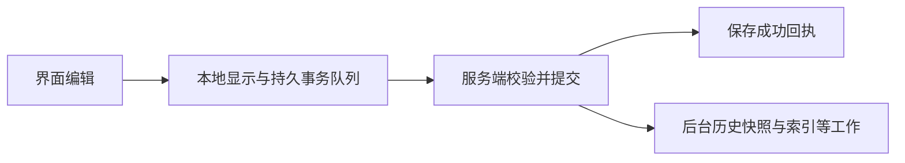

# Notion 历史参考：界面分组、持久化与恢复

核查日期：2026-10-27。依据 Robert 提供的截图、Notion 当前官方帮助与标明日期的工程文章；没有操作 Robert 的 Notion 账户或实际执行恢复。这里区分产品行为、公开工程机制和我们的推论。

## 先解释截图

原图已按原字节保存在[截图证据](../../evidence/历史管理/notion-version-history-user.png)。图中可见左侧版本时间、作者、书签与“分组方式 1 分钟”，右侧版本预览、“开始恢复”以及底部“1/2 项更改”的前后定位。

这说明历史可以组织成便于浏览的变更组，再让人检查具体影响。**“1 分钟分组”本身不能证明每分钟复制一份完整页面，也不能证明保存要等一分钟。** 时间相近的变更如何映射到存储版本，截图没有给出答案。图中“开始恢复”后的完整流程也未提供，不能把按钮文字当作已实测恢复合同。

Notion 2026-10-13 的 3.8 发布说明明确介绍了新的页面／数据库历史：高亮修改、显示修改者，覆盖人和 Agent。这与截图的重点一致；不能只拿多年以前的旧界面描述解释当前产品。[发布说明](https://www.notion.com/releases/2026-10-13)

## 当前官方帮助能确认什么

| 问题 | 官方说明 |
| --- | --- |
| 记录时机 | 活跃编辑时每 10 分钟记录版本，最后一次编辑后 2 分钟再记录一版 |
| 浏览 | 可调整变更分组、预览历史和高亮差异；高亮不覆盖所有变更类型 |
| 找回内容 | 可以复制旧块回当前页，或把所选页面版本恢复为当前版本；支持命名书签 |
| 再反悔 | 恢复后仍可从历史选择原先的版本再恢复 |
| 恢复范围 | 数据库恢复包含页面及属性，但不包含这些页面内部正文；正文须分别恢复 |

来源：[Delete & restore content](https://www.notion.com/help/duplicate-delete-and-restore-content)。该页同时描述记录时机和新版分组界面，却未解释两者的内部映射。它没有承诺“每一个按键均是可独立找回的历史版本”，也没有证明所有复杂对象都具有字符级差异。

**对本项目的判断**：借鉴可见差异、修改归属、命名节点与恢复前范围说明；不照搬时间间隔或“页面”粒度。课程单元中的公式、实验配置、知识关系和个人批注有一致性要求，范围应由这些对象的真实依赖决定。

## 公开工程机制：保存早于历史快照

2021-05-18 的官方工程文章描述：块使用稳定 ID；一次界面操作可以涉及多块，并组成事务。客户端先更新本地显示，把事务保存在本地队列，直到服务端确认或拒绝。服务端核验前后数据并提交后返回成功，随后安排版本历史快照、索引及通知等后台工作。[The data model behind Notion’s flexibility](https://www.notion.com/blog/data-model-behind-notion)

这份有日期的公开机制支持“持久化提交与历史快照并非同一步”的解释，**不是 Notion 当前全部实现的保证**。它没有公开今天的完整历史 schema、全量／增量混合格式、压缩算法或每个分组对应多少事务，不能据此编造实现细节。

上图仅概括该 2021 年文章。我们的本地产品可以采用不同进程与存储组织；尤其是选择性撤回必需的前后版本和操作回执，应与正式修改共同保存，不能只依赖稍后才可能生成的快照。

## CRDT 解决的不是全部恢复问题

2026-09-18 官方文章说明，Notion 为富文本及跨块拆合引入基于 RGA 的 CRDT，改进此前同块并发覆盖。文章也明确：合并时不丢变更，不等于总能保留每个人的完整意图。[How Notion handles concurrent editing with CRDTs](https://www.notion.com/blog/how-notion-handles-concurrent-editing-with-crdts)

因此，不能从“Notion 使用 CRDT”推出我们也必须使用 CRDT，或历史撤回已自动解决。我们当前是本地单人加 Agent，统一提交边界、版本依据和草稿保护可以先处理并发；撤回 Agent 的纠错、恢复旧公式是否连带恢复实验配置，仍要由课程语义判断。多人离线合并并非当前要求。

## 版本历史与导出也不同

Notion 官方说明可以导出内容及附件，但不能把导出重新上传就瞬间重建整个工作区。[Back up your data](https://www.notion.com/help/back-up-your-data)

本项目已经要求课程文件夹可迁移，因此只导出当前 Markdown 不够。课程交换与备份需要明确是否包含历史、草稿、个人原引用和依赖资源；这些是我们的产品合同，不能把 Notion 云端历史的可用性直接移植到本地课程。

## 对设计的结论

1. 保存负责不丢当前工作，历史负责解释变化和找回旧内容，时间分组负责方便浏览。三者应独立设计。
2. 历史应能回答“谁因为什么请求改了哪里”，不能只有时间戳；Agent 一次任务的多次提交可以作为一个可展开活动展示。
3. 旧版预览、复制片段、恢复选定范围、撤回特定修改是不同意图，需要不同执行语义。
4. 恢复前保留当前状态，恢复后产生新修改；不删除后来历史，不倒退任务事实与提交身份。
5. 具体保留期限、压缩与快照频率由本产品的恢复目标和实际增长量决定，不直接照搬云产品的套餐期限。

跨产品比较见 [Figma 历史参考](Figma历史参考.md)、[本地编辑器历史参考](本地编辑器历史参考.md)；本项目的完整候选设计见[历史管理与恢复设计](../../../architecture/历史管理与恢复设计.md)。
