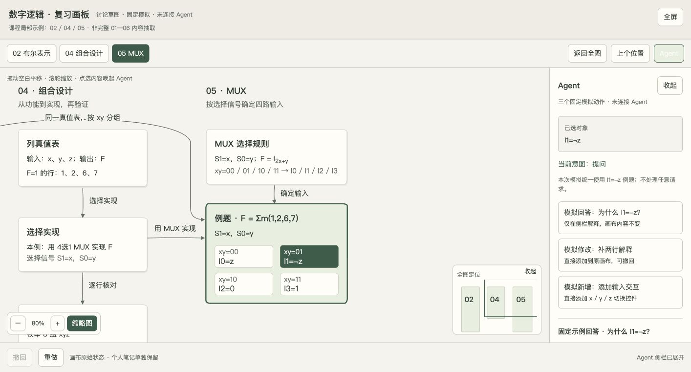

# 复习画板 · 独立讨论草图

双击 `index.html`，用现代桌面浏览器直接打开即可；不需要安装依赖、联网或启动服务器。页面占满浏览器内容区域，桌面画布随窗口剩余高度伸缩。

点击右上角“全屏”进入网页全屏，按 Esc 退出。浏览器不支持或拒绝 Fullscreen API 时会显示提示，也可使用浏览器菜单“全屏”（Windows / Linux 通常为 F11，macOS 通常为 Control + Command + F）。

保留空白拖动平移、滚轮与按钮缩放、课程定位、缩略图导航、点选上下文菜单、个人笔记，以及模拟修改的撤回/重做。点击 Agent 可展开/收起侧栏，桌面下拖动其左边缘可调整宽度；窄屏时侧栏排列在画布下方。

这仍是讨论草图，只有三个固定模拟动作，未连接真实 Agent；示例仅覆盖 02 / 04 / 05 的局部内容，不是完整复习系统。顶部持续显示“固定模拟 · 未连接 Agent”。

HTML 自包含样式和脚本，无外部 Tweak 或联网资源依赖。状态沿用导出 wrapper 的本地保存机制；浏览器允许本地存储时可在刷新后恢复，禁用或不支持时仍可在当前页面操作。

2026-10-24 已在 Chrome 的本地网页中验证整窗布局、区域定位、选中菜单展开侧栏、固定回答、直接添加解释、撤回时保留后写笔记，以及刷新恢复笔记和修改状态。验证用笔记已恢复为原始示例。网页 Fullscreen API 的自动化点击被浏览器拒绝（`not granted`），备用提示正确显示；未把这一情况记为网页全屏验证通过。用户仍可使用浏览器菜单或上述原生全屏快捷键。

本次打开的本地地址为 <http://127.0.0.1:8765/>，只在本机服务运行时有效。双击 `index.html` 是无需服务的永久入口。当前版本没有已验证的 `file://` 浏览器验收记录，离线可用性依据是文件自包含、无外部资源引用和静态检查。

